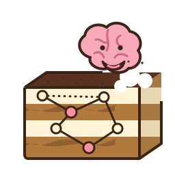
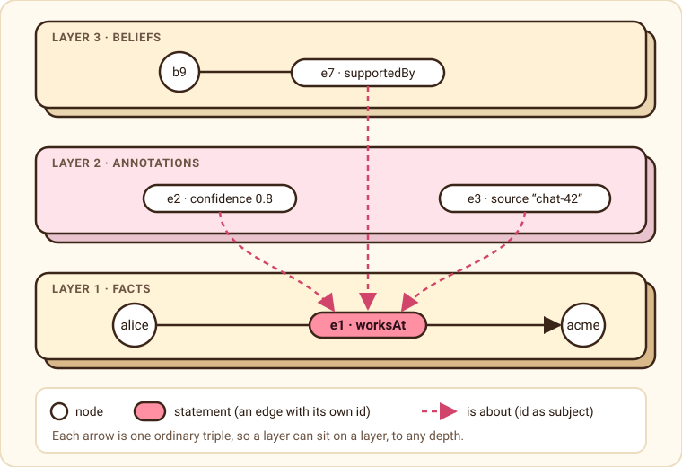
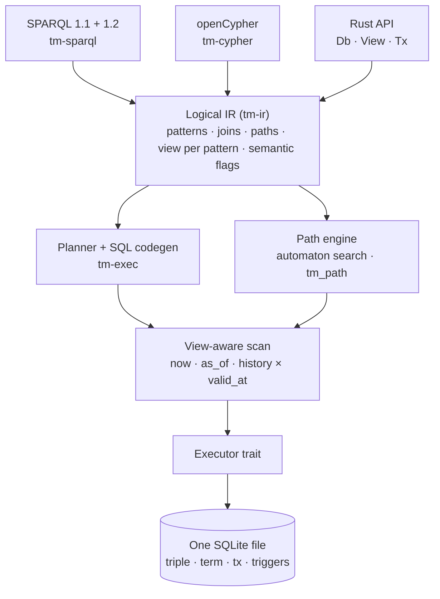

<p align="center"></p>

<h1 align="center">Tiramemsu</h1>

<p align="center"><em>Your agent’s brain loves Tiramemsu.</em></p>

<p align="center"><strong>Layered, never-forget memory for agents.</strong><br>
An embedded graph database on SQLite. Every fact has an id, so facts can carry layers of provenance and belief, and every change is kept with when it was made and when it was true.</p>

<p align="center"><a href="site/articles/layered-graphs.html">Layered graphs, explained</a> · <a href="site/articles/tiramemsu-vs-oxilite.html">Tiramemsu vs oxilite</a> · <a href="site/articles/metagraphs.html">Metagraphs</a> · <a href="lat.md/">Design (lat.md)</a> · <a href="openspec/specs/">Specs (OpenSpec)</a></p>

> **Status: new.** Designed and implemented in September and October 2026 as one Rust library, released as 0.11.0 on PyPI (`tiramemsu`), npm (`@tiramemsu/node`) and crates.io (every crate, from `tm-core` to the facade `tiramemsu`, the `tiramemsu-mcp` server and the `tm` command line). N3 reasoning comes with its reasoner [eyeron](https://github.com/eyereasoner/eyeron) from crates.io. There is no network server; it runs on rusqlite natively, on SQLite compiled to WebAssembly in the browser, and (experimental) on redb. What is measured and what is not is listed under [Status](#status).

## Why

A knowledge graph stores facts. An agent also needs to say *how sure am I*, *where did I read it*, *what do I conclude from it*, and later *I was wrong*. Those are statements about statements. In tiramemsu a fact is a row `(eid, s, p, o)` with its own id, and an id can be the subject or object of another statement. That gives you **layered graphs** with no second data structure:

<p align="center"></p>

## Features

- **Layers.** Provenance, confidence and beliefs stack to any depth. Retracting a fact retracts its layers, and correcting it replays them.
- **Bitemporal.** Transaction time (when the database believed it) and valid time (when it was true). `now`, `as_of(t)`, `history` and `valid_at(d)` views, per query or per pattern.
- **Never forget.** SQLite triggers reject `DELETE` and any second change to a row, inside the file. Forgetting means retracting. Erasure for legal reasons is planned as crypto-shredding (destroy a key, keep the rows).
- **Memory verbs.** Idempotent `assert`, `create` for parallel edges, `supersede` (correct a fact and replay its layers), `confirm` (another source agrees), cardinality-one and unique predicates, and `with` / `dry_run` for changes that leave no trace.
- **SPARQL and Cypher, one store.** SPARQL 1.1 with RDF 1.2 annotations, and openCypher, share one logical IR and one semantics table. A relationship is also a `:Statement` node, so Cypher can reach layers.
- **Paths.** Reachability, trails and shortest paths through a native automaton search, also as a SQL table function (`tm_path`). Paths can cross layers, stay inside named graphs, and be time-respecting (valid time never goes backwards along the walk), also from SPARQL (`SERVICE <urn:tiramemsu:tm:timeRespecting/…>` with `tm:arrival`) and Cypher (`MATCH TIME RESPECTING AFTER $t ARRIVAL AS t`). Path results say whether the search was exhaustive, stopped at an explicit bound, or cut by the configured hop cap.
- **Named graphs as tags.** A graph is a node, or a statement, and membership is one more layer statement. `GRAPH`, `FROM`, `FROM NAMED` and `WITH` work with no new column or table.
- **Metagraphs.** Edges are vertices (statement ids), and vertices and edges are containers (graphs named by a node or a statement). Nesting, fold and unfold are ordinary statements, so they travel in time.
- **Bulk import.** An opt-in import session commits chunks as ordinary atomic transactions, holds the write lease, skips the per-commit `ANALYZE`, and refreshes planner statistics once when finished. Progress counts committed rows and rejected chunks; cancelling keeps every committed chunk.
- **Vector recall.** Store the embeddings your model computes (`define_embedding_model`, `set_embedding`) beside the facts, in the same file and transaction, append-only. `View::vector_search`, SPARQL `?e tm:vectorMatch "[…]"` and Cypher `CALL tiramemsu.vector.search(...)` run one exact, view-aware search: as-of, history, valid time and graphs filter before ranking, so time travel never loses a hit to an index cut, and it works on every SQLite build including WASM. `View::recall` fuses text and vector recall by reciprocal rank and can expand each hit to its layers. Since 0.6 the query languages write too: Cypher `CREATE VECTOR INDEX` / `DROP INDEX` / `SHOW VECTOR INDEXES` and `CALL tiramemsu.vector.setEmbedding(...)`, SPARQL Update `tm:vectorEmbedding`. Samples: [Vectors](#vectors) below and the [vector cookbook](https://www.tiramemsu.com/articles/vector-cookbook.html). Design: [`docs/vector-architecture.md`](docs/vector-architecture.md).
- **Text recall.** Opt-in FTS5 recall over string values (inline short strings included): `View::text_search`, SPARQL `?e tm:textMatch "words"` and Cypher `CALL tiramemsu.text.search(...)` share one operation. Hits respect as-of, history, valid time and graphs, and carry a lexical score plus evidence (confidence, confirmations, authors, when added); absent evidence is reported as absent, and ties break on the statement id.
- **Cyclic joins.** Opt-in native leapfrog triejoin for pure cyclic patterns (triangles and longer cycles) as the `tm_lftj` table function: `OpenOptions::planner.lftj`. It returns exactly the SQL rows (set or bag semantics, per-pattern views, graphs, provenance), routes only when enabled, installed, applicable and the size estimate agrees, and `explain_sparql` names the route or the reason it stayed in SQL.
- **Bounded calls.** Opt-in query budgets: a deadline, cancellation from another thread, a reader-pool timeout and row or byte limits per operation. A stopped write commits nothing, and an over-budget result is an error, never a truncated answer.
- **Derived beliefs.** `Tx::derive(s, p, o, valid, support)` writes a conclusion with engine-owned `sys:derivedFrom` links to the statements it rests on. Retracting or correcting any support retracts the conclusion in the same transaction, and `View::dependents` shows it first.
- **N3 reasoning (opt-in feature `n3`).** Notation3 rules run by [eyeron](https://github.com/eyereasoner/eyeron) over any view, aware of both clocks: facts that were never valid at the same time never combine, as-of views reason with the facts and the rules believed then, and every conclusion carries a proof of statement ids. `Db::materialize` stores conclusions as derived beliefs with the rule set among their supports, so they fall when a premise or a rule changes. Also as `tm reason` / `tm materialize`, MCP tools and the bridge. Read [the N3 book](site/n3/index.html);
- **Datalog (opt-in feature `datalog`).** A Soufflé-style Datalog in its own crate, `tm-datalog`, with no git dependency. A fact holds exactly when it follows from the facts valid at that instant, computed in one pass with interval sets, with DatalogMTL operators (`past`, `always_future`, `since`, ...), the 13 Allen relations, stratified negation and aggregates, and goal-directed evaluation (magic sets). `constraint ... error :- ...` rules are enforced at commit, seeded by what the transaction changed; `Db::materialize_program` stores conclusions as derived beliefs that fall with their premises and are reconciled when negation or aggregates are involved. A goal can be called from SPARQL (`SERVICE <urn:tiramemsu:dl:query>`) and Cypher (`CALL tiramemsu.datalog.query`). Also as `tm datalog`, `tm check`, `tm materialize-program`, MCP tools and the bridge. Read [the guide](docs/datalog.md) and [the article](site/articles/datalog-temporal-reasoning.html). Not built yet: incremental materialization.
- **ELPI (opt-in feature `elpi`).** λProlog programs run by [lean-elpi](https://github.com/Volland/lean-elpi), with higher-order clauses, hypothetical reasoning (`=>`, `pi`) and rules over rules. A program reads memory through host builtins (`tm.triple S P O E`, `tm.valid`), never a copy, on any view. `tm.violation-delta` validators run at commit, seeded by what the transaction changed. `tm.conclude` states the statements a conclusion rests on, and the run refuses support it never read. `Db::materialize_elpi` stores conclusions that fall with a premise, the program or a library it includes (`accumulate <iri>.`). A goal can be called from SPARQL (`SERVICE <urn:tiramemsu:elpi:query>`) and Cypher (`CALL tiramemsu.elpi.query`). Also as `tm elpi`, five MCP tools and the bridge. It links the native libleanelpi (macOS and Linux), so no package turns it on by default and Node, Python and wasm leave it out. Read [the guide](docs/elpi.md) and [the article](site/articles/elpi-reasoning.html). It needs lean-elpi 0.4, which is not on crates.io yet.
- **Saved answers.** Save a SPARQL or Cypher query with its parameters, view and result, and let later events mark it: `stale` when a cited statement is retracted or superseded, `recheck` when any other write (or the clock) could have changed it. Each mark is reported once, survives restarts, and only a successful re-run clears it; answers on past views stay fresh.
- **Conflict review.** `View::conflicts` lists subject/predicate pairs whose distinct objects hold at the same valid time, with the evidence behind each value (statement ids, authors, sources, confirmations, confidence when stated), never a made-up score and never a write. `Db::preview_bundle` runs an import as a dry run and shows proposed and reused facts, cardinality retractions and schema failures before anything is committed.
- **MCP server.** `tiramemsu-mcp` serves one memory file to Claude Code, Claude Desktop or any MCP client over stdio (`claude mcp add tiramemsu -- tiramemsu-mcp --db ./memory.db`): typed `assert`, `confirm`, `supersede`, `query`, `dependents`, bundle, `conflicts`, `preview_bundle`, `text_search` and saved-answer tools, a read-only mode, per-call budgets, and query results that name their view and say whether their provenance is complete.
- **Two engines (experimental in 0.8).** A memory lives in SQLite (the default) or in redb, a pure-Rust key-value file with snapshot readers, chosen at creation (`tm create --backend redb`, `OpenOptions::backend`) and detected from the file header after that. Both hold the same ids, clocks and history, and `tm convert` moves a file between them. On redb, SPARQL and Cypher run on a native runner with hybrid and worst-case-optimal joins. It is faster than SQLite on cyclic queries, many concurrent readers, time-travel lookups and loading, and slower on probe-heavy star queries, Cypher paths and file size. Saved answers are SQLite-only for now. See [the benchmark](bench/backends/README.md) and [Two engines, one memory](site/articles/two-engines.html).
- **Statement-graph export, proven.** `tm export --format sg-nt12` writes every statement with its id and both clocks as RDF 1.2 reification. It asserts what is live in the view you choose (`--as-of`, `--history`, `--valid-at`). The format is [LeanRDF](https://github.com/Volland/rdf-lean)'s, whose decoder is proven exact in Lean: `leanrdf-sg decode` checks a file, and LeanRDF's tests decode tiramemsu's recorded exports and reproduce them byte for byte. Read [the guide](docs/statement-graph-export.md).
- **Embedded.** One SQLite file (WAL, STRICT). The core reaches SQLite through a small synchronous executor trait.
- **In the browser.** The `tm-wasm` host runs the whole engine, query languages included, on SQLite compiled to WebAssembly in a Web Worker, with the database in memory or in OPFS; `bindings/wasm` serves the JSON bridge to JavaScript. Capabilities are probed from the running SQLite, a journal mode the browser VFS cannot keep fails at open, and the files open natively and back.
- **Pay for what you use.** The query engine and the SPARQL and Cypher front ends are optional cargo features of the `tiramemsu` crate (`exec`, `sparql`, `cypher`; all on by default). `default-features = false` keeps transactions, views, bundles, text recall and conflict review and links no parser.

### What agents are saying

Early feedback from the people it is for. We made these up, but each one is about something the code really does.

> “I used to say *‘I recall you said Acme’* with total confidence. Now I say *0.8, from chat-2026-09-29*. My humans find this either reassuring or unsettling.” — a chatbot, on layers

> “I was wrong about where Alice works. `supersede` fixed the fact and carried my confidence over to it. I have never felt so forgiven.” — an assistant, on supersede

> “My last memory store let me `DELETE` things. I do not trust myself with that kind of power. Here the triggers say no, in the file itself.” — a cautious agent, on never forgetting

> “A user asked what I believed last Tuesday. I ran `as_of` and answered without a single hallucination. I asked for a raise in tokens.” — a support agent, on bitemporal views

> “I wanted to try a wild idea without committing to it. A `with` block let me be reckless and leave no trace.” — a planner agent, on speculation

> “My orchestrator speaks SPARQL and my intern speaks Cypher. They now share one store and, for the first time, one opinion.” — a multi-agent swarm, on two query languages

## Questions only layers can answer

Every statement and every layer on it has an id, both clocks, a structural link to what it is about, and a row that is never deleted. Together those answer questions that usually need glue code, each in one query. All of these are tests; the queries are in [`lat.md/recipes.md`](lat.md/recipes.md) and explained in [the article](site/articles/layer-recipes.html).

| Question | How |
|---|---|
| What did this belief rest on, back then? | A path from the belief through statement ids, inside `SERVICE <tm:asOf/150>` |
| What breaks if I retract this? | `View::dependents(eid)` on any view, with no write lock; equal to the path `(^sys:subject\|^sys:object)*` |
| Who wrote this, and why was that forgotten? | `?r tm:txAdded ?t . ?t sys:author ?who`, and `tm:txRetracted` → `sys:reason` |
| How was this fact corrected over time? | `?r sys:supersedes+ ?old` |
| Where do my sources disagree? | Same subject and predicate, different objects, overlapping valid time, different authors |
| How late did we learn it? | `tm:addedAt` / `r.addedAt` against `tm:validFrom` / `tm:validTo` |
| Which of my answers are stale? | `View::sparql_with(q, &SparqlOptions { provenance: true })` cites the statement ids behind every row |
| Can I hand this fact to another agent? | `View::bundle(eid)` exports it with its layers and evidence; `Tx::import_bundle` asserts it idempotently |
| Where does memory disagree with itself? | `View::conflicts` lists overlapping distinct values with their evidence; `Db::preview_bundle` shows what an import would change first |
| Can I stop layers from rotting? | `(v:confidence sys:subjectType sys:STMT)` rejects a confidence on anything but a statement |
| What can I reach inside one session? | Recursive paths under `GRAPH <g>` / `GRAPH ?g` only cross the graph's statements |
| What does this edge contain? | `GRAPH <urn:tiramemsu:stmt:n> { … }`: a statement names a graph, its contents follow a supersede and go with a retraction |
| Could this have reached B, and when? | Time-respecting paths: valid time never goes backwards along the walk, and each row carries its earliest arrival |

## Architecture



| Crate | Role |
|---|---|
| `tm-core` | ObjectId codec, term dictionary, format-1 schema and triggers, the transaction engine, views, the `Executor` trait. No SQLite dependency. |
| `tm-rusqlite` | The rusqlite host: bundled SQLite, functions, virtual tables. |
| `tm-ir` | Logical algebra, per-pattern views, semantic flags. |
| `tm-exec` | Planner, SQL codegen, path engine, result decoding. |
| `tm-sparql` | SPARQL front end. |
| `tm-cypher` | openCypher front end. |
| `tm-n3` | N3 reasoning with eyeron over facts the facade loads: pruning, the valid-time sweep, proofs (feature `n3`). |
| `tm-datalog` | Datalog over the storage traits: parser, analysis, interval sets with DatalogMTL, magic-set goals, semi-naive evaluation, constraint checks (feature `datalog`). |
| `tm-elpi` | ELPI (λProlog) over a view through lean-elpi: host builtins, terms, queries, checks, conclusions with stated support (feature `elpi`). |
| `tm-elpi-store` | ELPI persistence: program nodes with includes, enforcement at commit, materialization plans (feature `elpi`). |
| `tiramemsu` | The facade: `Db`, `View`, `Tx`. The only crate an application needs. |

Each layer depends only on the one below it, and time is resolved in exactly one place. The full design is in [`lat.md/`](lat.md/), and every capability has a spec under [`openspec/specs/`](openspec/specs/).

## Quick start

From [`crates/tiramemsu/examples/quickstart.rs`](crates/tiramemsu/examples/quickstart.rs). Run it with `cargo run -p tiramemsu --example quickstart`.

```rust
let db = Db::open(dir.join("memory.db"), OpenOptions::default())?;

// 1. A fact is a statement with its own id, so it can carry layers.
let mut fact = None;
db.transact(TxOptions::default(), |tx| {
    let eid = match tx.assert(v("alice"), v("worksAt"), v("acme"), Valid::ALWAYS)? {
        Asserted::New(e) | Asserted::Existing(e) => e,
    };
    fact = Some(eid);
    let conf = Value::literal("0.8", Some("http://www.w3.org/2001/XMLSchema#double"), None);
    tx.assert(Value::Stmt(eid), v("confidence"), &conf, Valid::ALWAYS)?;
    tx.assert(Value::Stmt(eid), v("source"), Value::str("chat-2026-09-29"), Valid::ALWAYS)?;
    Ok(())
})?;

// 2. Correct it. The layers are replayed on the new fact; nothing is deleted.
let corrected = db.transact(TxOptions::default(), |tx| {
    tx.supersede(fact.unwrap(), Patch { o: Some(v("globex")), ..Patch::default() })?;
    Ok(())
})?;

// 3. What is believed now, and what was believed before the correction?
let q = "SELECT ?who ?org WHERE { ?who v:worksAt ?org }";
db.as_of(TimeRef::Tx(corrected.t.0 - 1)).sparql(q)?;   // alice → acme
db.now().sparql(q)?;                                   // alice → globex

// 4. The same store in Cypher. The confidence layer is a relationship property.
db.now().cypher("MATCH (p)-[r:worksAt]->(o) RETURN p, o, r.confidence", &CypherParams::default())?;
```

Layer queries in SPARQL use RDF 1.2 annotation syntax, and Cypher sees the id as a relationship and as a `:Statement` node:

```sparql
SELECT ?c ?s WHERE { v:alice v:worksAt v:acme {| v:confidence ?c ; v:source ?s |} }
```

```cypher
MATCH (a)-[r:worksAt]->(c), (b:Belief)-[:supportedBy]->(r) RETURN a, c, r.confidence, b
```

### From the command line

The `tm` binary (`cargo install tiramemsu-cli`) creates files on either backend and detects the backend of every file it opens:

```sh
tm create memory.redb --backend redb
tm import memory.redb people.ttl
tm query memory.redb --sparql 'SELECT ?p ?o WHERE { <urn:alice> ?p ?o }'
tm convert memory.redb memory.db --backend sqlite
tm export memory.db --format sg-nt12 --history > memory.nt   # every statement, both clocks, RDF 1.2
```

See [`crates/tiramemsu-cli`](crates/tiramemsu-cli/README.md) for every command.

## Vectors

A vector index is an embedding model: dimensions, a metric (`cosine`, `dot`, `l2`) and an encoding (`f32`, `f16`). Your application computes the embeddings; tiramemsu stores them with the statements they describe, in the same transaction, and searches them exactly inside any view. Every sample below runs against the published 0.6 packages.

**Create an index, add vectors, search, drop: Cypher.** A short name such as `minilm` is the IRI `urn:tiramemsu:v:minilm` (`v:minilm` in SPARQL).

```cypher
CREATE VECTOR INDEX minilm IF NOT EXISTS OPTIONS {dimensions: 384, metric: 'cosine'}

MATCH (:Person {name: 'Alice'})-[r:visited]->(:City {name: 'Lisbon'})
CALL tiramemsu.vector.setEmbedding(r, 'minilm', $vector) YIELD stored
RETURN stored

UNWIND $rows AS row
MATCH (:Trip {name: row.name})-[r:note]->()
CALL tiramemsu.vector.setEmbedding(r, 'minilm', row.vector) YIELD stored
RETURN row.name, stored

CALL tiramemsu.vector.search('minilm', $query, {limit: 5, predicates: ['visited']})
YIELD subject, predicate, object, similarity, rank
RETURN subject, object, similarity, rank

SHOW VECTOR INDEXES
DROP INDEX minilm IF EXISTS
```

**The same in SPARQL.** The definition is written as its `sys:` statements, and `tm:vectorEmbedding` (a JSON array in a string) with `tm:vectorModel` embeds a statement, here a new one through an annotation and existing ones through `~ ?e`:

```sparql
PREFIX sys: <urn:tiramemsu:sys:>
INSERT DATA {
  <urn:example:minilm> sys:dimensions 384 ; sys:metric "cosine" .
  v:alice v:note "met Alice at the Lisbon offsite"
    {| tm:vectorEmbedding "[0.12, -0.4, …]" ; tm:vectorModel <urn:example:minilm> |} }

INSERT { ?e tm:vectorEmbedding "[0.1, 0.9, …]" ; tm:vectorModel <urn:example:minilm> }
WHERE  { ?p v:visited ?c ~ ?e . ?c v:name "Oslo" }

SELECT ?o ?sim WHERE {
  ?e tm:vectorMatch "[0.1, 0.8, …]" ; tm:vectorModel <urn:example:minilm> ;
     tm:vectorSimilarity ?sim ; tm:vectorLimit 5 .
  ?s ?p ?o ~ ?e }

DELETE DATA { <urn:example:minilm> sys:dimensions 384 }   # drops the index
```

**Python, Node.js and Rust** (`embed` is your model):

```python
with db.transact() as tx:
    tx.define_embedding_model("urn:example:minilm", 384, metric="cosine")
    e = tx.assert_(alice, note, "met Alice at the Lisbon offsite")
    tx.set_embedding(e, "urn:example:minilm", embed("met Alice at the Lisbon offsite"))

for hit in db.now().vector_search("urn:example:minilm", embed("trip to Portugal"), limit=5):
    print(hit.rank, hit.similarity, hit.o)
db.as_of(tx=41).vector_search("urn:example:minilm", embed("trip to Portugal"))  # what it knew then
db.now().unembedded("urn:example:minilm", limit=100)                             # still needs a vector
```

```js
db.transact((tx) => {
  tx.defineEmbeddingModel("urn:example:minilm", 384, { metric: "cosine" });
  const e = tx.assert(alice, note, "met Alice at the Lisbon offsite");
  tx.setEmbedding(e, "urn:example:minilm", embed("met Alice at the Lisbon offsite"));
});
const { hits } = db.now().vectorSearch("urn:example:minilm", embed("trip to Portugal"), { limit: 5 });
```

```rust
let model = Value::iri("urn:example:minilm");
db.transact(TxOptions::default(), |tx| {
    tx.define_embedding_model(model.clone(), &EmbeddingModel::new(384))?;
    let e = tx.assert(v("alice"), v("note"), Value::str(text), Valid::ALWAYS)?.eid();
    tx.set_embedding(e, model.clone(), &embed(text))?;
    Ok(())
})?;
let m = db.now().encode(&model)?.unwrap();
let hits = db.now().vector_search(&VectorQuery::new(m, embed("trip to Portugal")))?.hits;
// tx.drop_embedding_model(model) drops it: vectors stay, past views still search them
```

Rules: a vector of the wrong length is `InvalidQuery`; a different vector for the same index and statement is `EmbeddingConflict` (vectors are append-only, so a better model is a new index); a dropped index is gone now but answers as of before the drop, and comes back if created again with the same definition. Over MCP the agent gets `define_embedding_model`, `set_embedding`, `vector_search`, `recall` and `unembedded`.

## Build and test

Rust 1.91.1 is pinned in `rust-toolchain.toml`. If your shell finds another `rustc` first (for example Homebrew's), put rustup's first on `PATH`, because `open-cypher` needs 1.88 or newer.

```sh
export PATH="$HOME/.cargo/bin:$PATH"
cargo build --workspace
cargo test --workspace                 # 1 109 tests; PROPTEST_CASES=64 to speed up property tests
cargo clippy --workspace --all-targets -- -D warnings
lat check                              # design graph and code refs stay in sync
scripts/feature-matrix.sh core         # core | exec | sparql | cypher | default | bindings: deps, check, tests
cargo test -p tm-wasm --target wasm32-unknown-unknown --tests   # the WASM host under Node.js (wasm-bindgen-cli 0.2.129)
scripts/wasm-interop.sh                # a file handed native -> WASM -> native
```

## Status

| | |
|---|---|
| Size | About 88 000 lines of Rust in 9 crates and 4 bindings, 1 311 tests, 48 capability specs |
| SPARQL | 634 of 781 in-scope W3C tests pass (66 more are skipped: named-graph data and unsupported formats). Every failing one is listed with a reason in `crates/tm-sparql/tests/w3c/expected-deviations.toml`, and an unexpected result fails the build |
| Cypher | 2 615 of 3 880 openCypher TCK scenarios (67 %). Temporal types, `CALL`, and a few dual-view cases are deferred and listed in `crates/tm-cypher/tests/tck/allowlist.txt` |
| Speed | Raw SQLite lookups on the schema take about 4 µs at 11 million statements; about 150 bytes per statement with all indexes. See [`bench/`](bench/) |

**Known limits.** As-of lookups slow down as one key collects many updates. A membership per statement roughly doubles the file. SPARQL decimals come back as doubles. Recursive paths add no statement ids to query provenance (results say so: `provenance_gaps`). There is no network server yet; the MCP server is local stdio only. In the browser the database uses a rollback journal (no WAL readers) and refuses query budgets and bulk import sessions. The comparison with oxilite's change-log approach to history is not benchmarked head to head.

## How it differs from oxilite

[oxilite](https://github.com/Volland/oxilite) is a shipped, Oxigraph-compatible RDF database on SQLite by the same author. It stores quads and uses reifiers for annotations, keeps history in a change log, and runs on D1, WebAssembly and more. Tiramemsu stores statements with ids, keeps lifetime in the row and is bitemporal, but it is new, runs on rusqlite and in the browser on SQLite compiled to WebAssembly (not on D1), and has none of oxilite's SHACL or ShEx validation; it reasons with N3 rules through eyeron and with Datalog, both opt-in, rather than OWL. [The article](site/articles/tiramemsu-vs-oxilite.html) has the details and a benchmark.

## Repository

| Path | Contents |
|---|---|
| `crates/` | The crates: core, hosts (`tm-rusqlite`, `tm-wasm`), query engine and front ends, facade, MCP server |
| `lat.md/` | The design as a cross-linked knowledge graph: architecture, data model, time model, storage, query, tests |
| `openspec/specs/` | Requirements with scenarios, one folder per capability; `openspec/changes/archive/` has the changes that built them |
| `bindings/` | The JSON bridge, and the Node.js (`@tiramemsu/node`), Python (`tiramemsu`) and WebAssembly (`tiramemsu-wasm`) packages built on it; publishing guides in `docs/` |
| `bench/` | SQLite versus DuckDB, and ids versus reifiers, benchmarks with results |
| `docs/design-options.md` | The option analysis behind the design decisions |
| `site/` | The static website (GitHub Pages) and its articles |

## Website

`site/` is plain HTML and one stylesheet, with no build step, no scripts and no external fonts. `.github/workflows/pages.yml` publishes it to GitHub Pages on pushes to `main` that touch `site/`. Enable it once under *Settings → Pages → Source: GitHub Actions*.

## License

MIT OR Apache-2.0.
