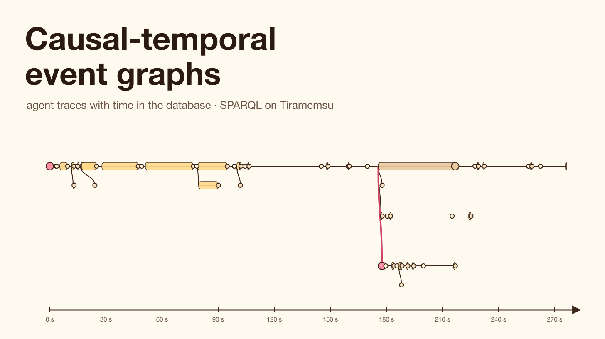
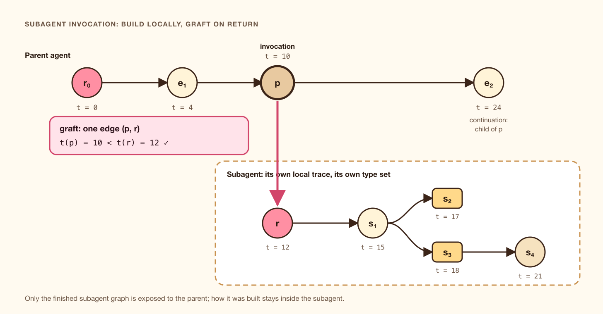

# Causal-temporal event graphs on Tiramemsu

*An agent's trace should say what caused what, not just what came next. Here is how to build causal-temporal event graphs (CTEGs) on statements with ids and two clocks, checked and queried in SPARQL, using the real trace of the agent that wrote this article.*



---

Ask an agent framework what happened in a run and you usually get a log: one line per event, in the order they were written. That is enough to replay the run. It is not enough to answer the questions people ask afterwards:

- **Which tool result did the agent act on** when it wrote that file?
- **What did this subagent cause** in the parent's run, and what did it cost?
- **Was the trace even consistent**, or does an effect sit before its cause?
- **What did the parent know** at the moment it decided, before the subagent came back?
- **If the run crashed halfway, is the half we have still usable?**

A list in time order cannot answer these, because order is not cause. Two tool calls issued in parallel finish in some order, and nothing in a flat log says which result a later step used.

In April 2026, Simon Foldvik published a short formal paper that names the structure these questions need: the **causal-temporal event graph**, or CTEG. This article explains what a CTEG is, why it matters for multi-agent systems, and how to build one on Tiramemsu, an embedded graph database where every statement has its own id and two clocks. The point of the design is to move time out of a `timestamp` column and into the database layer, where queries can use it.

The working example is not made up. It is the execution trace of the Claude Code session that researched and wrote this article, including a subagent it started to fact-check the paper. Every query result below came from loading that trace into Tiramemsu and running the query.

## What a CTEG is

The paper is [*Causal-Temporal Event Graphs: A Formal Model for Recursive Agent Execution Traces*](https://arxiv.org/abs/2604.17557) (Foldvik, arXiv 2604.17557, 19 April 2026). It models what a run of agents leaves behind once it is fully resolved, including agents that call subagents that call subagents.

The definitions are short. A **causal graph** is a finite directed acyclic graph with a root, where:

1. every node other than the root has **exactly one incoming edge**, its causal parent;
2. no edge enters the root;
3. every node can be reached from the root.

That is an *arborescence*: a tree with its edges pointing away from the root. The paper calls the first rule **single-parenthood causal semantics**.

A **CTEG** is a causal graph with two more maps:

- a **timestamp** `t` on every node, which must be **strictly increasing along causal paths**: if `n` can be reached from `m`, then `t(m) < t(n)`. The paper calls such a `t` *causally compatible*;
- a **type** `τ` on every node, from a type set `T` that is "flat by design": the graph records types but puts no relations between them.


*A linear log loses which result belongs to which call. The CTEG keeps one parent per event, and time increases along every branch.*

### How CTEGs grow

The paper builds traces with two operations:

- **Direct emission.** An agent picks an existing node `p` and adds new child events under it, each with a timestamp later than `t(p)`.
- **Subagent invocation.** The parent calls a subagent at a node `p`. The subagent builds its own trace from its own root. When it finishes, its final graph is **grafted** onto the parent with a single new edge from `p` to the subagent's root. The result is a CTEG exactly when `t(p) < t(root)` (Lemma 2.10 states this for any two CTEGs; Definition 3.4 applies it to a returned subagent trace).

Two details of invocation matter later. Only the subagent's final graph is exposed to the parent; how it was built is discarded (§4). And each agent declares its own type set before it runs, so a run where agent A calls agent B produces a CTEG over the union of their types. The paper calls these **type contracts** (Remark 2.12), and they remove the need for one central vocabulary.



*Grafting: the subagent's finished tree joins the parent's by one edge, and only if that edge goes forward in time.*

### What the formalism gives you

- **Composition without a coordinator.** Each agent keeps a small local trace. Grafting is guaranteed to give a well-formed global trace, so nobody needs a central log writer.
- **Robustness to failure.** Every step keeps the trace well-formed, so "any prefix of an agent execution sequence produces a valid CTEG" (Remark 3.15). A run that crashes leaves a usable trace.
- **A relational encoding.** One append-only node table with an id, a timestamp, a session id, a type, an opaque payload and a parent reference; the root has no parent (Remark 2.7). Rebuilding a session is one query plus pointer resolution.
- **Tamper evidence.** Because the graph is a tree, a Merkle tree over it commits to a whole session or to any prefix (Remark 2.6).
- **No extra depth.** The paper defines a hierarchy of execution levels by recursion depth and proves it stops growing at level one: `E_1 = E_∞` (Theorem 3.16), as long as a subagent's construction stays opaque to its parent.

The paper is just as clear about what it does *not* settle. It separates a **well-formed** trace (the structure is a CTEG) from a **correct** one (the edges are the right causes). Which event should be the parent of which is a *local parenthood semantics*, chosen by the system that records the trace, and "outside the scope of the current paper". It also leaves open causes with more than one parent and messages between agents that are not parent and child. Both come up in the real trace below.

## Why this matters for agents talking to agents

Single-agent loops are already hard to debug from logs. Multi-agent workflows make it worse in three ways, and the CTEG structure addresses each.

**Attribution crosses agent boundaries.** When an orchestrator delegates to a researcher that calls a search tool, the cost, latency and errors of that search belong to a specific step of the orchestrator. A tree with grafted subtrees makes "everything this delegation caused" a subtree query, not a guess from timestamps.

**Agents run concurrently, so time order lies.** Parallel tool calls and background subagents return in whatever order they finish. The CTEG keeps the cause explicit, and the timestamp rule catches a trace in which an effect is stamped before its cause, which happens more often than you would think (we found 77 such links in one session).

**Audit asks what was known when.** Regulated uses of agents need to show why a decision was taken. The paper's motivation is exactly this: plain linear traces "are not well-suited to capture the underlying causal relationships between events in agentic workflows". A CTEG says which inputs led to a step. A store with transaction time can also say what the recorder had *received* when the step was taken.

The idea sits next to two efforts you may already use:

- **OpenTelemetry's GenAI conventions** define spans such as `invoke_agent`, `execute_tool` and `chat`, and every span has one parent span. A span tree is close to a CTEG in shape. The CTEG adds the formal rules: strictly increasing time, the grafting condition, and the prefix guarantee.
- **[PROV-AGENT](https://arxiv.org/abs/2508.02866)** (Souza et al., IEEE eScience 2025) extends W3C PROV to capture agent interactions in scientific workflows, with MCP as the capture point. It is cited by the CTEG paper and models provenance more richly, with many-to-many relations. The CTEG is deliberately narrower, and that is what makes its guarantees cheap to check.

## The working example: the trace of this article

The session that produced this article was an ordinary Claude Code run. It searched the project's docs, ran web searches, fetched the paper twice, started one background subagent to fact-check twelve claims about the paper, and wrote files. Claude Code stores each session as a JSONL transcript. Every record has a `uuid`, a `parentUuid` and a `timestamp`, and a subagent gets its own transcript whose first record has no parent.

That is already a single-parent structure with timestamps: a CTEG candidate, written by a real harness. The extraction script in this article's folder keeps only structure (ids, parents, times, an event type, the tool name and a short label) and drops every prompt, output and path. The snapshot covers the first four and a half minutes of the session, which is itself a prefix of the run:

- **205 records** from the main agent and **65** from the fact-checking subagent;
- across both agents, **28 tool calls** and 28 results, 21 reasoning steps, 8 messages, one subagent call and one hand-back;
- **180 records of harness context**: hook output, reminders, tool listings and similar material the harness inserts into the conversation.

## Moving time into the database layer

The paper's relational encoding puts the timestamp in a column. That works, but the database then knows nothing about it: every time question becomes hand-written SQL over that column, and the database cannot tell when something happened from when it was recorded.

Tiramemsu stores everything as statements, `(eid, s, p, o)` rows, and every statement carries two clocks:

- **valid time** `[v_from, v_to)`: when the fact held in the world;
- **transaction time** `[t_add, t_ret)`: when the database believed it, with the transaction's instant and metadata.

Every statement has an id (the `eid`), so a statement can be the subject of another statement. That gives three places for a CTEG's data to live:


*One event as statements. The paper's columns become statements, and its timestamp becomes valid time, which every query in the database understands.*

How the paper's node table maps onto Tiramemsu:

- **Node id** → an IRI, `v:ev-<id>`.
- **Type `τ`** → the statement `ev a v:ToolCall`.
- **Timestamp `t`** → the **valid time** of that type statement: a point `[t, t+1 ms)`, or a span `[call, result)` for calls.
- **Parent reference** → the statement `parent v:caused ev`, with **its own id** and valid time `[t, t+1 ms)`.
- **Session id** → `ev v:inSession v:session-main`.
- **Opaque payload** → ordinary statements such as `v:tool` and `v:label`.
- **Not in the table: transaction time**, when the store received the event and who recorded it.
- **Not in the table: annotations on the causal edge itself**, such as latency, the rule that chose the parent, or a confidence.

Here is the recorder. One emission is one transaction, so the transaction log of the store is the agent's execution sequence. The code uses the Node.js binding; the Python and Rust APIs are the same shape.

```ts
import { Database, iri } from "@tiramemsu/node";

const v = (name: string) => iri(`urn:tiramemsu:v:${name}`);
const A = iri("http://www.w3.org/1999/02/22-rdf-syntax-ns#type");
const db = Database.open("traces.db");

function record(e, { spanTo, latencyMs } = {}) {
  return db.transact((tx) => {
    tx.meta(v("recordedBy"), "agent recorder");
    // the event happened at e.t (a point), or ran until spanTo
    tx.assert(v(`ev-${e.id}`), A, v(e.type), { validFrom: e.t, validTo: spanTo ?? e.t + 1 });
    tx.assert(v(`ev-${e.id}`), v("inSession"), v(`session-${e.session}`));
    if (e.tool) tx.assert(v(`ev-${e.id}`), v("tool"), e.tool);
    if (e.cause) {
      // the single causal parent: a statement with its own id and time
      const edge = tx.assert(v(`ev-${e.cause}`), v("caused"), v(`ev-${e.id}`),
                             { validFrom: e.t, validTo: e.t + 1 });
      if (latencyMs !== undefined) tx.assert(edge, v("latencyMs"), latencyMs);
    }
  });
}
```

`tx.assert` returns a reference to the new statement, so `edge` can be the subject of `v:latencyMs` in the same transaction. That is the whole trick of statement ids: the causal link is a thing you can describe, not just a pointer in a column.

Grafting a returned subagent is one more transaction with one statement:

```ts
function graft(callId, subRoot, agentName) {
  return db.transact((tx) => {
    tx.meta(v("reason"), `graft ${agentName} trace on return`);
    const edge = tx.assert(v(`ev-${callId}`), v("caused"), v(`ev-${subRoot.id}`),
                           { validFrom: subRoot.t, validTo: subRoot.t + 1 });
    tx.assert(edge, v("grafts"), agentName);
  });
}
```

The subagent's own events are recorded as they happen, in its own session, with no edge to the parent. Until the graft transaction commits, nothing connects them to the parent's tree.

## First question: is the log a CTEG at all?

We first loaded the transcript exactly as logged, with each record's `parentUuid` as the parent (stored as `v:loggedBefore`), and asked how many links fail the paper's rule, a child stamped no later than its parent. The SPARQL reads the time of each link and of its parent's type statement through the reifier syntax `~ ?link` and the virtual predicate `tm:validFrom`:

```sparql
SELECT (COUNT(*) AS ?backwards) WHERE {
  ?p v:loggedBefore ?c ~ ?link . ?link tm:validFrom ?tc .
  ?p a ?pt ~ ?occ .              ?occ  tm:validFrom ?tp .
  FILTER(?tc <= ?tp)
}
```

```
backwards
77
```

Seventy-seven links go backwards or stand still in time. A second query shows how much damage that does. A *time-respecting path* in Tiramemsu is a path whose hops never go back in valid time ([journeys in time](https://volland.github.io/tiramemsu/articles/journeys-in-time.html)). Comparing ordinary reachability with time-respecting reachability from the root tells us how many events no forward-in-time chain can reach:

```sparql
SELECT (COUNT(?e) AS ?reachable) (SUM(?cut) AS ?cutOff) WHERE {
  v:ev-c9930725 v:loggedBefore+ ?e .
  BIND(IF(EXISTS {
         SERVICE <urn:tiramemsu:tm:timeRespecting> { v:ev-c9930725 v:loggedBefore+ ?e }
       }, 0, 1) AS ?cut)
}
```

```
reachable | cutOff
204       | 180
```

180 of 204 events cannot be reached by any chain that moves forward in time. The trace is a chain, so one backward link early on cuts off everything after it.

The cause is mundane and instructive. The harness inserts context records (hook output, reminders, tool lists) into the parent chain. They are stamped when they were *produced*, which is often a second and in one case 11 seconds before the record they are attached to. And the subagent's hand-back was stamped when it was *queued* (11:35:24.574 UTC) but entered the parent's chain after a tool result stamped 11:35:33.018.

This is the paper's distinction between well-formed and correct. The raw `parentUuid` is a record of *where the harness wrote things*, not of *what caused what*. We need a local parenthood semantics. Ours has two rules:

1. **Harness context is not a cause.** An event's parent is its nearest logged ancestor that is not harness context. Context events stay in the store, with their logged links, but they get no causal parent.
2. **What comes back from a subagent continues from the invocation.** The hand-back's parent is the node that called the subagent, not whatever the parent agent was doing when the message arrived. This is the paper's own choice for continuations after a subagent.


*Same events, two parenthood rules. The database checks well-formedness; the rules decide correctness.*

The same two queries over `v:caused`:

```
backwards
0

reachable | cutOff
89        | 0
```

Now every one of the 89 events is reachable by a forward-in-time journey, no link goes backwards, and a last check confirms single parenthood:

```sparql
SELECT ?e (COUNT(?p) AS ?parents) WHERE { ?p v:caused ?e }
GROUP BY ?e HAVING (COUNT(?p) > 1)
```

```
(0 rows)
```

Two notes on these checks. The time-respecting path allows equal times, so the strict `<` of the paper is checked by the direct-link query, and the path query checks the whole chain. And both checks are ordinary queries, so they run on any past state of the store too.

## Querying the trace

With the CTEG in place, the questions from the start become short SPARQL queries. The figure shows the part of the trace they touch.


*The first four minutes of the session that wrote this article, as a CTEG. The subagent's tree is grafted under the call that started it.*

### Rebuild a session

The paper's "one query plus pointer resolution", with the pointers resolved by the query itself. Each event's time is the valid time of its type statement:

```sparql
SELECT ?t ?type ?label ?parent WHERE {
  ?e v:inSession v:session-main ; a ?type .
  ?e a ?type ~ ?occ . ?occ tm:validFrom ?t .
  OPTIONAL { ?e v:label ?label }
  OPTIONAL { ?parent v:caused ?e }
  FILTER(?type != v:HarnessContext)
} ORDER BY ?t
```

```
t             | type       | label                                         | parent
11:31:47.806  | Prompt     | user message                                  |
11:31:51.108  | Thinking   | reasoning                                     | ev-bf7a21b0
11:31:51.525  | Message    | I'll start by grounding in the project docs…  | ev-4d7a34ba
11:31:53.121  | ToolCall   | Search lat docs and list repo structure       | ev-3c8b83d1
11:31:57.279  | ToolResult | result                                        | ev-eb0a1af1
11:31:59.354  | ToolCall   | Inspect article folders and an existing site… | ev-a12e356f
11:32:00.232  | ToolCall   | Read time model and temporal query docs       | ev-bc23b59d
11:32:00.741  | ToolResult | result                                        | ev-04e93c07
11:32:00.744  | ToolResult | result                                        | ev-bc23b59d
…  73 rows
```

Look at the two results at 11:32:00.741 and .744. In the log they are neighbours. In the CTEG each points at its own call: the first came from the second call, issued later, because that command was quicker.

### Why did this happen?

Causal ancestors are an inverse path. Here, every prompt and tool call that led to the subagent's last tool call, the one that handed its report back:

```sparql
SELECT ?anc ?type ?label WHERE {
  ?anc v:caused+ v:ev-d4f93438 ; a ?type .
  OPTIONAL { ?anc v:label ?label }
  FILTER(?type IN (v:Prompt, v:SubagentCall, v:ToolCall))
}
```

```
anc          | type     | label
ev-bf7a21b0  | Prompt   | user message
ev-c5847514  | Prompt   | task prompt            (the subagent's root)
ev-eb0a1af1  | ToolCall | Search lat docs and list repo structure
ev-7578de2e  | ToolCall | "causal temporal event graph" paper
ev-709e4d9b  | ToolCall | https://arxiv.org/html/2604.17557
…  22 rows
```

The answer crosses the agent boundary: the subagent's hand-back descends from its own task prompt, and through the graft from the parent's searches that found the paper in the first place.

### What did it cause?

The descendants of the subagent call, grouped by agent:

```sparql
SELECT ?agent (COUNT(?d) AS ?n) WHERE {
  ?call a v:SubagentCall . ?call v:caused+ ?d . ?d v:agent ?agent
} GROUP BY ?agent
```

```
agent        | n
fact-checker | 17
main         | 25
```

### When could each step first have been influenced?

A time-respecting path binds `tm:arrival`, the earliest time a forward-in-time chain from the root reaches each node. For the web tools:

```sparql
SELECT ?tool ?label ?arrived WHERE {
  SERVICE <urn:tiramemsu:tm:timeRespecting> {
    v:ev-bf7a21b0 v:caused+ ?call .
    ?call tm:arrival ?arrived
  }
  ?call a v:ToolCall ; v:tool ?tool .
  FILTER(?tool IN ("WebFetch", "WebSearch"))
  OPTIONAL { ?call v:label ?label }
} ORDER BY ?arrived
```

```
tool      | label                                        | arrived (UTC)
WebSearch | "causal temporal event graph" paper          | 11:32:04.214
WebSearch | "temporal event graph" causal LLM agents…    | 11:32:04.695
WebFetch  | https://arxiv.org/html/2604.17557            | 11:32:15.645
WebFetch  | https://arxiv.org/html/2604.17557            | 11:32:38.900
WebSearch | PROV-AGENT Unified Provenance for Tracking…  | 11:33:06.880
WebSearch | OpenTelemetry GenAI semantic conventions…    | 11:33:07.359
```

In a well-formed CTEG the arrival equals the event's own time. When a recorder gets a parent wrong, the two differ, and that difference is how you find it.

### Which causal links were slow?

Latency is a property of the link between a call and its result, so it is stored on the `v:caused` statement. The RDF 1.2 annotation syntax `{| … |}` reads it:

```sparql
SELECT ?tool ?label ?ms WHERE {
  ?call v:caused ?result {| v:latencyMs ?ms |} .
  ?call v:tool ?tool .
  OPTIONAL { ?call v:label ?label }
} ORDER BY DESC(?ms) LIMIT 5
```

```
tool      | label                                   | ms
Agent     | Fact-check CTEG paper claims            | 41119
WebFetch  | https://arxiv.org/html/2604.17557       | 25621
WebFetch  | https://arxiv.org/html/2604.17557       | 19418
WebSearch | PROV-AGENT Unified Provenance for…      | 15774
WebSearch | OpenTelemetry GenAI semantic conventions| 10552
```

In a node table the latency would have to live on one of the two events, or be recomputed each time. Here it belongs to the edge, and the edge can carry more: which parenthood rule produced it, a confidence, a reviewer's note.

### What was running at a given moment?

Calls have spans, `[call, result)`, so "what was in flight" is a valid-time slice. Halfway through the subagent's run:

```sparql
SELECT ?type ?agent ?label
FROM <urn:tiramemsu:tm:validAt/2026-10-13T11:35:04.015Z>
WHERE { ?e a ?type ; v:agent ?agent . OPTIONAL { ?e v:label ?label }
        FILTER(?type IN (v:ToolCall, v:SubagentCall)) }
```

```
type         | agent | label
SubagentCall | main  | Fact-check CTEG paper claims
```

## Grafting with two clocks

The paper says only the finished subagent graph is exposed to the parent. In a store with transaction time, that is something you can query.


*Valid time says when the subagent started. Transaction time says when the parent's store connected it.*

In our replay the graft committed in transaction 229. Just before it:

```sparql
# as of tx 228
SELECT (COUNT(?e) AS ?n) WHERE { v:ev-bf7a21b0 v:caused+ ?e . ?e v:agent "fact-checker" }
```

```
n
0
```

The subagent's events were already in the store (16 of its 17), but none could be reached from the parent's root. After the graft, all 17 can. The graft edge shows both clocks side by side:

```sparql
SELECT ?call ?root ?validFrom ?addedAt ?tx WHERE {
  ?call v:caused ?root ~ ?g . ?g v:grafts ?name ;
     tm:validFrom ?validFrom ; tm:addedAt ?addedAt ; tm:txAdded ?tx .
}
```

```
call         | root         | validFrom     | addedAt       | tx
ev-0efbe02c  | ev-c5847514  | 11:34:45.399  | 11:48:39.989  | 229
```

The edge is valid from the moment the subagent's root event happened. It was added later. In this replay "later" is the time we ran the loader; with a live recorder, `addedAt` would be the moment the hand-back reached the parent. Either way the store can answer "what had the parent received when it took step X?" with `asOf`, which a timestamp column cannot.

## The prefix property, for free

Remark 3.15 says any prefix of a run is a valid CTEG. In Tiramemsu, every transaction commits atomically and the recorder writes one emission per transaction, so the state as of any transaction is a prefix of the run. If the agent crashes, the last committed transaction is a well-formed trace, and every query above works on it. The same check, as of transaction 228, mid-run:

```
events | backwards
72     | 0
```

## Beyond single parenthood

The paper leaves "more general multi-parenthood causal semantics" to future work, and the real trace shows why it is needed. When an agent issues two tool calls in parallel, the next reasoning step reads *both* results. Under single parenthood only one of them can be its parent.

Tiramemsu does not have to choose. The `v:caused` statements keep the arborescence, so every guarantee above still holds. A second predicate, `v:consumed`, records every input a step read, as a separate layer of the same graph:

```sparql
SELECT ?stepType ?inputTool (COUNT(*) AS ?n) WHERE {
  ?step v:consumed ?input ; a ?stepType .
  ?call v:caused ?input . ?call v:tool ?inputTool .
  MINUS { ?step v:consumed ?input . ?input v:caused+ ?step }
} GROUP BY ?stepType ?inputTool ORDER BY DESC(?n)
```

```
stepType | inputTool | n
Thinking | Bash      | 3
Thinking | WebSearch | 1
Thinking | Agent     | 1
ToolCall | WebSearch | 1
ToolCall | Bash      | 1
```

Seven inputs in four and a half minutes were read by a step that is not their causal descendant. A trace that only keeps the tree loses those seven dependencies. One that only keeps the dependencies loses the tree's guarantees. With statements you keep both, and each `v:consumed` link can carry its own annotations.


*Solid: the CTEG. Dashed: what the next step also read. Both are statements in one graph.*

## Limits and honest notes

- **Merkle commitments are not built in.** The tree shape allows them, but Tiramemsu does not compute them. A recorder can hash each subtree itself and store the hash as a statement about the root.
- **Clocks.** Valid time here comes from the harness's clocks, transaction time from the database's. A subagent on another machine brings clock skew, and the checks above will report it as backward links. That is the right outcome, but it means a recorder should decide whose clock stamps an event.
- **Millisecond resolution.** Some events in the trace are 1 to 2 ms apart. Two events in the same millisecond would fail the strict check even if the order is right. A recorder can break ties by adding a millisecond or by storing a sequence number.
- **Time-respecting paths need a start.** A journey runs forward from a bound node, so "ancestors in time" are asked as a forward journey from the root, or as an ordinary inverse path, as in the queries above.
- **The replay is a replay.** Our transaction instants are the time we loaded the trace. Valid times and all causal structure come from the real session.
- **The paper is new.** It appeared on arXiv in April 2026 as a single-author formal note and has not, to our knowledge, been peer reviewed. The structure it names is old and familiar; its value is in making the guarantees explicit.

## Try it

Everything for this article is in `article/cteg/` in the [Tiramemsu repository](https://github.com/Volland/tiramemsu):

```sh
cd article/cteg/code
# turn a Claude Code transcript (and any subagent transcripts) into a sanitized trace
python3 extract-trace.py ~/.claude/projects/<project>/<session>.jsonl \
        ~/.claude/projects/<project>/<session>/subagents/*.jsonl > trace.json
# load it as a CTEG and run every query in this article
node cteg-demo.mjs trace.json cteg.db
```

`trace.json` is the sanitized trace used here, and `queries.out.txt` is the full output of the run.

Further reading:

- Simon Foldvik, [*Causal-Temporal Event Graphs: A Formal Model for Recursive Agent Execution Traces*](https://arxiv.org/abs/2604.17557), arXiv 2604.17557, 2026.
- Renan Souza et al., [*PROV-AGENT: Unified Provenance for Tracking AI Agent Interactions in Agentic Workflows*](https://arxiv.org/abs/2508.02866), IEEE eScience 2025.
- OpenTelemetry, [Semantic conventions for GenAI agent spans](https://opentelemetry.io/docs/specs/semconv/gen-ai/gen-ai-agent-spans/).
- Tiramemsu: [Time travel and bitemporality](https://volland.github.io/tiramemsu/articles/time-travel.html), [Journeys that respect time](https://volland.github.io/tiramemsu/articles/journeys-in-time.html), [Layered graphs](https://volland.github.io/tiramemsu/articles/layered-graphs.html).
