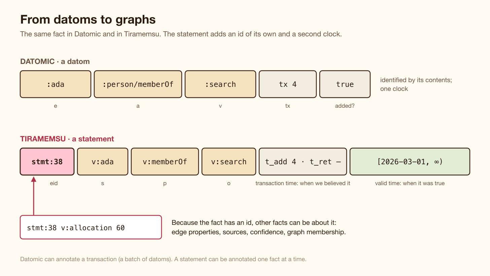
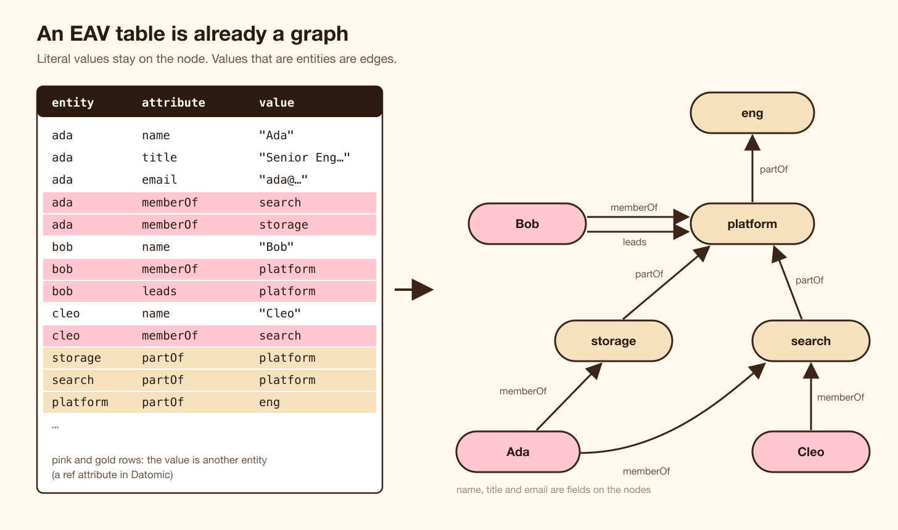
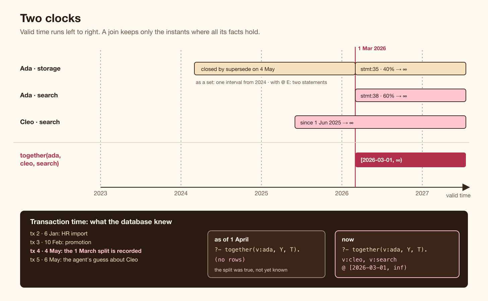
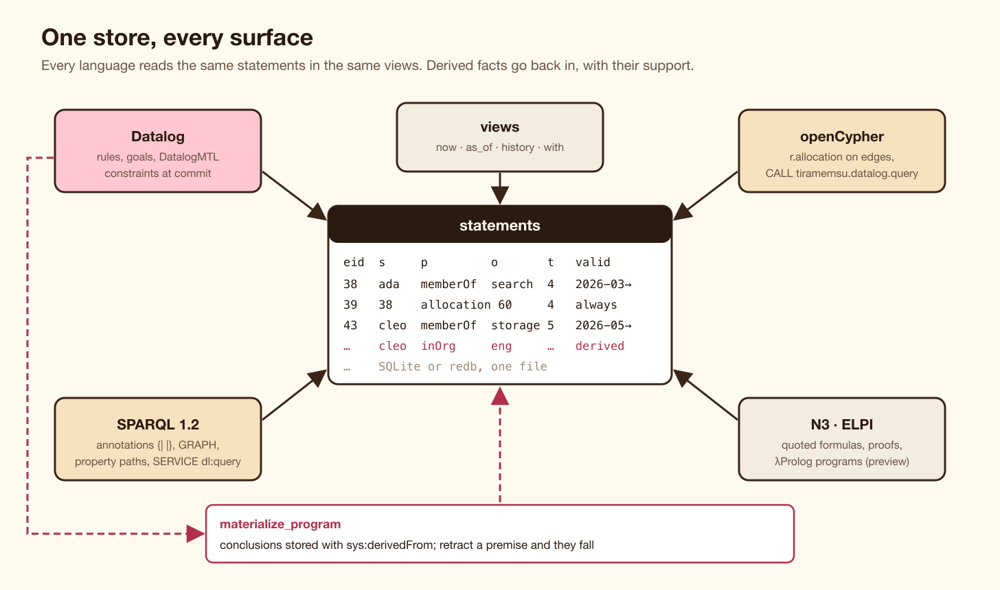

# From datoms to graphs: Datomic-style EAV with Datalog, and what a statement id adds

*Datomic showed that a database can be five-column facts, immutable history and Datalog. Here is the same setup in Tiramemsu, query by query, and then what you get when every fact also has its own id and a second clock: edges with properties, provenance per fact, valid time in every join, rules that refuse a commit, and conclusions that remember why they hold.*

---

If you have used Datomic, you know the feeling of the first week. There are no tables. A database is a set of facts, each saying one thing about one entity: this person has this name, this person is a member of this team. Facts are never updated in place. New facts are added and old ones are retracted, so you can ask what the database looked like last Tuesday. And you query it in Datalog, which turns out to be a far better fit for this shape than SQL.

That model has a name older than Datomic: **EAV**, entity–attribute–value. Datomic made it practical by adding the transaction as a fourth column and a flag for assertion or retraction. Its unit is the **datom**: `[e a v tx added?]`.

Tiramemsu is an embedded graph database (Rust, on SQLite or redb) that started from the same place and then changed two things. Every fact has its own id, so a fact can be the subject of other facts. And every fact has a second clock, *valid time*, which says when it was true in the world, next to *transaction time*, which says when the database learned it.

This article does two things. First it sets up a Datomic-style EAV database in Tiramemsu and runs the queries you would run in Datomic: find by attribute, rules, as-of, history, speculation, who wrote what. Then it shows, one feature at a time, what the statement id and the second clock add once you start treating the same facts as a graph.

Every query and result below is a test in `crates/tiramemsu/tests/eav_graphs.rs`, which runs on both storage engines and must give the same rows on each.



*A datom and a statement carry the same three things. A statement also has an id of its own, a lifetime in transaction time, and a valid-time interval.*

## The setup: a small engineering org

The example is a small company. Four teams: `storage` and `search` are part of `platform`, which is part of `eng`. Three people: Ada, Bob and Cleo. HR imports them on 6 January 2026. Ada is promoted on 10 February. On 4 May HR records something that happened on 1 March: Ada now splits her time between storage and search.

In Datomic you would start with a schema, because attributes are entities that must be declared:

```clojure
[{:db/ident :person/email    :db/valueType :db.type/string
  :db/cardinality :db.cardinality/one :db/unique :db.unique/identity}
 {:db/ident :person/title    :db/valueType :db.type/string
  :db/cardinality :db.cardinality/one}
 {:db/ident :person/memberOf :db/valueType :db.type/ref
  :db/cardinality :db.cardinality/many}
 {:db/ident :team/partOf     :db/valueType :db.type/ref
  :db/cardinality :db.cardinality/one}]
```

In Tiramemsu, an attribute is a predicate IRI and needs no declaration. An entity is a node, an attribute is a predicate, and a value is a literal or another node. Schema flags are optional, and they are facts too, with the predicate as subject. The two that matter here are the ones Datomic users reach for first: a unique email and a title with cardinality one.

```rust
db.transact(TxOptions::default(), |t| {
    t.assert(v("email"), sys_unique, Value::Bool(true), Valid::ALWAYS)?;
    t.assert(v("title"), sys_cardinality, sys_one, Valid::ALWAYS)?;
    Ok(())
})?;
```

Here `v("email")` is the IRI `urn:tiramemsu:v:email`, which every query language in Tiramemsu writes as `v:email`. `sys_unique`, `sys_cardinality` and `sys_one` stand for the IRIs in `vocab::SYS_UNIQUE` and its neighbours. Because schema flags are ordinary statements, a schema change is versioned like any other fact, and a change that live data already violates is refused with the offending ids.

Then the import. Each `assert` writes one fact. Two of the arguments are new to a Datomic user: the valid-time interval, and transaction metadata written with `meta`.

```rust
db.transact(TxOptions::default(), |t| {
    t.meta(sys_author, v("hr"))?;
    t.meta(sys_source, Value::str("hr-import"))?;
    t.assert(v("storage"), v("partOf"), v("platform"), Valid::ALWAYS)?;
    // … search and platform the same way, and a name for every team
    t.assert(v("ada"), v("name"),  Value::str("Ada"), Valid::ALWAYS)?;
    t.assert(v("ada"), v("email"), Value::str("ada@example.org"), Valid::ALWAYS)?;
    t.assert(v("ada"), v("title"), Value::str("Engineer"), Valid::ALWAYS)?;
    t.assert(v("ada"), v("memberOf"), v("storage"), Valid::from(ms("2024-03-01")))?;
    // … Bob (Lead, platform since 2023, leads platform) and Cleo (search since June 2025)
    Ok(())
})?;
```

`Valid::from(ms("2024-03-01"))` says Ada has been in storage since March 2024, although the database only hears about it in January 2026. Datomic has no slot for that date. You would add a `:membership/since` attribute and filter on it by hand in every query.



*An EAV table is already a graph. Attributes whose value is another entity are its edges.*

## Datomic-style queries

### Find by attribute

The first Datomic query everyone writes joins two attributes of one entity:

```clojure
[:find ?e ?n :where [?e :person/title "Lead"] [?e :person/name ?n]]
```

In Tiramemsu's Datalog an atom `v:title(E, "Lead")` reads the stored facts whose predicate is `v:title`, with subject `E` and object `"Lead"`. A goal is a comma-separated body:

```
?- v:title(E, "Lead"), v:name(E, N).
v:bob, "Bob"
```

The syntax is Soufflé-style text rather than Datomic's vectors. That was a deliberate choice (decision DL3 in the design notes): recursion and negation read better as text, and one text form passes unchanged through Rust, Python, Node, wasm, the CLI and the MCP server. The cost is that a query built by a program is built as a string, not as data.

### Cardinality one, as-of and history

Ada's promotion is a plain assert. Because `v:title` has cardinality one, the new title retracts the old one in the same transaction:

```rust
t.assert(v("ada"), v("title"), Value::str("Senior Engineer"), Valid::ALWAYS)?;
```

The past is still there. A view is a value: `db.now()`, `db.as_of(TimeRef::Tx(t))` or `db.as_of(TimeRef::Instant(ms))`, and `db.history()`, which are Datomic's `db`, `as-of` and `history`. Any query runs against any view:

```
?- v:title(v:ada, T).            -- now
"Senior Engineer"
?- v:title(v:ada, T).            -- as of 1 February 2026
"Engineer"
```

The history view shows both versions with their real lifetimes. The old title was added in transaction 2, retracted in transaction 3, and the retraction records its cause, `Cardinality`, so an audit can tell a replacement from an explicit delete. Datomic records the retraction datom too, but not why it happened.

### Who wrote it

In Datomic a transaction is an entity, and the fourth position of a datom joins to it:

```clojure
[:find ?title ?who :where [?e :person/email "ada@example.org"]
                          [?e :person/title ?title ?tx]
                          [?tx :audit/author ?who]]
```

Tiramemsu has the same idea. `meta` wrote `sys:author` and `sys:source` with the transaction as subject. Datalog reaches the transaction through the reserved atom `added(E, T)`, which needs the fact's id `E`, and `@ E` binds it:

```
?- v:title(v:ada, X) @ E, added(E, T), sys:author(T, A), sys:source(T, S), tx_instant(T, Ms).
"Senior Engineer", stmt:30, tx:3, v:hr, "promotion form", 2026-02-10T15:00:00.000Z
```

The row says that the fact is statement 30, written in transaction 3 by HR from the promotion form, at 15:00 on 10 February. That `stmt:30` is the first sign of the difference this article is about. Keep it in mind.

### Rules

Datomic rules are named clauses that can call themselves. "Everyone in a team or any team below it" is the standard example:

```clojure
[[(within ?t ?u) [?t :team/partOf ?u]]
 [(within ?t ?w) [?t :team/partOf ?u] (within ?u ?w)]]
```

The Tiramemsu program is the same shape, with one more rule for membership:

```
within(T, U) :- v:partOf(T, U).
within(T, W) :- within(T, U), v:partOf(U, W).
inOrg(P, T)  :- v:memberOf(P, T).
inOrg(P, U)  :- v:memberOf(P, T), within(T, U).

?- inOrg(P, v:eng).
v:ada  @ [2024-03-01, inf)
v:bob  @ [2023-01-01, inf)
v:cleo @ [2025-06-01, inf)
```

The engine evaluates bottom-up and semi-naively. A goal with a constant, like `v:eng` here, is rewritten with magic sets where the rewrite applies, so only the facts relevant to `eng` are derived. The rows also carry something Datomic's would not: each one says *when* it holds. That comes from valid time, and it is the second half of this article.

### What if

Datomic's `d/with` applies a transaction to a database value without committing it. Tiramemsu's `db.with` takes a write and a query, runs the query on the speculative state, and throws the write away:

```rust
let seen = db.with(
    |t| { t.assert(v("dan"), v("memberOf"), v("search"), Valid::from(ms("2026-06-01")))?; Ok(()) },
    |view| Ok(view.datalog(&org, Some("inOrg(P, v:platform)"), &opts)?.rows.len()),
)?;
// seen == 4; the real database still has 3
```

Speculation also runs the commit-time constraints described below, so `with` is how you preview whether a write would be refused.

So far this is Datomic with different syntax. The rest is where it stops being the same.

## Power-up 1: a fact you can point at

A datom is identified by its contents. You cannot say anything *about* one datom, only about its entity or its transaction. That is fine until you need a property of a relationship. Ada splits her time 40/60 between storage and search. Where does the 60 go?

In Datomic the usual answer is to turn the relationship into an entity: a `membership` with `:membership/person`, `:membership/team` and `:membership/allocation`. The direct edge from Ada to search disappears, every query walks two hops, and every rule that used `:person/memberOf` has to be rewritten.

In Tiramemsu the membership is already addressable. `assert` returns the fact's id, and the allocation is a fact about that id:

```rust
let e = t.assert(v("ada"), v("memberOf"), v("search"), Valid::from(ms("2026-03-01")))?.eid();
t.assert(Value::Stmt(e), v("allocation"), Value::Int(60), Valid::ALWAYS)?;
```

The edge stays an edge. Queries that ignore allocations read it exactly as before, and queries that need them follow the id:

```
?- v:memberOf(v:ada, T) @ E, v:allocation(E, A).
v:search,  stmt:38, 60 @ [2026-03-01, inf)
v:storage, stmt:35, 40 @ [2026-03-01, inf)
```

The same statements answer in SPARQL 1.2 annotation syntax and in Cypher, where a fact about a relationship's id is a property of the relationship:

```sparql
SELECT ?team ?a WHERE { v:ada v:memberOf ?team {| v:allocation ?a |} }
```

```cypher
MATCH (p {name: 'Ada'})-[r:memberOf]->(t) WHERE r.allocation IS NOT NULL
RETURN t.name AS team, r.allocation AS share ORDER BY share
-- "Storage", 40
-- "Search",  60
```

Nothing stops the layering at one level. A confidence on a fact, a source on that confidence, a reviewer's note on the source: each is a statement about the id below it. This is what makes the store a graph rather than a table. Facts are nodes too, and edges can point at edges.


*Every fact has an id, so every fact can have facts about it. Datomic can annotate the transaction, a whole batch of datoms; here the annotation can be on one fact.*

## Power-up 2: provenance per fact, and graphs as tags

Transaction metadata says who wrote a batch. In an agent's memory, or in any system with several writers, you often need to know more than that about each fact: where it came from, how sure the writer was, which context it belongs to.

On 6 May a chat agent reads a Slack thread and guesses that Cleo has joined storage. It writes that guess in its own graph, with a confidence:

```rust
t.meta(sys_author, v("chat-agent"))?;
t.meta(sys_source, Value::str("#storage-team thread"))?;
let e = t.assert(v("cleo"), v("memberOf"), v("storage"), Valid::from(ms("2026-05-01")))?.eid();
t.assert(Value::Stmt(e), v("confidence"), Value::Double(0.6), Valid::ALWAYS)?;
t.add_to_graph(e, v("agent-notes"), AssertOpts::default())?;
```

A named graph in Tiramemsu is a tag, not a container: membership is one more statement, `(e sys:inGraph g)`, on the fact's id. HR's import put its memberships in graph `v:hr` the same way. A rule can now choose what to trust:

```
hrMember(P, T) :- v:memberOf(P, T) @ E, in_graph(E, v:hr).

?- hrMember(v:cleo, T).
v:search @ [2025-06-01, inf)

?- v:memberOf(v:cleo, T).
v:search  @ [2025-06-01, inf)
v:storage @ [2026-05-01, inf)
```

Or it can look at the guess itself, with its confidence and its author in one row:

```
?- v:memberOf(P, T) @ E, v:confidence(E, K), added(E, X), sys:author(X, A).
v:cleo, v:storage, stmt:43, 0.6, tx:5, v:chat-agent @ [2026-05-01, inf)
```

Because graphs are tags, one fact keeps one id however many graphs it is in. A confidence on a fact belongs to the fact, not to a copy of it in each graph.

## Power-up 3: the second clock

Datomic has one clock, transaction time. It answers "what did the database believe at time t?" exactly. It cannot answer "what was true in the world at time t?" unless you model that yourself, and then every query has to do the interval arithmetic by hand.

Tiramemsu keeps both, and its Datalog engine makes valid time part of the meaning of a rule: **a conclusion holds at an instant exactly when it follows from the facts valid at that instant.** Every row carries a set of intervals. A join intersects them, and a union merges them.

On 4 May HR records the split. The old storage membership is closed at 1 March with a supersede, which keeps the old version in history and writes a new one with the end date, and two new memberships start on 1 March. Ask where Ada is:

```
?- v:memberOf(v:ada, T).
v:search  @ [2026-03-01, inf)
v:storage @ [2024-03-01, inf)
```

The storage row is one interval, from 2024 with no end, although it is now two statements: the closed episode and the new 40% one. Under set semantics the engine coalesces them, because Ada was in storage the whole time. Ask with `@ E` and you get the two statements back, each with its own interval; only the newer one carries the 40% allocation.

Now a join. Who works in the same team as Ada, and when?

```
together(X, Y, T) :- v:memberOf(X, T), v:memberOf(Y, T), X != Y.

?- together(v:ada, Y, T).
v:cleo, v:search @ [2026-03-01, inf)
```

Cleo has been in search since June 2025 and Ada since March 2026. The row holds from March 2026, the intersection, with no date filter in the rule. Two facts that were never true at the same time never meet in one rule body.

And the first clock still works. Ask the same question as of 1 April:

```
?- together(v:ada, Y, T).        -- as of 2026-04-01
(no rows)
```

On 1 April the split had happened in the world, but HR had not recorded it yet. Both answers are correct, and they answer different questions. "What was true on 1 April?" is a valid-time question. "What did we know on 1 April?" is a transaction-time question. A system that keeps one clock has to pick one and lose the other.



*Valid time runs left to right. The intersection is computed by the join. The as-of view on 1 April sees the world as the database believed it then.*

The Datalog engine also has DatalogMTL's metric operators (`past[0d, 30d]`, `always_past`, `since`, `until` and their future forms) and the 13 Allen relations between intervals. The [Datalog over time](https://volland.github.io/tiramemsu/articles/datalog-temporal-reasoning.html) article covers those.

## Power-up 4: rules that refuse a commit

Datomic can guard writes with transaction functions and, in recent versions, with entity predicates through `:db/ensure`. Both are Clojure functions you write and deploy. A rule like "a team has one lead at a time" has to be coded by hand, interval overlap included.

In Tiramemsu a constraint is a Datalog line in a stored program, and with valid time the "at a time" is free:

```
constraint one_lead error :- v:leads(X, T), v:leads(Y, T), X != Y.
```

```rust
t.store_program(v("policies"), ONE_LEAD)?;
t.enforce(v("policies"), true)?;
```

On 1 June HR tries to name Dan the lead of platform from 1 July, while Bob's lead has no end date. The commit fails with `ConstraintViolated { constraint: "one_lead", … }`, and the violation lists the bindings, the statement ids and the instants where both hold. The hand-over goes through as one transaction: supersede Bob's lead to end on 1 July and assert Dan's from 1 July.

```
?- v:leads(X, v:platform).
v:bob @ [2023-01-01, 2026-07-01)
v:dan @ [2026-07-01, inf)
```

An `error` constraint runs inside the writer at commit. It is seeded only by the facts the transaction added and retracted, so its cost follows the size of the write, not the size of the database, and it runs under a budget that fails closed. A `warn` constraint is check-only, through `View::check`, at any as-of or valid-time view. The program itself is a stored fact, so an as-of check uses the rules that were in force at the time.

## Power-up 5: conclusions that remember why

Datomic rules are evaluated at query time and their results are gone when the query ends. That is often right. Sometimes you want the conclusions stored, indexed and readable from other query languages, and then you need them to stay honest when their premises change.

Tiramemsu's `materialize_program` writes a program's conclusions as statements. Each one is linked by `sys:derivedFrom` to the facts it was derived from and to the program statement itself. The only change to the program is that the head is a stored predicate, `v:inOrg`, instead of a rule-local name:

```
v:inOrg(P, T) :- v:memberOf(P, T).
v:inOrg(P, U) :- v:memberOf(P, T), within(T, U).
```

```
?- v:inOrg(v:cleo, T).            -- after materialize
v:eng      @ [2025-06-01, inf)
v:platform @ [2025-06-01, inf)
v:search   @ [2025-06-01, inf)
```

Now retract the fact that Cleo is in search. Her three conclusions are retracted in the same transaction, by cascade, because the statement that supported them is gone. The query above returns no rows. Nothing is deleted: the conclusions are still in history with `ret_kind` cascade, so you can see what the system concluded and why it stopped. Editing the program retracts the conclusions of the old version the same way.

This is the property that matters most for memory that an agent writes and reads: nothing goes on standing on a premise that has been withdrawn.

## One store, every surface

All of the above is one set of statements. The same facts answer SPARQL with property paths:

```sparql
SELECT ?name WHERE { ?p v:memberOf/v:partOf* v:eng ; v:name ?name } ORDER BY ?name
-- "Ada", "Bob", "Cleo"
```

And a stored Datalog program is a table a SPARQL or Cypher query can join with. The goal runs once per query, not once per row:

```sparql
SELECT ?mail WHERE {
  SERVICE <urn:tiramemsu:dl:query> { [] dl:program v:org ; dl:goal "inOrg(P, v:search)" }
  ?P v:email ?mail
} ORDER BY ?mail
-- "ada@example.org", "cleo@example.org"
```

```cypher
CALL tiramemsu.datalog.query('v:org', 'inOrg(P, v:search)') YIELD P, validFrom, validTo
RETURN P.email AS mail, validFrom ORDER BY mail
-- "ada@example.org",  2026-03-01
-- "cleo@example.org", 2025-06-01
```

The store also runs N3 rules and ELPI (λProlog, in preview) over the same statements. Datalog is the set-at-a-time engine. On the project's benchmarks of 29 October 2026 it ran a hub transitive closure 84 times faster than the N3 path, and the closures within 1.0 to 1.4 times Soufflé's interpreter.



*One statement model, many ways in. Derived facts go back into the same table, with links to what they were derived from.*

## What Datomic has that this does not

A fair comparison has to say what is missing.

- **No peers, no cloud.** Tiramemsu is an embedded library with one writer per file. Datomic's architecture, with readers that scale out and share a transactor, solves a different problem.
- **No pull expressions.** There is no equivalent of `(pull ?e [:person/name {:person/memberOf [:team/name]}])`. You build entity shapes with Cypher, with SPARQL `CONSTRUCT`, or in code.
- **Queries are text.** Datomic queries are data you can build and transform with ordinary functions. Here you build strings.
- **No excision.** Nothing is ever deleted. Erasure is designed as crypto-shredding, which seals sensitive values with a key and destroys the key, and it is not built yet.
- **Materialization is not incremental yet.** Each run evaluates the whole program on a snapshot and writes only the difference. The incremental version (DRed) is designed and not built.
- **One clock per operator.** The Datalog temporal operators range over valid time. Transaction time is data you can read (`added`, `tx_instant`) and a view you choose (`as_of`), not something an operator ranges over.
- **Ids cost space.** Every statement and every graph membership is a row with its own indexes. A store where every fact sits in one graph is about 1.9 times the size of one with no graphs.

## Takeaways

If you like Datomic's model, most of it carries over unchanged: facts as the unit, immutable history, a transaction as an entity, as-of and speculative views, Datalog with recursive rules.

What changes is that a fact is no longer only its contents. Once it has an id, a relationship can carry properties without becoming an entity, a single fact can carry its own source and confidence, and a named graph is a tag rather than a copy. Once it has a second clock, joins compute *when* a conclusion holds, and "what was true" and "what did we know" stay separate questions with separate answers. Constraints and derived facts are built on the same two properties: the first read valid time and refuse a write, and the second cite their premises and fall when a premise does.

EAV was always a graph. Giving every edge an id and a valid-time interval is what lets you use it as one.

*Tiramemsu is open source. The guide to its Datalog is at [volland.github.io/tiramemsu/datalog/](https://volland.github.io/tiramemsu/datalog/), and the tests behind every query in this article are in `crates/tiramemsu/tests/eav_graphs.rs`.*
