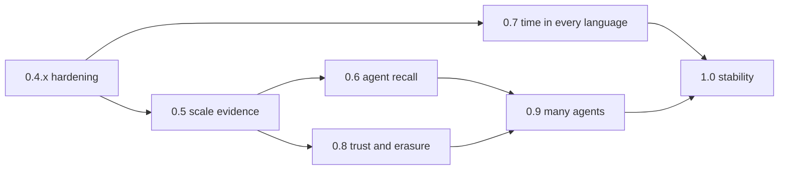

# Feature roadmap — after 0.4.0

Proposed on 2026-10-10, alongside [project-review.md](project-review.md). It continues the milestone table in `lat.md/roadmap.md` (M0–M5 done, M4 opt-in, text half of M7 done; M6 crypto-shredding and the vector half of M7 open). Each item is sized to become one OpenSpec change; the proposals now exist under `openspec/changes/` (eleven, all passing `openspec validate --strict`). Review finding ids (H1, M2, …) refer to the review.

## Principles for choosing work

1. **Depth over breadth.** The architecture already covers more ground than most embedded stores. The next releases should make the existing features fast at real history depth and easy to adopt, before adding new surfaces.
2. **Recall is the agent's main query.** Agents rarely know the graph pattern they need; they recall by meaning, then expand by structure and rank by evidence. Features that improve that loop come first.
3. **Never forget, but be able to erase.** Legal erasure (crypto-shredding) is the one feature the immutability promise depends on for real deployments.
4. **Stay embedded.** No network server, no second storage engine, no general reasoner until the embedded experience is hardened (unchanged from the first review).

## Overview

| Release | Theme | Headline items | Main review findings closed |
|---|---|---|---|
| **0.4.x** | Hardening and legibility | CHANGELOG, npm release, Lean model build, Python `new_node`, supersede batching, cache and lock fixes | H2, M1–M4, M6, M7, L1–L9 |
| **0.5** | Evidence at scale | Scale ceiling, history-depth performance, release benchmark gates | H1 |
| **0.6** | Agent recall | Vector recall (M7b) and hybrid recall (implemented), derived beliefs, MCP resources | — |
| **0.7** | Time in every language | Cypher temporal types, SPARQL decimal and language-tag fixes, interval algebra | H3, M5, M8 |
| **0.8** | Trust and erasure | Crypto-shredding (M6), sensitive predicates, signed bundles, audit export | — |
| **0.9** | Many agents | Memory merge over origin bits, bundle sync, cross-origin conflict policies | — |
| **1.0** | Stability | Format stability promise, migration tooling, semver policy, hosted docs | L10 |

0.6 and 0.7 can run in parallel; 0.7 touches only the front ends and expression evaluation.

## 0.4.x — Hardening and legibility

Patch releases with no format change.

| Item | What | Why |
|---|---|---|
| `CHANGELOG.md` | Entries from 0.1 to 0.4, with storage formats 1–4 and behavior changes (live-endpoint `assert`, date guards) called out | Users cannot assess an upgrade today (H2) |
| npm release | Run `npm-publish.yml` for `@tiramemsu/node` 0.4.x | The README's install line fails (H2) |
| Lean model in CI | Move `Store/`, `Sqlite/` to `lean/Tiramemsu/`, add lakefile and toolchain, build in CI, restore the `architecture#Store Abstraction` section | The model cannot build and its lat ref is dangling (M6) |
| Binding parity | Python `new_node()` returns a `Ref`; per-`Tx` ref counter in Node; a parity test that runs the same op script through both | M7, L5 |
| Batched supersede | Load the cascade set in one query | Correction cost grows linearly with round-trips (M1) |
| Term cache LRU | Replace clear-on-overflow with bounded eviction | Bulk chunks discard the warm cache (M2) |
| Writer condvar | Replace the 1 ms spin in `lock_bounded` | Latency and CPU under contention (M3) |
| LFTJ memory bound | Charge bytes while loading; `max_input_rows` routing limit | Unbounded materialisation (M4) |
| Typed corruption errors | NULL → `InvalidTerm`, missing cascade row → `NotLive` | L1, L2 |

## 0.5 — Evidence at scale

Settle the last open input in `lat.md/overview.md#Open Inputs`, then make the numbers release gates.

- **Pick the ceiling.** Proposed: 10⁷ statements per file, 1 000 versions per hot key, 100 writes per second sustained, on a laptop-class machine. Revisit if the first consumers need more.
- **History-depth performance.** Reproduce the 30× as-of slowdown at 1 000 versions and the unexplained current-view regression. Candidate fixes, in order of cost: verify the covering `hist_*` index is chosen, cluster history by `(s, p, t_add)`, partial `hist_*` indexes (the storage benchmark was meant to decide this), and a cold-history table for rows retracted before a horizon, read only by `as_of` and `history` views. The last one needs a format bump.
- **Benchmark gates in CI.** A nightly job that runs the churn, point/2-hop, path, supersede-cascade and bulk-import benchmarks at 10⁶ and records them; release fails if a gated number regresses more than an agreed margin. Refresh `crates/tiramemsu/benches/README.md` from that job.
- **oxilite head-to-head.** The `write-cost` and `as-of-latency` ports listed in `lat.md/roadmap.md#Benchmarks` were never run; run them, publish the result either way.
- **Operational metrics.** Expose maintenance time, `ANALYZE` runs, reader pool wait time and cache hit rates through a `Db::metrics()` snapshot, also as an MCP read-only tool.

## 0.6 — Agent recall

The vector half of M7, plus the loop that makes recall useful.

- **Vector recall: decided 2026-10-11, implemented.** The libSQL migration of 2026-10-10 was reversed: approximate indexes such as libSQL's DiskANN filter after their top-k, which loses hits under `as_of`, `valid_at` and graph views, and libSQL would cost SQLite 3.53, the WASM host and a single SQLite per binary. Instead, embeddings live in an append-only `embedding` table (format 5) and search is exact and view-aware, in Rust, on every host. Design and numbers: [vector-architecture.md](vector-architecture.md). `add-libsql-host` is deferred as an optional host for a later approximate tier.
- **`add-vector-recall` (M7b, implemented and archived 2026-10-11).** Models are `sys:` statements (dimensions, metric, f32/f16 encoding); `Tx::set_embedding` stores caller-supplied vectors in the write transaction; `View::vector_search`, SPARQL `tm:vectorMatch`, Cypher `tiramemsu.vector.search`, bridge, MCP and bindings share one search; an as-of view sees only embeddings stored by then; a sign-bit prefilter trades exhaustiveness for speed and says so.
- **`add-hybrid-recall` (implemented and archived 2026-10-11).** One operation that fuses text and vector hits (reciprocal-rank fusion), expands each hit by a bounded graph neighbourhood (the existing path engine with a hop and state cap), and ranks by the evidence the store already holds: confidence layers, `sys:confirmedBy` count, distinct authors, recency. Results carry the evidence and the completeness flag, never an invented score. Exposed as `View::recall`, SPARQL `tm:recall`, Cypher `CALL tiramemsu.recall`, and one MCP tool.
- **Consolidation helpers.** Agents summarise memory; the store should record it honestly. A `derive` verb (`add-derived-beliefs`) asserts a belief with engine-owned `sys:derivedFrom` links to its support. Today's cascade would only retract the link, not the summary (its subject is a node), so the change adds a support-cascade rule: the summary goes when its support goes, and saved-answer invalidation marks it stale. No summarisation in the store.
- **Salience without forgetting.** A read-time decay score over `volatile` access counters and `tm:addedAt`, usable in ranking and as a filter, with nothing retracted.
- **MCP resources and prompts.** Saved answers as MCP resources with `listChanged` notifications when they go stale, and two prompts ("record what you learned", "check before you answer") that teach agents the verbs. Advertise the capabilities only when implemented.

## 0.7 — Time in every language

- **`add-cypher-temporal-types`.** `date`, `datetime`, `localdatetime`, `time`, `localtime`, `duration`, truncation and arithmetic, mapped onto the store's instant and valid-time values (`r.validFrom` and `r.addedAt` already return UTC `DateTime`; what is missing is `Time`, `LocalTime`, `Duration`, map constructors, truncation and sub-millisecond precision in computed values). This is 1 064 of the 1 265 TCK deviations (H3).
- **Interval algebra.** Allen relations (`before`, `overlaps`, `during`, `meets`) as functions in both languages over valid-time intervals, so "which beliefs overlapped this period" is one predicate, not four comparisons.
- **SPARQL value fixes.** Exact `xsd:decimal` arithmetic, language-tag-preserving string functions, `xsd:date` with time zone, and negated property sets `!p` lowered into the path automaton (M5).
- **Cypher porting aids.** A "Cypher for Neo4j users" page covering empty nodes and the dual view, plus an opt-in setting where `CREATE ()` records an existence statement (M8). Pattern comprehension and the bidirectional arrow as smaller follow-ups.

## 0.8 — Trust and erasure

- **`add-crypto-shredding` (M6).** As designed in `lat.md/time-model.md#Erasure`: `sys:sensitive` predicates, `SEALED` terms encrypted under per-subject keys, `seal_key`, and an erase transaction that destroys the key and leaves the rows. Bundles and FTS/vector indexes must never hold plaintext of sealed terms; that is the hard part and needs its own tests.
- **Signed bundles.** Sign an exported bundle with the exporting agent's key; `import_bundle` can require a valid signature and records the signer as a source layer. This gives multi-agent exchange a provenance root.
- **Audit export.** Stream the event log (`since t`) as signed, append-only JSON Lines for external audit, with a verifier.
- **Author identity.** Make `sys:author` a first-class, optionally verified identity rather than free text, so conflict review and ranking can count distinct *verified* sources.

## 0.9 — Many agents

Origin bits are already reserved (`reserve-replica-id`, implemented). This release spends them.

- **`add-memory-merge`.** The origin registry (`meta.origin`), foreign statements keeping their ids, the skolem form `urn:tiramemsu:stmt:<origin>.<n>`, and merge as union of statements plus the earliest retraction of each (the 2P-set argument in the proposal).
- **Cross-origin policies.** `sys:one` and `sys:unique` become read-time policies across origins; conflicts surface through the existing `View::conflicts` with the origin as evidence.
- **Incremental sync.** Exchange event-log ranges between files (`since t` per origin), building on bundles, with `preview_bundle`-style dry runs before applying.

## 1.0 — Stability

- **Format stability promise.** Storage format N is readable by every later 1.x; documented upgrade path for each format bump, with an `upgrade` command and a test corpus of files from every released version.
- **API stability.** Semver policy for the Rust facade, the JSON bridge ops, the MCP tool schemas and the bindings; deprecation windows.
- **Hosted docs.** docs.rs for the Rust crates, a TypeDoc site for Node, a mkdocs/Sphinx site for Python, and a recipes cookbook generated from the tested queries in `lat.md/recipes.md`.

## Explicitly not planned

- A network server or multi-writer process model. The MCP server and bindings cover the integration need.
- A non-SQLite storage backend (DuckDB, a key-value store). The executor boundary is a SQLite host boundary; libSQL and the WASM host are other SQLite builds, which is the useful kind of portability.
- A general rule engine or OWL reasoner. Derived beliefs with explicit support (0.6) give agents traceable inference without one.
- Calling embedding or language models from the store.

## Ideas worth a spike, not yet a commitment

- **SHACL shapes as predicate schema.** Paper 2 already ships SHACL validators for metagraph encodings; reusing them for write-time validation could replace part of the bespoke predicate schema.
- **Metapath queries.** Paper 2's executable metapaths as a query form in SPARQL and Cypher over statement graphs.
- **Temporal snapshots as files.** `VACUUM INTO` an `as_of` view to hand another agent a frozen, smaller copy of past memory.
- **Browser-side memory.** A small demo app on the WASM host with OPFS, showing an agent's memory living entirely in the user's browser.
