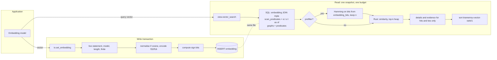
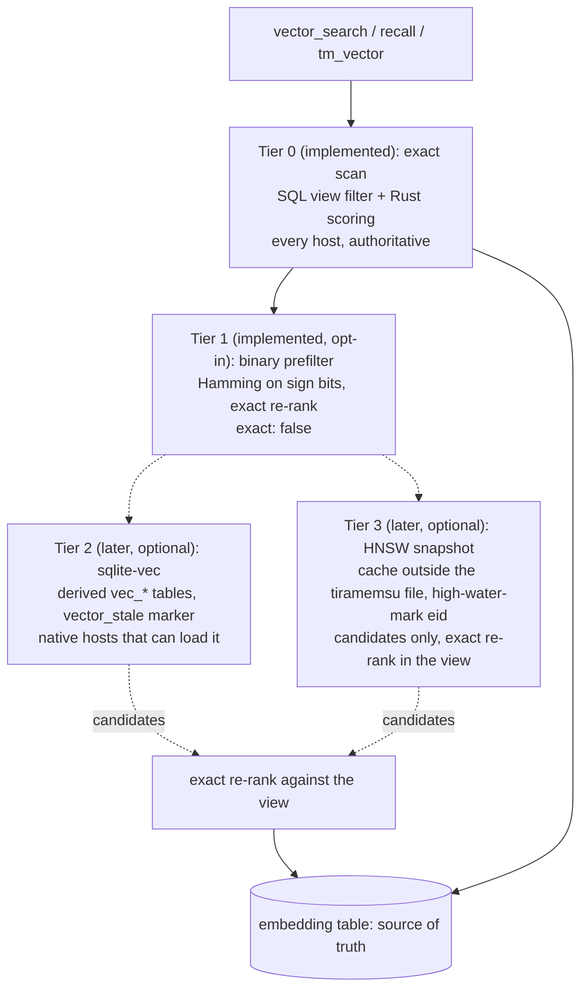

# Vector recall: architecture

Status: implemented and archived on 2026-10-11 (OpenSpec changes `archive/2026-10-11-add-vector-recall` and `archive/2026-10-11-add-hybrid-recall`; main specs `openspec/specs/vector-retrieval` and `openspec/specs/hybrid-recall`). Storage format 5, released in 0.5.0. This document describes how vector and hybrid recall work, the API names they use, how they are verified (section 11) and what they cost. Every size and latency in section 10 is measured.

## 1. Context and goals

Tiramemsu stores every fact as a statement with its own id, two clocks (transaction time and valid time), optional layers about it, and graph membership. Rows are never deleted. Reads go through a view: `now()`, `as_of(t)`, `valid_at(d)`, history, optionally restricted to graphs.

Agents recall by meaning as often as by words. Text recall (FTS5 over string terms, `term_fts`) finds "Lisbon offsite" but not "the team trip to Portugal". Vector recall closes that gap: the application stores an embedding for a statement, and later asks for the statements whose embeddings are most similar to a query vector.

Goals:

- **Correct under every view.** A vector search in `as_of(t)`, `valid_at(d)` or a graph scope returns the nearest statements *visible in that view*, not the nearest statements overall filtered afterwards.
- **One file, one transaction.** Vectors live in the same SQLite file as the graph and are written in the same transaction as the statement they describe.
- **Host-neutral.** Works wherever tiramemsu works: native (`tm-rusqlite`, bundled SQLite) and the browser (`tm-wasm`). It needs only SQL and Rust, no SQLite extension and no host capability.
- **Never-forget.** Embedding rows are append-only, like the rest of history.
- **Evidence-aware ranking.** Hits carry the same evidence as text recall and use it to break ties.
- **Hybrid recall.** One call fuses text and vector results.

Non-goals:

- An approximate nearest-neighbour index (a later tier, section 13).
- Computing embeddings. The store never calls a model.

## 2. The decision

**Exact first, host-neutral, no libSQL migration.**

Vector search is an exact scan over the embeddings of the statements visible in the view. SQL selects the visible rows; Rust computes similarity and keeps the top hits. An optional binary prefilter on sign bits reduces the work for larger stores. Approximate indexes are a later, optional tier that is never authoritative (section 13).

The reason is the time model. An approximate index answers "the k nearest vectors overall". Tiramemsu's question is "the k nearest vectors among statements visible at this transaction, valid on this date, in these graphs". When the index returns its top k and the view then removes the ones that are retracted, superseded, not yet asserted, not valid at the asked date or outside the graph, the result can be much shorter than k, or empty, while correct answers exist further down the list. Raising k until enough survive is unbounded in the worst case, because the fraction of history visible in a given view can be arbitrarily small. An exact scan over the visible rows has no such failure.

### Rejected alternatives

| Option | Why not now |
|---|---|
| **libSQL with its DiskANN vector index** | Decided against on 2026-10-11; libSQL stays a deferred, optional native host (`openspec/changes/add-libsql-host`). It pins tiramemsu to libSQL's SQLite fork, which tracks older SQLite (3.45 / 3.47 lines). No WASM build that fits `tm-wasm`. A process can link only one SQLite, so choosing libSQL changes the base for every user, not just vector users. And the index is approximate: its top-k then view-filter loses results under `as_of`, `valid_at` and graph scopes, which is the failure this design exists to avoid. |
| **SQLite `vec1` extension** | Version 0.7, pre-1.0, with no stability promise for its on-disk format. No WASM build. |
| **sqlite-vec** | A reasonable optional accelerator later (section 13). Not the base, because it is an extension (not every host can load one) and it does not know the view. |
| **External vector database** (Qdrant, pgvector, a hosted service) | Breaks the one-file, transactional model. A statement and its vector could disagree after a crash or a partial write, `as_of` could not be answered for the vector side, and the agent's memory would no longer be one portable file. |

## 3. Data model and storage

Storage format 5 adds one table, two indexes and two triggers:

```sql
CREATE TABLE embedding (
  model INTEGER NOT NULL,  -- IRI ObjectId of the model
  eid   INTEGER NOT NULL,  -- STMT ObjectId of the statement the vector describes
  t     INTEGER NOT NULL,  -- transaction that stored it
  bits  BLOB NOT NULL,     -- sign bits, ceil(dim / 8) bytes, for the binary prefilter
  vec   BLOB NOT NULL      -- dim values, little-endian f32 or f16; unit length for cosine
) STRICT;
CREATE UNIQUE INDEX embedding_model_eid ON embedding(model, eid);
-- covering index for the binary prefilter
CREATE INDEX embedding_bits ON embedding(model, eid, bits);
-- triggers embedding_no_delete and embedding_no_update abort any DELETE or UPDATE
```

- **One vector per (model, statement).** The unique index enforces it. A statement can have vectors under several models.
- **`eid` points at a statement, not a node.** The vector describes a fact (or a layer, or a note), which is the unit every other read returns. To embed "everything about Alice", embed the statements about Alice.
- **`t`** records the transaction that stored the vector. An as-of view uses it: it sees only the embeddings stored by its transaction (section 5).
- **`bits`** holds one bit per dimension: 1 when the component is positive. For 768 dimensions that is 96 bytes.
- **`vec`** holds the components, little-endian, in the model's encoding. For `cosine` the vector is normalised to unit length on write, so cosine similarity becomes a dot product at read time.
- **`embedding_bits`** covers `(model, eid, bits)`, so a prefilter scan reads about 100 bytes per row from the index instead of the table row (section 6).

### Model definitions

A model is an IRI. Its definition is three engine-owned `sys:` statements on that IRI, written through the normal write path and therefore versioned like any other fact:

| Predicate | Values |
|---|---|
| `sys:dimensions` | integer, 1 to 16,384, e.g. 768 |
| `sys:metric` | `"cosine"`, `"dot"` or `"l2"` |
| `sys:vectorEncoding` | `"f32"` or `"f16"` |

Only `define_embedding_model` writes them; a user writing one of these predicates directly gets `ReservedNamespace`. `set_embedding` and `vector_search` read the definition to validate the vector's length and to know how to normalise and encode it. A vector for an undefined model, or with the wrong number of components, is rejected with `InvalidQuery`.

### Format bump

The table makes this format 5. The 4→5 migration creates the empty table, its indexes and triggers, and reads or writes no graph row. As with earlier bumps, an older build refuses a format-5 file (`FormatVersion`) instead of writing statements without maintaining their vectors' invariants.

## 4. Write path: who maintains what

| Party | Responsibility |
|---|---|
| **Application** | Chooses the model, computes the embedding (calls the model), decides which statements to embed, re-embeds after a supersede. |
| **Engine writer** | Inside the write transaction: checks the statement is live, validates the model, the length and finiteness, normalises (cosine), encodes (f32/f16), computes the sign bits, inserts the row, enforces uniqueness. |
| **SQLite** | Atomicity and durability, the unique index, the triggers that forbid `UPDATE` and `DELETE`. |

This is the same division as the FTS5 text index `term_fts`: the engine writer maintains it inside the write transaction, so a reader never sees a statement whose index entry is missing or ahead of it, and a failed transaction, dry run or speculation leaves no row. One difference matters. `term_fts` is derived from the graph and can be dropped and rebuilt. Embedding rows cannot be rebuilt by the store, because it never had the model; they are history, written once and kept.

Rust:

```rust
db.transact(TxOptions::default(), |tx| {
    tx.define_embedding_model(model, &EmbeddingModel {
        dimensions: 768,
        metric: Metric::Cosine,
        encoding: VectorEncoding::F32,
    })?;
    let e = tx.assert(alice, note, Value::str("met Alice at the Lisbon offsite"), Valid::ALWAYS)?.eid();
    let new = tx.set_embedding(e, model, &embed("met Alice at the Lisbon offsite"))?;
    Ok(())
})?;
```

`define_embedding_model` returns `true` for a new definition and `false` for the identical definition again. A different definition for an already defined IRI is `InvalidQuery`, because stored vectors depend on it; define a new model IRI instead. A model that is not an IRI is `InvalidTerm`.

`set_embedding` returns:

- `true` when it stored a new vector;
- `false` when the identical vector already exists for this model and statement (idempotent, so replaying an import is safe);
- `Error::EmbeddingConflict` when a *different* vector exists for the same model and statement. There is no overwrite. A changed vector means a changed model (new model IRI) or a changed statement (supersede, then embed the new version).

It fails with `NotLive` for an unknown or retracted statement, and with `InvalidQuery` for an undefined model, a wrong dimension, a non-finite component or a zero vector under cosine.

## 5. Read path

```rust
let r: VectorResult = db.now().vector_search(&VectorQuery {
    model: Some(model),
    vector: embed("team trip to Portugal"),
    limit: Some(10),
    ..VectorQuery::default()
})?;                       // or VectorQuery::new(model, vector)
// r.hits: Vec<VectorHit { eid, s, p, o, similarity, rank, evidence }>
// r.candidates: how many visible embeddings the search considered
// r.exact: true unless a prefilter was used
```

`VectorQuery` also takes `graphs`, `predicates`, `prefilter` and `confidence` (the predicate read as a confidence layer, `v:confidence` by default). `limit` defaults to 10. `db.as_of(TimeRef::Tx(t)).vector_search(..)` and `db.now().valid_at(d).vector_search(..)` work the same way; the view decides what is visible.

**Embeddings have transaction time too.** An as-of view also requires `embedding.t <= t`: it sees only the embeddings stored by then. A statement that was live at `t` but embedded later is not found as of `t`, so a past view answers the same forever, and saved answers on past views stay valid. Now and history views see every stored embedding. `unembedded` follows the same rule: as of `t` it lists the statements that had no vector by then.

Steps, all in one snapshot and one budgeted read:

1. **Select visible rows in SQL.** `embedding` is joined to `triple` on `eid`, with the time predicates produced by `scan_predicates`, the single writer of time predicates, plus `e.t <= t` for an as-of view. Graph membership and predicate filters are the same predicate list and graph `EXISTS` as text recall. The view therefore selects exactly the statements `View::triples` would. The scan reads only `(eid, blob)`, with no `ORDER BY` and no per-row statement details.
2. **Score in Rust.** For each visible row, decode `vec` into one reused buffer (f16 through a 65,536-entry lookup table) and compute similarity under the model's metric: dot product of unit vectors for cosine, dot product for dot, `-‖a−b‖` for l2, so larger is always closer. A bounded heap keeps the top candidates; nothing else is materialised. Budget deadline and cancellation are polled per row.
3. **Read details and evidence for the hits only.** Subject, predicate, object, and the evidence (confidence, confirmations, distinct authors, `added_at`) in the same view, as in text recall, for the hits plus any rows tied at the cut, so the ranking policy also holds at the limit. Absent evidence is reported as absent.
4. **Rank and number.** Sort by the ranking policy, assign 1-based `rank`. Returned hits are charged to the budget as rows and bytes.

### Ranking policy `tiramemsu-vector-rank/1`

1. `similarity` descending
2. confidence descending, absent last
3. confirmations descending
4. distinct authors descending
5. `added_at`, newer first
6. `eid` ascending (final tie-break)

Similarity dominates. Evidence only orders hits that are equally similar, which in practice mostly means duplicates and near-duplicates of the same text written by different agents. The policy has a name so that a change to it is visible: a different order gets a different name.

## 6. Binary prefilter

`VectorQuery::prefilter: Some(n)` runs a two-stage search:

1. For every visible row, compute the Hamming distance between the query's sign bits and the row's `bits` (XOR and popcount, 12 machine words for 768 dimensions). Keep the `n` closest.
2. Decode `vec` for those `n` only and re-rank them exactly with the model's metric.

The result reports `exact: false`, because a true neighbour can fall outside the `n` kept in stage 1; `candidates` still counts every visible embedding scanned in stage 1. Larger `n` trades speed for recall. Sign bits approximate the angle between vectors, so the prefilter suits `cosine` best and is weaker for `dot` and `l2` with vectors of very different lengths.

Where the speed-up comes from: at 768 f32 dimensions a table row is about 3.2 KB, roughly one 4 KiB page, so an exact scan reads about a page per row. Stage 1 reads `bits` from the covering index `embedding_bits` (about 100 bytes per row) and never touches the table rows except for the `n` survivors. The win is scanning that small index instead of the table, plus skipping the float decoding and arithmetic. It is still a scan over every visible row; it is a constant-factor speed-up, not an index.

Measured on real vectors (GloVe-100, section 10), the prefilter is a coarse trade-off: at its best it is about 1.5× faster than exact search, and only at recall@10 of 0.7 or less. It is opt-in, and exact search stays the default.

## 7. Hybrid recall

```rust
let hits = db.now().recall(&RecallQuery {
    text: Some(TextQuery::new("lisbon offsite")),
    vector: Some(vq),
    limit: Some(10),
    expand: 2,
    ..RecallQuery::default()
})?;
// RecallHit { eid, s, p, o, score, rank, lexical, similarity,
//             text_rank, vector_rank, evidence, via }
```

- **Channels.** Each channel runs its own exact, view-aware recall in the same snapshot for `depth` candidates (default `max(4 × limit, 50)`); the channels' own `limit`s are replaced by `depth`. `limit` defaults to 10.
- **Fusion.** Reciprocal rank fusion with `rrf_k` = 60 (Cormack, Clarke and Büttcher, SIGIR 2009): a statement's `score` is the sum of `1 / (rrf_k + rank)` over the lists (text, vector) it appears in. Raw bm25 scores and similarities are on different scales, so only ranks are fused. `lexical`, `similarity`, `text_rank` and `vector_rank` keep the per-list values so the caller can see why a hit is there; each is absent when the hit came from the other list only.
- **Policy** `tiramemsu-recall-rank/1`: fused score descending, then the evidence tie-breaks of vector recall, then `eid`.
- **Expansion.** `expand: n` adds, per fused hit in rank order, up to `n` visible statements whose subject is the hit's `eid` (its layers, such as confidence or source), then up to `n` visible statements about the hit's subject node. They come after all fused hits with `score` 0 and `via` set to the hit they were reached from, so they are never confused with direct matches, and a statement is never repeated.
- **Expansion ignores filters on purpose.** It follows the hit's structure in the view and ignores the channels' `graphs` and `predicates`: layers such as a source or a confidence are rarely graph members themselves, so a graph filter would hide exactly the context expansion is for. The view still applies, so expansion never reaches a statement the view cannot see. Each distinct subject is read once per call (`statements_about`, `n + 1` rows in eid order).
- **Time.** Both channels and the expansion run in the same view and snapshot. As of `t`, the vector channel sees only embeddings with `embedding.t <= t` (section 5), so a fused past answer is as stable as a single-channel one.
- **Single channel.** Either `text` or `vector` may be omitted; recall then degenerates to the single list, in the standalone order, with the same hit shape. A recall with neither is `InvalidQuery`. A text channel needs the text index (`TextIndexUnavailable` when it is not built, `MissingCapability("fts5")` on a host without FTS5); a vector-only recall needs neither.

## 8. Surfaces

| Surface | Write | Read |
|---|---|---|
| Rust | `Tx::define_embedding_model`, `Tx::set_embedding` | `View::vector_search`, `View::recall`, `View::unembedded` |
| JSON bridge | tx ops `defineEmbeddingModel`, `setEmbedding` (eid or ref) | `vectorSearch`, `recall`, `unembedded` |
| MCP | `define_embedding_model` (model, dimensions, metric, encoding), `set_embedding` (eid, model, vector) | `vector_search` (model, vector, graphs, predicates, limit, confidence, prefilter, view), `recall` (text, mode, model, vector, graphs, predicates, limit, depth, expand, view), `unembedded` (model, limit, view) |
| Python | `tx.define_embedding_model(model, dimensions, metric="cosine", encoding="f32")`, `tx.set_embedding(eid_or_ref, model, vector)` | `view.vector_search(model, vector, limit=, graphs=, predicates=, prefilter=, confidence=)` → `VectorResult` (iterable over its hits), `view.recall(text=None, model=, vector=, mode=, limit=, depth=, expand=, graphs=, predicates=)` → list of `RecallHit`, `view.unembedded(model, limit=None)` |
| Node.js | `Tx.defineEmbeddingModel(model, dimensions, {metric, encoding})`, `Tx.setEmbedding(eid \| Ref, model, vector)` | `View.vectorSearch(model, vector, {limit, graphs, predicates, prefilter, confidence})` → `{hits, candidates, exact}`, `View.recall({text, mode, model, vector, limit, depth, expand, graphs, predicates})`, `View.unembedded(model, limit?)` |
| Cypher | | `CALL tiramemsu.vector.search(model, vectorList, {limit, graphs, predicates}) YIELD statement, subject, predicate, object, similarity, rank, confidence`; `CALL tiramemsu.recall({text, model, vector, mode, limit, expand, graphs}) YIELD statement, subject, predicate, object, score, rank, via` |
| SPARQL | | `?e tm:vectorMatch "[0.1, …]" ; tm:vectorModel <iri> ; tm:vectorPredicate <p> ; tm:vectorSimilarity ?sim ; tm:vectorRank ?r ; tm:vectorConfidence ?c ; tm:vectorLimit 10`; `?e tm:recallText "…" ; tm:recallVector "[…]" ; tm:recallModel <iri> ; tm:recallMode "any" ; tm:recallLimit 10 ; tm:recallExpand 2 ; tm:recallScore ?s ; tm:recallRank ?r ; tm:recallVia ?via` |

In Python and Node a model may be given as a plain IRI string.

**MCP.** The server has 19 tools; the five above are the vector ones. `set_embedding` takes an eid; `unembedded` returns `{view, eids}`, the backlog an agent embeds before calling `set_embedding`. Read-only mode hides every tool that writes, including `define_embedding_model` and `set_embedding`. `recall`'s text channel needs the server started with `--text-index`.

**SPARQL, vector.** The `tm:vector*` patterns on one subject variable form one recall. `tm:vectorMatch` (a string literal holding a JSON array) and `tm:vectorModel` are required; the others are optional. `tm:vectorPredicate <p>` is repeatable and keeps statements with one of those predicates, before ranking, as `VectorQuery::predicates` does. `GRAPH <g>` restricts the recall, `SERVICE <tm:asOf/…>` times it, and `GRAPH ?g` around it is `InvalidQuery`. Join `?e` to `?s ?p ?o ~ ?e` to read the statement.

**Cypher, vector.** The model is an IRI or a bare name resolved like a graph name; the vector is a list of numbers; options are `limit`, `graphs` and `predicates`. The procedure joins each hit with its statement, and the time clauses apply.

Both compile through the IR leaf `VectorPattern` to the connection table function `tm_vector(model, vector, view, graphs, limit)`, which calls the same search.

**SPARQL, hybrid.** The `tm:recall*` patterns on one subject variable form one recall (`recall_patterns` in `crates/tm-sparql/src/lower/bgp.rs`). It needs `tm:recallText`, or `tm:recallVector` with `tm:recallModel`, or both. `tm:recallMode` (`"all"`, `"any"`, `"phrase"`), `tm:recallLimit` and `tm:recallExpand` tune it; `tm:recallScore`, `tm:recallRank` and `tm:recallVia` bind outputs, and `tm:recallVia` is unbound for fused hits. `GRAPH <g>` restricts both channels, `SERVICE <tm:asOf/…>` times it, and `GRAPH ?g` around it is `InvalidQuery`.

```sparql
SELECT ?e ?score ?via WHERE {
  ?e tm:recallText "lisbon offsite" ; tm:recallVector "[0.12, …]" ; tm:recallModel <urn:example:minilm> ;
     tm:recallExpand 2 ; tm:recallScore ?score ; tm:recallRank ?r ; tm:recallVia ?via }
ORDER BY ?r
```

**Cypher, hybrid.** `CALL tiramemsu.recall({...})` (`crates/tm-cypher/src/exec/recall.rs`) takes one map with `text` and/or `model` with `vector`, and `mode`, `limit`, `expand` and `graphs`. It yields fused hits with `via` null and expanded statements with `via` set.

Both compile through the IR leaf `RecallPattern` to the table function `tm_recall(text, mode, model, vector, view, graphs, limit, expand)` (`crates/tm-exec/src/recall.rs`), which calls `tm_core::recall::recall`.

All surfaces call one logical operation per read, so ranking and visibility cannot drift between them.

## 9. Never-forget interaction

- **Append-only.** Triggers forbid `UPDATE` and `DELETE` on `embedding`. The only change is an insert.
- **Retraction does not remove a vector.** The view decides. A retracted statement is invisible in `now()`, so its vector is not scanned; `as_of` a transaction before the retraction (and after the vector was stored) finds it again.
- **Past views are stable.** An as-of view ignores embeddings stored after its transaction, so storing a vector later never changes a past answer.
- **Supersede does not copy embeddings.** A superseded statement's new version is a new statement with new content, and the old vector describes the old content. The store cannot recompute it. `view.unembedded(model, Some(100))` lists visible statements that have no vector under the model, so the application can find and fill the gaps.
- **A new model means new rows.** Changing the embedding model is a new model IRI with its own definition and its own rows. Old vectors stay, and `as_of` queries against the old model still work.
- **Erasure.** Crypto-shredding (a separate proposal) must cover vectors too, since an embedding can leak the text it was computed from. Until then, embedding rows are as permanent as the statements.

## 10. Size and performance

### Footprint

Measured with `cargo run --release -p tiramemsu --example vector_footprint`: 10,000 vectors, file size after `VACUUM`, bytes added per embedding.

| Model | Raw `vec` | File per embedding | Of which |
|---|---|---|---|
| 768 f32 | 3,072 | 4,234 | table 4,105, `embedding_bits` 113, `embedding_model_eid` 13 |
| 768 f16 | 1,536 | about 2,150 | two rows per page |
| 384 f32 | 1,536 | about 2,150 | two rows per page |

A 768 f32 row is about 3.2 KB, so only one fits in a 4 KiB page and about a quarter of each page is slack. That is why the file grows by 4.2 KB, not 3.2 KB, per embedding, and why 768 f16 and 384 f32 cost about half: two rows share a page. Prefer f16 when file size matters; 100,000 embeddings at 768 f32 add about 423 MB, at f16 about 215 MB.

### Scan latency

**Measured latency** (`crates/tiramemsu/benches/vector.rs`, recorded in `crates/tiramemsu/benches/README.md`): Apple laptop, bundled SQLite, now view, top 10, pseudo-random cosine vectors. These numbers measure the scan cost, not retrieval quality.

| Statements | Dims, encoding | Exact | Prefilter 200 |
|---|---|---|---|
| 10,000 | 384 f32 | 7.4 ms | 2.4 ms |
| 10,000 | 768 f32 | 11.6 ms | 2.5 ms |
| 10,000 | 768 f16 | 11.0 ms | 2.5 ms |
| 100,000 | 384 f32 | 84.8 ms | 31.0 ms |
| 100,000 | 768 f32 | 134.4 ms | 31.3 ms |
| 100,000 | 768 f16 | 116.2 ms | 30.9 ms |

Exact search costs about 1.2 µs per 768-dimension embedding and grows linearly with the number of *visible* vectors. A narrow view (a graph scope, an early `as_of`) scans fewer rows. f16 halves the bytes of `vec`; the prefilter replaces the table scan with a scan of the small covering index. The browser host will be slower than native; it has not been benchmarked. Past roughly 10⁶ vectors an approximate tier is the next step (section 13).

The prefilter column above is speed only: on random vectors its recall means nothing.

### Prefilter quality on real vectors

GloVe-100 angular from ann-benchmarks, the first 100,000 and 200,000 vectors, 200 test queries, release build, Apple M2 Max. Recall@10 is measured against the engine's exact top 10, which matched a numpy brute force on 20 of 20 sampled queries.

| `prefilter` n | 100k recall@10 | 100k ms | 200k recall@10 | 200k ms |
|---|---|---|---|---|
| exact | 1.000 | 44.5 | 1.000 | 89.9 |
| 200 | 0.544 | 28.5 | 0.515 | 58.1 |
| 1,000 | 0.785 | 30.8 | 0.754 | 60.6 |
| 5,000 | 0.945 | 46.0 | 0.913 | 72.5 |
| 10,000 | 0.979 | 92.2 | 0.961 | 96.3 |

Interpretation:

- **The bit scan has a large fixed cost**, about 28 ms at 100k and 58 ms at 200k, roughly two thirds of an exact search. It still visits every visible row.
- **The best speed-up is about 1.5×, and only at recall@10 ≤ 0.7.** For 0.95 recall the prefilter needs about 5 % of the corpus as candidates, where it is no faster than exact search. Recall also drops as the corpus grows at fixed `n`.
- **GloVe-100 is a hard case.** 100 dimensions give only 100 sign bits. 384- and 768-dimension sentence embeddings give more bits and are expected to do better, but that is not measured.
- **Consequence:** exact search is the default and the recommendation. The prefilter is an opt-in, coarse trade-off for callers who accept missing neighbours, and its result says `exact: false`.

### Hybrid recall latency

`recall_<n>_384` in `crates/tiramemsu/benches/vector.rs`: notes with text, text index on, 384-dimension vectors, a query word (`topic7`) that matches 2 % of notes.

| Statements | Text + vector | With `expand: 2` | Text only |
|---|---|---|---|
| 10,000 | 10.0 ms | 15.2 ms | 0.49 ms |
| 100,000 | 90.7 ms | 112.4 ms | 7.6 ms |

The vector channel dominates: hybrid recall costs about one exact vector scan at `depth` plus a cheap text query. Expansion reads each distinct subject once per call (in this fixture all notes share one subject).

## 11. How it is verified

- **Exact equals brute force** (`crates/tiramemsu/tests/vector_properties.rs`, proptest): over random vectors, for cosine, dot and L2, f32 and f16, with retractions and limits, the engine's exact top k equals a brute-force ranking recomputed from the stored values.
- **Prefilter honesty:** prefilter hits carry their exact similarities, and the prefilter re-ranks its candidates exactly (`the_prefilter_reranks_its_candidates_exactly`).
- **Fusion is recomputable** (proptest `fusion_recomputes_from_the_standalone_channels`): each fused score equals Σ 1/(60 + rank) recomputed from standalone text and vector recall, and a single-channel recall keeps the standalone order.
- **Views and graphs:** fixtures check fused and expanded hits under `now`, `as_of`, `valid_at`, history and graph scopes (`hybrid_recall_honours_views_and_graphs`, `views_decide_which_embeddings_are_visible`, `an_as_of_view_sees_only_the_embeddings_stored_by_then`).
- **Capabilities:** on a host without FTS5, vector-only recall works and a text channel fails with `MissingCapability("fts5")` (`channel_failures_are_typed_and_vectors_need_no_fts5`).
- **Budgets:** a search or recall over a limit fails with `ResultLimitExceeded`, and a cancelled one with `Cancelled`, never with a partial ranking (`a_budget_bounds_a_vector_search`, `hybrid_expansion_is_capped_and_a_budget_bounds_recall`).
- **Surface agreement:** Rust, SPARQL, Cypher, the JSON bridge and MCP return identical hits and ranks for the same query (`sparql_and_cypher_run_the_same_search_as_the_rust_api`, `sparql_and_cypher_run_the_same_recall_and_predicate_filters`, `bindings/json/tests/bridge.rs`, `crates/tiramemsu-mcp/tests`).
- **Hosts:** the same brute-force-checked fixture (`check_vector_recall` in `crates/tm-wasm/tests/common/mod.rs`) passes on rusqlite, on the WASM host natively, and in WebAssembly under Node.js.
- **Write path:** model definitions, append-only rows, rollback, supersede gaps and the 4→5 migration have their own tests in `vector_recall.rs`.

## 12. Diagrams

### Write and read paths



### Tiers



## 13. Future tiers

Each tier is derived and rebuildable, never decides visibility, and its candidates are re-ranked exactly.

- **sqlite-vec** on native hosts that can load it, as a candidate generator. It would keep derived `vec_*` tables in the file (the prefix is reserved), maintained by the writer, with a `vector_stale` catch-up marker like `text_stale`: a host without the extension writes `embedding` only and marks the tier stale, and search falls back to the exact path until a capable writer catches up. The `embedding` table stays the source of truth.
- **HNSW snapshots** (USearch or a pure-Rust crate) for more than about a million vectors. Built from the `embedding` table up to a high-water-mark `eid`; rows above the mark are scanned exactly and merged. The snapshot is a cache kept outside the tiramemsu file: never authoritative, rebuilt or discarded at will. Its candidates are always re-ranked exactly and filtered through the view, and when too few survive the filter the search falls back to the exact scan, so a time-travel query never returns fewer correct results than the exact path would.
- **libSQL** remains a deferred optional host (`openspec/changes/add-libsql-host`); if it ever hosts an approximate tier, the same rules apply.
- **Prefilter quality on 384/768-dimension models** should be measured before the prefilter is recommended for them.

Any accelerated tier reports `exact: false` unless it proves completeness for the query.

## 14. Failure modes and limits

- **No approximate index yet.** Cost is linear in visible vectors (about 1.2 µs per 768-dimension embedding). Large stores should use the prefilter, narrower views, or wait for the later tiers.
- **The caller supplies embeddings.** The store cannot check that a vector matches its statement's text, or that the query vector came from the same model. Mixing models under one IRI gives meaningless similarities; the dimension check catches only a length mismatch.
- **Supersede leaves gaps.** New versions have no vector until the application embeds them. `unembedded` finds them; a search before that misses them.
- **Late embeddings are invisible to the past.** A vector stored after transaction `t` is not seen by `as_of(t)`, even if the statement was live then. This is what keeps past answers stable.
- **No overwrite.** A different vector for the same model and statement is `Error::EmbeddingConflict`. Re-embedding with an improved model means a new model IRI. Redefining a model differently is `InvalidQuery`.
- **Prefilter recall.** With `prefilter`, true neighbours can be missed; `exact: false` says so. On GloVe-100 recall@10 is 0.54 at n = 200 and 0.95 only at n = 5,000, where it is no faster than exact (section 10). Unmeasured on 384/768-dimension models. Weaker for `dot` and `l2`.
- **f16 precision.** Halves `vec` at some loss of precision; ties may reorder.
- **Budgets.** A search or recall over a large view can hit a read budget (row, byte or time limit) or be cancelled, and fails with the budget error (`ResultLimitExceeded`, `Cancelled`, …) rather than return a partial ranking.
- **Page slack.** At 768 f32 a row fills most of a 4 KiB page, so each embedding costs about 4.2 KB of file. f16 halves that.
- **Erasure.** Vectors are permanent until crypto-shredding covers them.
- **Format 5.** Older builds cannot open a format-5 file.
