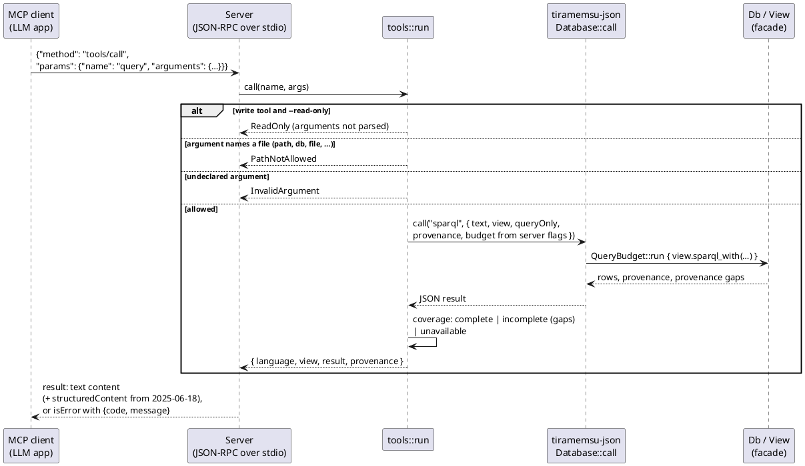

# API

The `tiramemsu` facade crate exposes three handles: `Db` opens the file and runs transactions, `View` is an immutable time selection that runs queries, and `Tx` holds the write operations.

## Rust Surface

The signatures below are the contract that bindings wrap. Names are fixed; details such as generic bounds may change during implementation.

```rust
pub struct Db { /* writer + reader pool */ }

impl Db {
    pub fn open(path: impl AsRef<Path>, opts: OpenOptions) -> Result<Db>;   // tm-rusqlite host
    pub fn open_with_host(host: impl Host, path: impl AsRef<Path>, opts: OpenOptions) -> Result<Db>;
    pub fn capabilities(&self) -> Capabilities;                             // declared by the host
    pub fn optimize(&self) -> Result<()>;                                   // full ANALYZE
    pub fn transact<F>(&self, opts: TxOptions, f: F) -> Result<TxReport>
        where F: FnOnce(&mut Tx) -> Result<()>;
    pub fn with<F, G, R>(&self, ops: F, query: G) -> Result<R>      // speculative
        where F: FnOnce(&mut Tx) -> Result<()>, G: FnOnce(&View) -> Result<R>;
    pub fn now(&self) -> View;
    pub fn as_of(&self, at: TimeRef) -> View;                     // TimeRef::Tx(t) | TimeRef::Instant(ms)
    pub fn history(&self) -> View;
    pub fn events_since(&self, t: u64) -> Result<Vec<Event>>;
    pub fn cypher_write(&self, opts: TxOptions, q: &str, params: &CypherParams) -> Result<CypherResult>; // one transaction; rows + TxReport
    pub fn transact_budgeted<F>(&self, opts: TxOptions, budget: &QueryBudget, f: F) -> Result<TxReport>; // bounded; stopped = rolled back
    pub fn cypher_write_budgeted(&self, opts: TxOptions, q: &str, params: &CypherParams, budget: &QueryBudget) -> Result<CypherResult>;
    pub fn bulk_import(&self) -> Result<BulkImport<'_>>;                    // write lease, deferred statistics
    pub fn bulk_import_shared(self: &Arc<Db>) -> Result<BulkImport<'static>>;
    pub fn statistics_due(&self) -> Result<bool>;
    pub fn import_active(&self) -> bool;
    pub fn enable_text_index(&self) -> Result<bool>;                        // build unless current; catch up
    pub fn rebuild_text_index(&self) -> Result<u64>;                        // drop + refill term_fts; history untouched
    pub fn save_answer(&self, name: &str, q: &SavedQuery) -> Result<SavedAnswer>;  // run + store; derived record
    pub fn save_answer_with(&self, name: &str, q: &SavedQuery, budget: Option<&QueryBudget>) -> Result<SavedAnswer>;
    pub fn saved_answer(&self, name: &str) -> Result<Option<SavedAnswer>>;
    pub fn saved_answers(&self) -> Result<Vec<SavedAnswer>>;
    pub fn check_saved_answers(&self) -> Result<Vec<Invalidation>>;       // process events once; recheck / stale
    pub fn refresh_answer(&self, name: &str) -> Result<SavedAnswer>;      // only success clears a mark
    pub fn refresh_answer_with(&self, name: &str, budget: Option<&QueryBudget>) -> Result<SavedAnswer>;
    pub fn delete_saved_answer(&self, name: &str) -> Result<bool>;
    pub fn preview_bundle(&self, bundle: &Bundle) -> Result<BundlePreview>; // dry-run import; nothing committed
}

impl BulkImport<'_> {
    pub fn chunk<F>(&mut self, f: F) -> Result<TxReport>;           // one atomic transaction
    pub fn chunk_with<F>(&mut self, opts: TxOptions, budget: Option<&QueryBudget>, f: F) -> Result<TxReport>;
    pub fn progress(&self) -> &ImportProgress;
    pub fn finish(self) -> ImportSummary;                           // one full ANALYZE; never fails
    pub fn cancel(self) -> ImportProgress;                          // no analysis; statistics left due
}

impl View {
    pub fn valid_at(self, epoch_ms: i64) -> View;
    pub fn with_budget(self, budget: &QueryBudget) -> View;      // every call through it is one bounded operation
    pub fn sparql(&self, q: &str) -> Result<SparqlResult>;        // SELECT | ASK | CONSTRUCT | update (current view only)
    pub fn sparql_with(&self, q: &str, opts: &SparqlOptions) -> Result<SparqlResult>; // opts.provenance: per-row eids
    pub fn cypher(&self, q: &str, params: &CypherParams) -> Result<CypherResult>;   // read-only; a write clause is Unsupported
    pub fn path(&self, start: ObjectId, path: &str, mode: PathMode, max_hops: u32) -> Result<Vec<PathRow>>;
    pub fn path_with(&self, start: ObjectId, path: &str, args: &PathArgs) -> Result<Vec<PathRow>>; // + graphs, time_respecting, capped
    pub fn path_report(&self, start: ObjectId, path: &str, args: &PathArgs) -> Result<PathReport>; // rows + PathCompleteness
    pub fn triples(&self, s: Option<ObjectId>, p: Option<ObjectId>, o: Option<ObjectId>) -> Result<Vec<Triple>>;
    pub fn graphs(&self) -> Result<Vec<ObjectId>>;                             // graphs with a visible membership, or declared
    pub fn graph_members(&self, graph: ObjectId) -> Result<Vec<Eid>>;          // member statements in this view
    pub fn dependents(&self, eid: Eid) -> Result<Vec<Eid>>;                    // what stands on eid (the cascade set on now)
    pub fn bundle(&self, root: Eid) -> Result<Bundle>;                         // root, its dependents and their evidence
    pub fn values(&self, s: ObjectId, key: ObjectId) -> Result<Vec<ObjectId>>; // statements, else volatile (Now only)
    pub fn encode(&self, v: &Value) -> Result<Option<ObjectId>>;              // lookup only, never inserts
    pub fn decode(&self, id: ObjectId) -> Result<Value>;
    pub fn events_since(&self, t: u64) -> Result<Vec<Event>>;
    pub fn text_search(&self, q: &TextQuery) -> Result<Vec<TextHit>>;         // ranked recall with evidence
    pub fn vector_search(&self, q: &VectorQuery) -> Result<VectorResult>;     // exact, view-aware vector recall
    pub fn recall(&self, q: &RecallQuery) -> Result<Vec<RecallHit>>;          // text + vector, fused by rank
    pub fn unembedded(&self, model: ObjectId, limit: Option<usize>) -> Result<Vec<Eid>>;
    pub fn explain_sparql(&self, q: &str) -> Result<Explain>;                 // routing + reasons, SQL, query plan
    pub fn conflicts(&self, q: &ConflictQuery) -> Result<Vec<Conflict>>;      // overlapping distinct objects + evidence
}
```

`Tx` is the core write handle, re-exported by the facade. The `TxCypher` extension trait adds `cypher(q, params)`, which runs a Cypher query with reads and writes inside the caller's `transact` closure ([[crates/tiramemsu/src/cypher.rs#TxCypher]]); `Tx::set_vocab` and `Tx::set_prefix` change the vocabulary configuration ([[data-model#Vocabulary Mapping]]). Besides the operations of [[time-model#Operations]] it offers `assert_with` (with `OnExisting::Confirm`), `new_bnode`, `clear_volatile`, `encode`, `lookup`, `decode`, `schema`, `t` and `instant`. Positions take any `IntoObject`: an `ObjectId`, `Eid`, `TxId` or `Value`.

- Named graphs ([[data-model#Named Graphs]]): `Tx::add_to_graph(eid, graph, opts) -> (membership_eid, is_new)` (idempotent, `opts.valid` bounds the membership), `remove_from_graph(eid, graph) -> bool`, `clear_graph(graph) -> Vec<Eid>`, `create_graph(graph)`, and the helpers `drop_graph`, `graph_declared`, `graph_has_members` and `live_graphs`. All reject a non-node graph with `InvalidGraphName`. `TxReport` lists new memberships in `memberships` and retracted ones in `memberships_retracted`, and no longer in `asserted` and `retracted`.
- Fact bundles ([[data-model#Fact Bundles]]): `View::bundle(root) -> Bundle` and `Tx::import_bundle(&Bundle) -> ImportReport` (`root` and one `{local, eid, new}` per statement). The facade trait `BundleFormat` adds `to_json`, `from_json` (`tiramemsu-bundle/1`) and `to_ntriples`. `View::dependents(eid)` is the read-only cascade preview of [[time-model#Cascade#Dependents]].
- A `View` is a pure value: creating or deriving one does no I/O. Rows from an as-of view report `t_ret` and `ret_kind` as absent, so each row shows what was believed then; `history()` gives real lifetimes.
- `SparqlResult` is `Solutions`, `Boolean`, `Graph` or `Update(TxReport)`, with `write_sparql_json` (SELECT, ASK) and `write_ntriples` (CONSTRUCT). A SPARQL update is one transaction on the writer and returns its `TxReport`. See [[query#Front Ends#SPARQL]].
- Temporal paths and completeness ([[query#Temporal Path Syntax]], [[query#Physical Planning#Path Engine#Path Completeness]]): `SparqlOptions::params` (`Params`) supplies the `$name` start of `SERVICE <urn:tiramemsu:tm:timeRespecting/$name>`; `PathArgs::capped` stops an unbounded search at `path_max_hops`; `View::path_report` returns `PathReport { rows, completeness }`; `Solutions::path_completeness` and `CypherResult::path_completeness` are `Option<PathCompleteness>` (`Exhaustive`, `StoppedAtBound { max_hops }`, `StoppedAtCap { max_hops }`), re-exported as `tiramemsu::PathCompleteness`.
- `sparql(q)` is `sparql_with(q, &SparqlOptions::default())`. `SparqlOptions { provenance: true }` makes each `SELECT` row carry the eids of the statements that produced it: `Solutions::provenance(row) -> Option<&[Eid]>`, a `"provenance"` member in SPARQL JSON, and `provenance: true` on the JSON bridge's `sparql`. `ASK`, `CONSTRUCT` and updates with it are `Unsupported`. See [[query#Front Ends#SPARQL#Query Provenance]].
- Query budgets ([[query#Query Budgets]]): `QueryBudget { timeout, cancel, reader_timeout, max_rows, max_bytes }` (all `Option`, `Default` bounds nothing), `CancelToken::{new, cancel, is_cancelled}`, and `QueryBudget::run(f)`, which bounds a sequence of calls as one operation. Hosts receive the stop conditions through `Executor::set_interrupt(Option<Interrupt>)`, a default no-op.
- Bulk import ([[query#Bulk Import]]): `ImportProgress { chunks, rejected, asserted, existing, retracted, txs, elapsed, maintenance }` and `ImportSummary { progress, analyzed, maintenance_error, statistics_due }`. Dropping a `BulkImport` equals `cancel`.
- Text recall ([[query#Text Recall]]): `TextQuery { text, mode: TextMode::{All, Any, Phrase}, graphs, predicates, limit, confidence }` (`TextQuery::new(text)` for the defaults) and `TextHit { eid, s, p, o, text, lang, lexical, rank, evidence: TextEvidence { confidence: Option<f64>, confirmations, authors, t_add, added_at } }`, ordered by `text::RANK_POLICY`. The index is opt-in: `OpenOptions::text_index` or `Db::rebuild_text_index`.
- Saved answers ([[query#Saved Answers]]): `SavedQuery { language: QueryLanguage::{Sparql, Cypher}, text, params, view }` (`SavedQuery::sparql(text)`, `SavedQuery::cypher(text, params)`, `.on(view)`), and `SavedAnswer { name, query, vocab, prefixes, result, dependencies, coverage, checkpoint, cursor, evaluated_at, revision, status, invalidation, error }` with `solutions()` and `boolean()`. `AnswerStatus::{Fresh, Recheck, Stale}`, `CoverageReason` and `Invalidation { name, status, cause: InvalidationCause, t, event }`.
- Cyclic joins ([[query#Physical Planning#LFTJ]]): `OpenOptions { planner: PlannerOptions { lftj: LftjConfig { enabled: true, min_rows_estimate: 0 } }, .. }` installs `LftjOperator` (`tm_lftj`) and routes pure cyclic BGPs to it. `View::explain_ir` and `View::explain_sparql` return `Explain { regions: Vec<RegionInfo { kind: RegionKind, note: RouteNote, aliases, query_plan }>, sql, params, query_plan, short_circuit }`; the LFTJ notes are `CyclicLftjDisabled`, `LftjUnavailable`, `LftjUnsupportedShape`, `LftjBelowEstimate` and `LftjNative`.
- Conflict review ([[query#Conflict Inspection]], [[data-model#Fact Bundles#Import Preview]]): `ConflictQuery { subject, predicate, limit, confidence, source }` and `Conflict { s, p, declared_many, overlaps: Vec<Valid>, values: Vec<ConflictValue { o, statements: Vec<ConflictEvidence { eid, valid, t_add, added_at, confidence, confirmed_by, authors, sources, source_layer }> }> }`; `BundlePreview { import, report, failure, burned: IdUsage, scope: PreviewScope { basis, t, instant } }` with `would_commit()`. `Tx::id_usage() -> IdUsage { statements, nodes, blank_nodes, terms }` lists the ids a transaction allocated (burned after a dry run).
- `values(s, key)` is how M0 exposes volatile state before a query language exists. See [[storage#Volatile Table]].
- `Patch::from_fields` builds a patch from named fields for bindings and rejects `s` and `p` with `InvalidPatch`.

`Tx` operations are specified in [[time-model#Operations]]. Values cross the API as `Value` (IRI, node, literal, statement, tx), which the ObjectId codec encodes. See [[data-model#ObjectId]].

## Errors

Every failure is a typed error, and a failed transaction leaves no trace: no tx row, no triples, no terms.

| Error | Raised when |
|---|---|
| `UniqueViolation { p, o, existing }` | Asserting a second live subject for a `sys:unique` predicate |
| `ValueTypeMismatch { p, expected, got }` | The object violates `sys:valueType` |
| `SubjectTypeMismatch { p, expected, got }` | The subject's kind is none of the predicate's `sys:subjectType` tags (a typed layer written on a node, say) |
| `CascadeLimitExceeded { root, limit }` | The cascade set is larger than `max_cascade` |
| `NotLive(eid)` | `supersede` or `confirm` on a retracted or unknown eid |
| `InvalidPatch` | A patch tries to change `s` or `p`, gives an empty interval (`v_from ≥ v_to`), or changes nothing |
| `SelfReference(eid)` | A statement would use its own eid as `s` or `o` |
| `ReservedNamespace(iri)` | User data writes a `sys:` predicate that is not a schema, vocab or prefix flag (or tx metadata on a tx), `sys:inGraph` (only `GRAPH` blocks, `WITH` and `Tx::add_to_graph` write it), `sys:derivedFrom` (only `Tx::derive` writes it), any `tm:` predicate, a schema flag on a `sys:` subject, or supersedes an engine statement (`sys:confirmedBy`, `sys:supersedes`) |
| `InvalidGraphName { term }` | A graph name that is a literal, statement or transaction |
| `GraphNotFound { graph }` / `GraphExists { graph }` | `CLEAR GRAPH` or `DROP GRAPH` on a graph with no membership and no declaration; `CREATE GRAPH` on a declared graph (both unless `SILENT`) |
| `SchemaConflict { violating }` | A schema change is violated by existing live data |
| `Parse { dialect, span, msg }` / `Unsupported { feature }` | A query is outside the v1 subset. `dialect` is SPARQL, Cypher or Path (the `tm_path` expression text). `Unsupported` also rejects what format 1 reserves for later milestones: tag 15 `SEALED` and the `sys:sensitive` flag (M6), and a `NODE`, `BNODE`, `STMT` or `TX` id with a non-zero origin ([[data-model#ObjectId#Origin Bits]]) |
| `MissingCapability { capability }` | `Db::open` with the query engine on a host that lacks `functions` or `vtab`, or text recall and index maintenance on a host without `fts5`. See [[architecture#Executor]] |
| `TextIndexUnavailable { reason }` | Text recall when the text index was never built, has another layout version, or lacks strings a host without FTS5 wrote. See [[storage#Text Index]] |
| `SavedAnswerNotFound { name }` | `refresh_answer` of a name that was never saved, or was deleted. See [[query#Saved Answers]] |
| `InvalidQuery { msg }` | A structurally invalid IR or query plan (e.g. an unbound variable in a projection) that is not a parse error |
| `Cancelled` | A budgeted operation's `CancelToken` was cancelled. Read resources are released; a write rolls back |
| `DeadlineExceeded { timeout }` | A budgeted operation ran past its `timeout`, including time spent waiting for a connection |
| `PoolTimeout { timeout }` | No read connection became free within the reader timeout (`QueryBudget::reader_timeout` or `OpenOptions::reader_timeout`) |
| `ResultLimitExceeded { limit }` | A budgeted operation decoded more than `max_rows` rows or `max_bytes` bytes (`ResultLimit::Rows(n)` or `Bytes(n)`) across all its statements. No partial result is returned |
| `PathLimitExceeded { limit }` | A path search exceeds `OpenOptions.path_max_states` (default 1 000 000). Results are never silently truncated |
| `FormatVersion { found, supported }` | The file was written by a newer format |
| `ForeignFile` | The file is a SQLite database with user tables but no `meta` table |
| `InvalidTerm { position, reason }` | A value of the wrong kind in a position (e.g. a literal as predicate, a non-IRI volatile key), or an unknown dictionary id |
| `InvalidInterval` | `assert`/`create` with an empty valid interval (`v_from ≥ v_to`); `InvalidPatch` covers supersede |
| `NotUniquePredicate(p)` | `upsert` on a predicate without `sys:unique` |
| `IdSpaceExhausted { kind }` | A `NODE`, `BNODE`, `STMT` or `TX` counter would pass 2⁴⁸ − 1, the largest number format 1 allocates. See [[data-model#ObjectId#Origin Bits]] |
| `Reentrant` | A write is started from inside a running transaction on the same `Db` |
| `ImportInProgress` | A write, or a second session, while a bulk import session holds the write lease. Reads are unaffected. See [[query#Bulk Import]] |
| `DeleteConnectedNode { node, relationships }` | Cypher `DELETE n` while `n` still has live relationships at the end of the query (use `DETACH DELETE`); it lists their eids |
| `Eval { dialect, msg }` | A runtime expression error during query evaluation: a type error, integer division by zero, an unstorable property value or an invalid `@id` |
| `Sqlite(e)` / `Custom(msg)` | A host-neutral SQLite error carrying the result code (busy, I/O, corruption), or the caller aborting the transaction body |

The error enum is `#[non_exhaustive]`. Each OpenSpec change adds the variants it owns.

## Open Options

`OpenOptions` gathers the per-database tuning knobs. They are defined across the OpenSpec changes and listed here so bindings expose one consistent set.

| Option | Default | Owner |
|---|---|---|
| `readers` | 4 | `add-core-store` |
| `clock` | system clock (injectable for tests) | `add-core-store` |
| `busy_timeout` | 5 s | `add-core-store` |
| `term_cache_capacity` | 16 384 | `add-core-store` / `add-query-ir-and-sql-planner` |
| `optimize_every` | 1000 commits (also after a commit inserting that many statements) | `add-core-store` |
| `planner` | default routing (LFTJ off); `planner.lftj = LftjConfig { enabled, min_rows_estimate }` opts in to the native cyclic-join operator ([[query#Physical Planning#LFTJ]]) | `add-query-ir-and-sql-planner` / `add-lftj-operator` |
| `query_engine` | true; false opens the `tm-core` tier only, for hosts without `functions` or `vtab` | `add-query-ir-and-sql-planner` |
| `path_max_hops` | 15 | `add-path-engine` |
| `path_max_states` | 1 000 000 | `add-path-engine` |
| `reader_timeout` | `None` (wait for a reader without limit); past it a read fails with `PoolTimeout` | `add-query-budgets` |
| `text_index` | false; true builds the derived text index at open (ignored without FTS5) | `add-text-retrieval` |
| `backend` | `Auto` (detect existing files, create new ones on SQLite); `Sqlite` or `Redb` choose the backend of a new file and refuse a file of the other with `BackendMismatch` ([[backends#Backend Detection and CLI]]) | `add-redb-backend` |
| `durability` | `Normal`; `Immediate` and `None` trade speed for how many of the newest commits a crash may lose ([[backends#Durability Modes]]) | `add-redb-backend` |
| `flush_interval`, `flush_commits` | 50 ms, 1000; the redb group commit of `Normal` | `add-redb-backend` |
| `parallel_threshold` | 4096 input rows; above it a native-runner join step runs in parallel morsels, `0` disables it ([[query#Native Runner#Parallel Morsels And Budgets]]) | `add-native-runner` |

`planner`, `query_engine`, `path_max_hops` and `path_max_states` exist only with the facade's `exec` feature ([[architecture#Crates#Cargo Features]]), so options are built with `..OpenOptions::default()`.

## Bindings

Bindings wrap the facade crate one to one. Python, Node, WASM and the MCP server are implemented over a shared JSON bridge ([[bindings]]); the others are designed and ordered later. See [[overview#Open Inputs]].

| Binding | Crate | Notes |
|---|---|---|
| Python | `tiramemsu-python`, package `tiramemsu` (PyO3, maturin wheel) | Done. Transactions take a list of op dicts, or a context manager |
| Node | `tiramemsu-node`, package `@tiramemsu/node` (napi-rs) | Done. Sync API; queries return plain JS objects |
| WASM | `tiramemsu-wasm` (wasm-bindgen, on the `tm-wasm` host) | Done, not published. A Web Worker class `Database` over the JSON bridge; memory or OPFS storage with a rollback journal; single-threaded, reader = writer; no budgets or bulk import ([[bindings#WebAssembly]]) |
| MCP | `tiramemsu-mcp` (stdio JSON-RPC server, binary of the same name) | Done. Tools: `assert`, `confirm`, `supersede`, `derive`, `query`, `dependents`, `export_bundle`, `import_bundle`, `conflicts`, `preview_bundle`, `text_search`, `define_embedding_model`, `set_embedding`, `vector_search`, `recall`, `unembedded`, the saved-answer tools and the N3 tools `reason`, `store_rules` and `materialize`, and the Datalog tools `datalog_query`, `check_constraints` and `store_program`; see [[api#MCP Tools]] |
| SQLite extension | later | Only the `tm_path` table function and time helpers; no write API |

## CLI

`tiramemsu-cli` is the `tm` binary: the facade on the command line, with no engine logic of its own. A file's backend is chosen by `tm create --backend` and detected by every other command.

- **Commands** ([[crates/tiramemsu-cli/src/main.rs#run]]): `create`, `info` ([[crates/tiramemsu/src/db.rs#Db#summary]]: backend, format version, live and total statements, dictionary terms, transactions, file size), `query` (SPARQL or Cypher, `--as-of`, `--as-of-instant`, `--history`, `--valid-at`, `--timeout`, `--explain`), `import`, `export`, `convert`, `compact` and `bench` (SQLite against redb on this machine through `tm-bench`; [[roadmap#Benchmarks]]).
- **N3 reasoning** (feature `n3`, on by default; [[reasoning]], [[crates/tiramemsu-cli/src/n3.rs]]): `tm reason <file> (--rules <path> | --rule-set <iri>) [--as-of <t> | --as-of-instant <instant>] [--valid-at <instant> | --valid-during <from>..<to>] [--graph <iri>]… [--atemporal] [--max-segments n] [--proof] [--json]` prints one conclusion per line, `(v:socrates rdf:type v:Mortal)  always`, and a summary on stderr; `tm rules put <file> <iri> <path>` stores a rule set and `tm rules show <file> <iri> [--json]` prints it; `tm materialize <file> <iri> [--valid-during <from>..<to>] [--graph <iri>]… [--require-complete] [--dry-run] [--json]` writes conclusions, and with `--dry-run` lists what would be derived and writes nothing. Instants are epoch milliseconds or RFC 3339 dates and date-times; a window side may be empty. `--json` prints the bridge's result ([[bindings#JSON Bridge#N3 Reasoning]]).
- **Datalog** (feature `datalog`, on by default; [[datalog]], [[crates/tiramemsu-cli/src/datalog.rs]]): `tm datalog <file> <program> [goal]` runs a goal of a program file or stored program IRI and prints one row per line, `X=v:bob  always`, with the view and run flags of `tm reason` plus `--no-demand`, `--proof`, `--explain` and `--json`; `tm check <file> <program> [--only <name>]…` prints each violated constraint and its violations; `tm program put <file> <iri> <path>` stores a program, `tm program show <file> <iri> [--json]` prints it and whether it is enforced, `tm materialize-program <file> <iri> [--valid-during <from>..<to>] [--graph <iri>]… [--require-complete] [--dry-run] [--json]` writes a stored program's conclusions, and `tm program enforce|unenforce <file> <iri>` turns commit-time checking of its `error` constraints on or off; a refused write prints its violations ([[bindings#JSON Bridge#Datalog]]).
- **Formats:** `table`, SPARQL 1.1 `json`/`csv`/`tsv`, `ntriples` for `CONSTRUCT`; Cypher prints the bridge's JSON. Terms in tables are N-Triples ([[crates/tm-core/src/rdf.rs#write_term]]).
- **Import and export** ([[crates/tiramemsu-cli/src/rdfio.rs]]): N-Triples, N-Quads, Turtle and TriG through `oxttl`, in bulk-import chunks ([[query#Bulk Import]]); blank-node labels are scoped to their file. Export writes the live statements, without the engine's `urn:tiramemsu:sys:` predicates, and each named-graph membership as a quad. `--format sg-nt12` writes every statement with its clocks instead ([[api#Statement Graph Export]]).
- **Errors:** the typed error name and message on stderr and exit code 1 (`Parse: …`, `AlreadyExists: …`); usage errors exit with code 2. `--explain` covers SPARQL; Cypher has no explain entry point yet.

## Statement Graph Export

`tm export <file> --format sg-nt12 [--as-of T | --history] [--valid-at MS]` writes memory whole as RDF 1.2: every statement with its id and both clocks, in LeanRDF's proven format.

The writer is [[crates/tiramemsu-cli/src/sg.rs#export_sg]]. For each statement `e` it writes:
- `stmt:e rdf:reifies <<( s p o )>>`;
- `tm:txAdded`, and `tm:txRetracted` when retracted;
- `tm:validFromMs` and `tm:validToMs`, as `xsd:integer`;
- the base triple, when `e` is live in the selected view.

Statement references inside the triple term are `urn:tiramemsu:stmt:n`, as everywhere else ([[crates/tm-core/src/rdf.rs#render]]).

- **The format is LeanRDF's.** `leanrdf-statements` (LeanRDF v0.3.1, `statements/`) defines it, and proves its decoder exact both ways (`decode_toRDF`, `toRDF_decode`). The output is canonical RDF 1.2 N-Triples, in LeanRDF's triple order (its derived `Ord` on terms) and with its string escapes, so `leanrdf-sg decode` accepts each file in its view, and `leanrdf-sg export` of the result reproduces it byte for byte. The recorded outputs in `crates/tiramemsu-cli/tests/sg/` are checked that way in LeanRDF's own test suite.
- **Valid time has its own names.** In queries, `tm:validFrom` and `tm:validTo` are virtual `xsd:dateTime` predicates ([[query#Views and Scans#Virtual Predicates]]). The export writes epoch milliseconds, the form LeanRDF's decoder is proven on, under `tm:validFromMs` and `tm:validToMs`, so no IRI has two datatypes.
- **Left out:**
  - `sys:` bookkeeping, for example the `sys:supersedes` statement a supersede writes;
  - statements added and retracted in one transaction, which no view ever shows.
- **Refused:** a plain IRI under `urn:tiramemsu:stmt:` in content, and `rdf:reifies` as a predicate. Both would read back as something else.
- **Export-only:** `tm import` refuses triple terms, and the exported clocks are not mapped back to intervals.
- **Two senses of "statement graph".** This export is about the paper's sense: Gelling, Fletcher and Schmidt's Statement Graph, and the closed, acyclic criterion of [[paper#Statement as One Record Paper]]. It is not the named graph named by a statement ([[data-model#Named Graphs#Statement Graphs]]).

## MCP Tools

`tiramemsu-mcp` is a separate, publishable crate and binary: a local stdio MCP server over one configured file, with typed memory tools mapped onto the JSON bridge ([[bindings#JSON Bridge]]).

Register it with `claude mcp add tiramemsu -- tiramemsu-mcp --db ./memory.db`, or in Claude Desktop's `claude_desktop_config.json` as `{"mcpServers": {"tiramemsu": {"command": "tiramemsu-mcp", "args": ["--db", "/abs/memory.db"]}}}`. The crate README lists every flag and tool.

- **Protocol:** JSON-RPC 2.0, one message per line; `initialize`, `ping`, `tools/list`, `tools/call`, notifications ignored, batches answered. Revision `2025-06-18`, with `2025-03-26` and `2024-11-05` accepted; `structuredContent` from `2025-06-18` on. The layer is hand-rolled over `serde_json`, so no protocol crate reaches `tm-core` or the facade. It lives in [[crates/tiramemsu-mcp/src/lib.rs#Server]].
- **Configuration** comes only from the command line ([[crates/tiramemsu-mcp/src/config.rs#parse_args]]): `--db` (required), `--read-only`, `--text-index`, and `--timeout-ms` (30000), `--reader-timeout-ms`, `--max-rows` (10000), `--max-bytes` (8 MiB), `0` meaning unbounded. The bounds are one `QueryBudget` per tool call ([[query#Query Budgets]]).
- **Tools:** `assert` (`s`, `p`, `o`, `validFrom`, `validTo`, `onExisting`, `graph`), `confirm` (`eid`), `supersede` (`eid`, `patch`), `derive` (`s`, `p`, `o`, `support`, `validFrom`, `validTo`; [[data-model#Derived Beliefs]]), `import_bundle` (`bundle`), `define_embedding_model` (`model`, `dimensions`, `metric`, `encoding`) and `set_embedding` (`eid`, `model`, `vector`) write one transaction each; `query` (`language`: `sparql` or `cypher`, `text`, `params`, `view`, `provenance`), `dependents` and `export_bundle` (`eid`, `view`), `text_search` ([[query#Text Recall]]), `vector_search` (`model`, `vector`, `graphs`, `predicates`, `limit`, `confidence`, `prefilter`, `view`; [[query#Vector Recall]]), `recall` (`text`, `mode`, `model`, `vector`, `graphs`, `predicates`, `limit`, `depth`, `expand`, `view`; [[query#Hybrid Recall]]), `unembedded` (`model`, `limit`, `view`), `conflicts` (`s`, `p`, `limit`, `confidence`, `source`, `view`; [[query#Conflict Inspection]]) and `preview_bundle` (`bundle`; [[data-model#Fact Bundles#Import Preview]]) read. `preview_bundle` takes the writer briefly for its dry run and advances only the burned id counters, so it is offered in read-only mode; applying stays the write tool `import_bundle`. Terms and views use the bridge's JSON forms.
- **N3 reasoning** (feature `n3`, on by default; [[reasoning]]): `reason` (`rules` or `ruleSet`, `scope`, `window`, `time`, `maxSegments`, `proofN3`, `limits`, `view`) reads and is offered in read-only mode; `store_rules` (`ruleSet`, `n3`; returns `{eid, changed, superseded, t}`) and `materialize` (`ruleSet`, `scope`, `window`, `maxSegments`, `limits`, `requireComplete`, `dryRun`) write and are left out in read-only mode. Results are the bridge's ([[bindings#JSON Bridge#N3 Reasoning]]); `reason` adds its `view`.
- **Datalog** (feature `datalog`, on by default; [[datalog]]): `datalog_query` (`program` or `stored`, `goal`, `scope`, `window`, `time`, `limits`, `demand`, `proof`, `access`, `parallelThreshold`, `requireComplete`, `view`) and `check_constraints` (`program` or `stored`, `only`, the same options) read and are offered in read-only mode; `store_program` (`program`, `text`; returns `{eid, changed, superseded, t}`) `enforce_program` (`program`, `on`; returns `{eid, on, t}`) and `materialize_program` (`program`, `scope`, `window`, `limits`, `requireComplete`, `dryRun`) write and are left out in read-only mode; a write refused by an enforced constraint returns `ConstraintViolated` with `program`, `constraint` and `violations`. Results are the bridge's ([[bindings#JSON Bridge#Datalog]]).
- **Saved answers** ([[query#Saved Answers]]): `save_answer` (`name`, `language`, `text`, `params`, `view`), `check_answers` and `refresh_answer` (`name`) write only derived records and are left out in read-only mode; `saved_answers` (optional `name`) reads.
- **Write policy:** read-only mode leaves the write tools out of `tools/list` and refuses them with `ReadOnly` before arguments are parsed or a transaction starts. `query` only reads: SPARQL runs with `SparqlOptions::query_only` and Cypher on a view, so an update is `Unsupported`; there is no SQL.
- **Path policy:** arguments are checked against each tool's declared keys; `path`, `db`, `database`, `file` and similar are `PathNotAllowed`, anything else undeclared is `InvalidArgument`. Free text is data and never changes authorization.
- **Auditable results:** every read echoes its `view` (default `{"kind": "now"}`). A SPARQL `SELECT` runs with provenance unless `provenance: false`, and `provenance.coverage` is `complete`, `incomplete` with `gaps` from `Solutions::provenance_gaps` (a recursive path), or `unavailable` (Cypher, `ASK`, `CONSTRUCT`, or not requested). An unsupported combination is an error, never retried another way.
- **Errors** are tool results with `isError` and `{"code", "message"}`: the bridge codes plus `ReadOnly` and `PathNotAllowed`; a malformed bundle is `InvalidArgument` and commits nothing. Protocol faults are JSON-RPC errors (`-32700`, `-32600`, `-32601`, `-32602` for an unknown tool), and the server keeps serving after any of them.
- **Not included:** HTTP or remote transport, multi-user authorization, `retract`, `history` and `schema` tools (SPARQL on a history view covers history), and automatic extraction or embeddings.

One `tools/call` of `query`, from the client's line on stdin to the result on stdout. The two refusals happen before any argument is used or any transaction opens; the server is single-threaded and answers each line in order.


