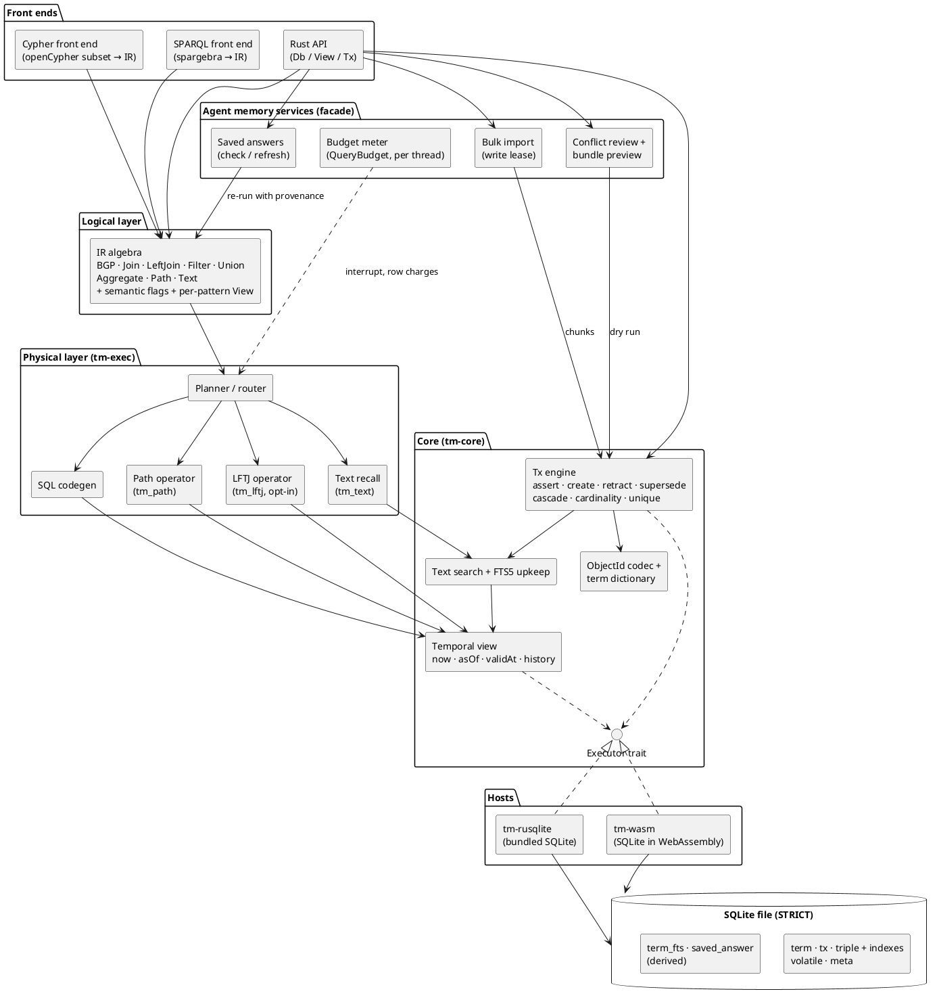
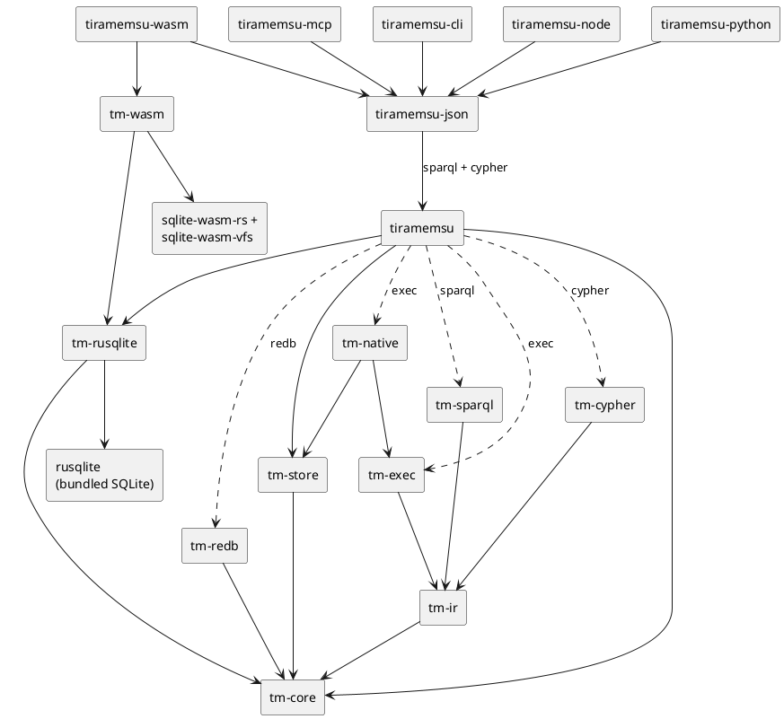
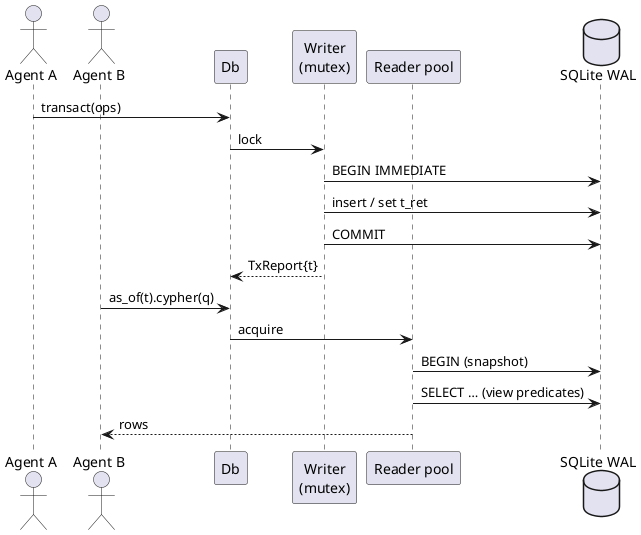
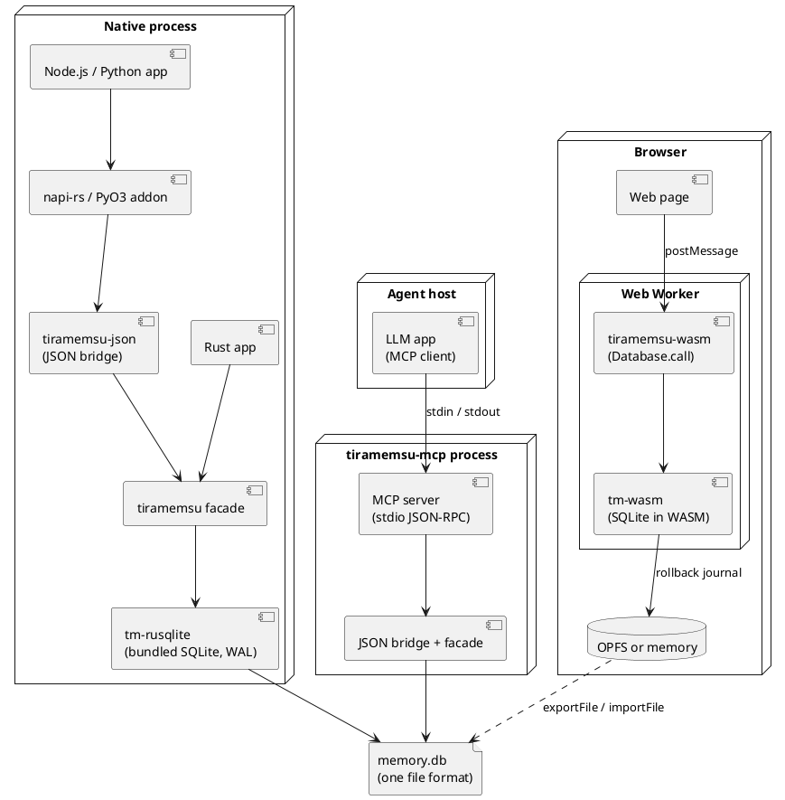

# Architecture

Tiramemsu is a stack of layers: two query front ends over one logical IR, a planner that routes to SQL or native operators, a temporal view layer, executor hosts, and one SQLite file.

It follows MillenniumDB's logical design (edge ids, tagged ObjectIds, permutation indexes, automaton paths) on top of SQLite's B-trees instead of custom storage. See [[prior-art#MillenniumDB]].

## Layers

Each layer depends only on the layer below it. Time is resolved in exactly one place, the view-aware scan in [[query#Views and Scans]].

The agent memory services of 0.3 sit beside the Rust API in the facade and reuse the lower layers instead of adding new storage paths: budgets meter every layer, saved answers re-run queries, review and preview run dry transactions, and text recall is one more native operator over the same views. The derived tables can always be rebuilt from the graph ([[storage#Format Versioning]]).

## Agent Memory Features

The ten features of 0.3.0 answer concrete agent needs. Each reuses the views, the tx engine and the executor; the table maps it to its entry points and to the section that explains how it works.

| Feature | Agent need | Entry points | How it works |
|---|---|---|---|
| Query budgets | A tool call must not hang the agent loop | `View::with_budget`, `Db::transact_budgeted`, `QueryBudget::run`; bridge `budget` and `cancel`; MCP server flags | [[query#Query Budgets]] |
| Bulk import | Load a large memory without re-analysing after every chunk | `Db::bulk_import`; bridge `importBegin` … `importFinish`; Node and Python `BulkImport` | [[query#Bulk Import]] |
| Text recall | Find memories by words, ranked by their evidence | `View::text_search`; SPARQL `tm:textMatch`; Cypher `CALL tiramemsu.text.search`; bridge `textSearch`; MCP `text_search` | [[query#Text Recall]], [[storage#Text Index]] |
| MCP adapter | Give an LLM app typed, auditable memory tools | `tiramemsu-mcp --db file` over stdio | [[api#MCP Tools]] |
| Saved answers | Know when a remembered answer can no longer be trusted | `Db::save_answer`, `check_saved_answers`, `refresh_answer`; bridge `saveAnswer` …; MCP `save_answer`, `check_answers` | [[query#Saved Answers]], [[storage#Saved Answers]] |
| Temporal paths | Ask "could this have spread in time order" in a query | SPARQL `SERVICE <urn:tiramemsu:tm:timeRespecting…>` and `tm:arrival`; Cypher `MATCH TIME RESPECTING`; `PathArgs::time_respecting` | [[query#Temporal Path Syntax]], [[query#Physical Planning#Path Engine#Path Completeness]] |
| LFTJ operator | Cyclic patterns over skewed graphs without blow-up | `OpenOptions.planner.lftj`; `View::explain_sparql`, bridge `explainSparql` | [[query#Physical Planning#LFTJ]] |
| Conflict review and preview | See disagreement and the effect of an import before writing | `View::conflicts`, `Db::preview_bundle`; bridge `conflicts`, `previewBundle`; MCP `conflicts`, `preview_bundle` | [[query#Conflict Inspection]], [[data-model#Fact Bundles#Import Preview]] |
| Optional query frontends | Embed the store without parsers | facade cargo features `exec`, `sparql`, `cypher` | [[architecture#Crates#Cargo Features]] |
| WASM SQLite host | Run the same memory in a browser | `tm-wasm` `WasmHost`; `tiramemsu-wasm` `Database` in a Web Worker | [[architecture#WebAssembly Host]], [[bindings#WebAssembly]] |

Shared rules hold across them: every read runs in one snapshot and can be bounded by one budget; reviews and previews never write graph rows; derived state (`term_fts`, `saved_answer`) is never history and can be rebuilt or discarded; and an unsupported request fails with a typed error rather than degrading silently ([[api#Errors]]).

## Crates

The Rust workspace is split by layer so each front end compiles against the IR only, and the core never depends on a query language.

| Crate | Responsibility | Depends on |
|---|---|---|
| `tm-core` | ObjectId codec, term dictionary, SQLite schema and migrations, tx engine, views, event log, volatile table, predicate schema, the `Executor` trait, the budget meter, text search and its FTS5 upkeep, conflict inspection, bundles | nothing SQLite-specific ([[architecture#Executor]]) |
| `tm-store` | The typed storage traits `ReadStore`/`WriteStore`, the transaction engine and reads ported onto them, the in-memory reference store and the contract checks ([[architecture#Storage Backends]]) | `tm-core` |
| `tm-redb` | The second backend: the storage traits on one redb file, six live and three history permutations, exact predicate statistics, the text index, durability modes ([[storage#redb Layout]]) | `tm-core`, `redb` |
| `tm-native` | The native runner: the whole IR over the storage traits, with hybrid and worst-case-optimal joins ([[query#Native Runner]]) | `tm-exec`, `tm-store`, `tm-ir` |
| `tm-rusqlite` | The first executor host: `rusqlite` with bundled SQLite, UDF and virtual-table registration | `rusqlite` (bundled), `tm-core` |
| `tm-wasm` | The WebAssembly host: SQLite compiled to `wasm32-unknown-unknown`, memory or OPFS storage, verified journal mode, probed capabilities ([[architecture#WebAssembly Host]]) | `tm-rusqlite`, `rusqlite` → `sqlite-wasm-rs`, `sqlite-wasm-vfs` |
| `tm-ir` | Logical algebra, semantic flags, view descriptors | `tm-core` (ids, views) |
| `tm-exec` | Planner/router, SQL codegen, path operator, the table functions `tm_path`, `tm_text` and the opt-in `tm_lftj` | `tm-ir`, `tm-core` |
| `tm-sparql` | SPARQL 1.1 (+1.2 annotations) → IR, results as SPARQL JSON/terms | `spargebra`, `tm-ir` |
| `tm-cypher` | openCypher subset + extensions → IR, results as Cypher values | a Cypher parser, `tm-ir` |
| `tm-n3` | N3 reasoning with eyeron over facts handed to it: term mapping, rule analysis and pruning sets, the pointwise valid-time sweep, proofs and support keys; never touches a store ([[reasoning]]) | `tm-core`, `eyeron` (crates.io, `default-features = false`) |
| `tm-datalog` | Datalog over a store's views: parser, analysis, interval sets with DatalogMTL and Allen relations, magic-set goals, probe-or-load stored access, semi-naive evaluation, proofs and constraint checks; reads through `ReadStore` and never writes ([[datalog]]) | `tm-core`, `tm-store` (publishable) |
| `tm-elpi` | ELPI (λProlog) over a store's views through lean-elpi: the prelude, term mapping, host builtins `tm.triple`/`tm.added`/`tm.retracted`/`tm.valid`, queries, checks and conclusions with stated support; reads through `ReadStore` and never writes ([[elpi#Engine And Persistence Crates]]) | `tm-core`, `tm-store`, `leanelpi` (feature `native`, links libleanelpi) |
| `tm-elpi-store` | ELPI persistence: `elpi:source` program nodes with includes, enforcement and the commit hook, materialization plans; writes through the transaction handle only ([[elpi#Engine And Persistence Crates]]) | `tm-elpi`, `tm-core`, `tm-store` |
| `tiramemsu` | Facade: `Db`, `View`, `Tx`, results, reader pool, budgets, bulk import, saved answers, conflict review and previews; the only crate bindings use | `tm-core`, `tm-rusqlite`; the others behind cargo features ([[architecture#Crates#Cargo Features]]) |
| `tiramemsu-json` (`bindings/json`) | The JSON bridge: one `Database` with `call(op, args)`, shared by every binding ([[bindings#JSON Bridge]]) | `tiramemsu` with `sparql` and `cypher` |
| `tiramemsu-mcp` | Local stdio MCP server with typed memory tools ([[api#MCP Tools]]) | `tiramemsu-json`, `tiramemsu` |
| `tiramemsu-cli` | The `tm` binary: create, inspect, query, import, export, convert and compact files on either backend ([[api#CLI]]) | `tiramemsu` with `redb`, `tiramemsu-json`, `clap`, `oxttl` |

Bindings (PyO3, napi-rs, WASM in `bindings/wasm`, MCP server) are separate crates on top of `tiramemsu`. The MCP server `tiramemsu-mcp` is a workspace crate under `crates/` built on the JSON bridge, so protocol code stays out of `tm-core` and the facade. See [[api#Bindings]].

`tm-core` has no normal dependency on any SQLite crate: `tm-rusqlite` appears only among its dev-dependencies, for tests. Front ends depend on `tm-ir` and `tm-core`, never on each other or on `tm-exec`; the facade wires them together.

Dotted edges are optional facade features; `sparql` and `cypher` each imply `exec`. `tm-exec`, `tm-sparql`, `tm-cypher` and `tm-wasm` also depend on `tm-core` directly; those edges are left out for clarity.

### Cargo Features

The facade's query engine and front ends are optional dependencies (`add-optional-query-frontends`): `default-features = false` links no IR, planner or parser, and the default build is unchanged.

| Feature | Facade surface | Adds to the dependency tree |
|---|---|---|
| none | `Db`, transactions, speculation, views and `triples`, dependents, bundles and their JSON and N-Triples forms, previews, conflicts, text recall, bulk import, budgets | `tm-core`, `tm-rusqlite` |
| `exec` | `execute_ir`, `explain_ir`, `View::path*`, LFTJ, the `ir` module and the engine open options; the native runner for redb files | `tm-ir`, `tm-exec`, `tm-native` |
| `sparql` | `View::sparql*`, `SparqlResult`, `Solutions`; implies `exec` | `tm-sparql`, `spargebra`, `peg` |
| `cypher` | `View::cypher`, `Db::cypher_write*`, `TxCypher`; implies `exec` | `tm-cypher`, `open-cypher` |
| `redb` | `Backend::Redb`: create, open and convert redb files; queries on them need `exec` | `tm-redb`, `redb` |
| `n3` | `View::reason`, `View::rule_set_info`, `TxN3::store_rules`, `Db::materialize`; off by default, independent of `exec` ([[reasoning#Optional Crate]]) | `tm-n3`, `eyeron` |
| `datalog` | `View::datalog`, `View::datalog_reason`, `View::check`, `View::program_info`, `View::explain_datalog`, `TxDatalog::store_program`; off by default, independent of `exec`, no git dependency ([[datalog#Own Kernel Over ReadStore]]) | `tm-datalog` |
| `elpi` | `View::elpi`, `View::elpi_check`, `View::elpi_conclude`, `View::elpi_program_info`, `TxElpi`, `Db::materialize_elpi`; off by default, links the native libleanelpi found through `LEANELPI_DIST` ([[elpi#Native Library Distribution]]) | `tm-elpi`, `tm-elpi-store`, `leanelpi` |
| `default` | `sparql` + `cypher`, and saved answers, which store queries of both languages | all |

- **Serialisation is not parsing.** The RDF terms and the N-Triples writer moved from `tm-sparql` to [[crates/tm-core/src/rdf.rs#render]] and [[crates/tm-core/src/rdf.rs#write_ntriples]], which `tm-sparql` re-exports, so bundle N-Triples and JSON need no front end.
- **No engine without `exec`.** The facade's engine type is uninhabited and [[crates/tiramemsu/src/db.rs#open_engine]] installs nothing, so a core build behaves like `query_engine: false` with the options absent.
- **Disabled APIs are absent**, not runtime errors, and the file format does not depend on the features. The JSON bridge, the MCP server and the bindings enable `sparql` and `cypher` explicitly.
- **Compatibility.** Until 0.2 the `sparql` feature only switched the SPARQL side of the differential suite and `default-features = false` still built both front ends; the facade README documents the migration.
- **Checks.** `scripts/feature-matrix.sh` asserts each combination's `cargo tree -e normal`, checks and tests it, and hands one file between it and the default build; the CI `features` job runs it for core, exec, sparql, cypher, datalog, default and the bindings (n3 included) ([[tests#Optional Query Frontends]]).

## Executor

`tm-core` reaches SQLite through a small synchronous `Executor` trait, so the engine can run on any host with interactive transactions. Hosts: `rusqlite` with bundled SQLite, and `tm-wasm` on SQLite compiled to WebAssembly ([[architecture#WebAssembly Host]]).

The boundary was drawn before any code existed, because it cost little then and would have cost a lot later. oxilite, which started from an abstract executor, runs on five SQLite hosts ([[prior-art#oxilite]]).

- **Required of every host:** prepared statements with bound parameters, interactive transactions (`BEGIN IMMEDIATE` … `COMMIT`/`ROLLBACK`), savepoints, and a stable snapshot within a read transaction. The tx engine reads before it writes (idempotent assert, cascade, schema checks, dictionary lookup), so it needs all of them.
- **Capabilities** (declared by the host): `reader_pool` (otherwise the reader is the writer, as on WASM), `functions` (scalar UDFs), `vtab` (virtual tables: `tm_path`, `tm_text` and `rarray`), `stat4`, `fts5` (text recall and its derived index, [[storage#Text Index]]; without it only recall fails, with `MissingCapability`).
- **Tiers:** `tm-core` needs only the required set, so a minimal host can run transactions, views, the event log and `View::triples`. `tm-exec` (SPARQL, Cypher, paths) also needs `functions` and `vtab`, and refuses to open on a host without them rather than degrading silently. A facade built without the `exec` feature is the `tm-core` tier at compile time ([[architecture#Crates#Cargo Features]]).
- **Hosts considered:** `rusqlite` (v1, all capabilities); SQLite compiled to WASM (`tm-wasm`: `functions`, `vtab` and `fts5`, no `stat4`, no `reader_pool`, probed at runtime); Cloudflare Durable Objects SQLite, which has interactive transactions through `transactionSync` but no user functions or virtual tables, so it gets the `tm-core` tier only; Turso, capabilities to be verified. Cloudflare D1 is out of scope: it has no interactive transactions (see oxilite's D5).
- `tm-exec` checks the capabilities in [[crates/tm-exec/src/host.rs#check_capabilities]] and registers its SQL functions and native operators through the executor's `registry()` hook (`HostRegistry` in `tm-core`); the `rusqlite` glue stays in `tm-rusqlite`.
- Host-specific details, such as `prepare_cached`, `Connection::from_handle` inside a virtual table, and `rarray`, stay inside the host crate.
- **Interruption** is optional: `Executor::set_interrupt` hands a host the stop conditions of a budgeted operation. The `rusqlite` host maps them to SQLite's progress handler; the default ignores them, and then only the engine's own checks stop work ([[query#Query Budgets]]).

## Connections and Concurrency

One writer connection behind a mutex and a pool of reader connections, all on one WAL-mode SQLite file.

- **Writer:** every transaction, speculative `with`, and schema change goes through the single writer. Transactions are serialised, which gives MERGE and `sys:unique` checks their atomicity. See [[time-model#Operations]].
- **Constraint checks:** with the feature `datalog`, the constraints of enforced Datalog programs are checked inside the writer, after the transaction's body and before its commit, seeded by the rows it added and retracted and bounded by `OpenOptions::constraint_budget` ([[datalog#Warn And Error Constraints]], [[crates/tiramemsu/src/datalog_enforce.rs]]). Bulk-import chunks and `with` speculations are checked too.
- **Import lease:** a bulk import session holds an exclusive write lease between its chunks; other writes fail with `ImportInProgress` instead of interleaving, and readers carry on ([[query#Bulk Import]]).
- **Readers:** each query takes a reader connection and runs inside one read transaction, so it sees a consistent WAL snapshot.
- **Bounded acquisition:** waiting for a reader is unbounded by default; `OpenOptions::reader_timeout` or a per-operation budget turns a long wait into `PoolTimeout`, and a deadline or cancellation also ends it ([[query#Query Budgets]]).
- **Recovery:** returned errors, failed read commits, and unwinding callbacks roll back active snapshots. A pooled executor is returned before the original panic is resumed, so caught panics do not reduce reader capacity.
- **Historical reads** never conflict with writes: rows are only ever appended or have `t_ret` set once, and `asOf(t)` for `t` ≤ the last committed tx is stable forever. See [[time-model#Never Forget]].
- The `tx` counter is read and incremented inside the writer transaction, so `t` is gap-free and strictly increasing.

## WebAssembly Host

`tm-wasm` runs the engine on SQLite compiled to `wasm32-unknown-unknown` inside a Web Worker, with the database in memory or in OPFS, in the native file format (`add-wasm-sqlite-host`).

- **Runtime choice.** `rusqlite` 0.40 links [`sqlite-wasm-rs`](https://crates.io/crates/sqlite-wasm-rs) on that target (SQLite 3.53 compiled to WASM, VFSes in Rust), so the host reuses the `RusqliteExec` of `tm-rusqlite` for statements, savepoints, registration and interrupts. [[crates/tm-wasm/src/lib.rs#WasmHost]] adds storage, the journal policy and the probe. Calls are synchronous, hence the worker.
- **Storage.** `Storage::Memory` (`memvfs`, any context, volatile), `Storage::Opfs` (the sync-access-handle pool of `sqlite-wasm-vfs`, dedicated worker, installed with `install_opfs`), and `Storage::File`, the native file VFS for tests. A storage the target lacks is `Unsupported`.
- **Probed capabilities** ([[crates/tm-wasm/src/probe.rs#probe_capabilities]]): each is established by running it on a scratch connection. In WebAssembly `functions`, `vtab` and `fts5` hold, so the whole query engine runs; `stat4` is not compiled in and `reader_pool` is never declared (`THREADSAFE=0`, no shared memory). `limit_capabilities` narrows the set, and the facade then refuses the engine with `MissingCapability`.
- **Journal contract.** Neither VFS has shared memory, so SQLite answers `journal_mode = WAL` with `delete`. The host reads the mode the runtime reports at open and fails with `MissingCapability` under `Journal::Wal`; `Journal::Rollback` is the explicit opt-in. [[crates/tm-wasm/src/lib.rs#WasmExec]] keeps the engine's WAL switch from changing the verified mode. The file format is identical, a hot journal is rolled back on open, and a native host switches the file back to WAL.
- **Interchange.** `export_file` and `import_file` move committed bytes; a closed native `Db` leaves no `-wal` (the readers close before the writer), so its main file is complete.
- **Limits.** `std::time::Instant` and `SystemTime` are missing on the target: `WasmClock` supplies `Date.now()`, and budgets and bulk import sessions are refused by the binding. SPARQL needs `--cfg getrandom_backend="wasm_js"` (in `.cargo/config.toml`). The OPFS tests snapshot storage during an open write; a worker killed mid-write on OPFS is not exercised.

## Store Abstraction

A Lean 4 model of the storage contract the engine relies on, in `lean/Tiramemsu/Store/`. It states, in one place, what a scan, a point read and a write must do, independent of SQLite.

The model is a Lake project (`lean/lakefile.toml`); `lake build` in `lean/` builds the pure part, and CI runs it. It contains definitions, not yet theorems: it is the shared vocabulary future proofs and refinement tests will be stated in.

### Interface

Three classes: `ReadStore` (ordered range scans with early exit, point reads of triples and terms), `WriteStore` (inserts and the once-only retraction) and `SnapshotStore` (read snapshots).

Writes check their violation first and return it in `Except`, leaving the state unchanged, as SQLite's statement-level abort does.

### Model Store

`ModelStore` is the pure implementation: one list of rows per table, scans that filter by the scan predicate and sort by the family key. Every later theorem is meant to be stated over it.

### Index Families

The nine scan families (`liveSpo`, `livePos`, `liveOsp`, the three `hist*`, `validP`, `logAdd`, `logRet`) with their key columns and order, mirroring the SQLite index definitions.

Keys append the rowid (`eid`), values compare as signed 64-bit integers, an absent value sorts first (SQLite NULL order), and the descending `t_add` of the history indexes is stored negated. See [[storage#Query Shapes]].

## Storage Backends

A second storage path beside SQLite: the typed traits of `tm-store`, one transaction engine over them, and backends that implement them. Decisions D37–D44 are in [[backends]].

`ReadStore` (one snapshot) and `WriteStore` (one write transaction that reads its own writes) live in `tm_core::store` so that every crate can name them; they take ObjectId integers and plain rows, never SQL ([[crates/tm-core/src/store.rs#ReadStore]], [[crates/tm-core/src/store.rs#WriteStore]]). Their operations are the access shapes the engine needs:

- point reads of a statement, a term (by id or key), a transaction instant, a meta counter, a volatile value, an embedding;
- prefix scans over live or all statements with any bound positions (`Pattern`, `Scope`), in permutation order or eid order;
- the log (`added_since`, `retracted_since`), `pred_multi`, and the text-index postings;
- appends, the single retraction, the volatile upsert and delete. Nothing deletes or rewrites a statement, term or transaction, so never-forget holds by construction instead of by triggers ([[time-model#Never Forget]]).

A `Backend` hands out snapshot readers and one writer; a `WriteTxn` commits or aborts. Rows hold the same integers as the SQLite file of the same history, which is what makes conversion lossless and differential tests exact.

### Trait Engine

`tm_store::Engine` and `tm_store::Tx` are a statement-by-statement port of the `tm-core` engine, with the same errors and reports ([[crates/tm-store/src/engine/mod.rs#Engine]]).

It covers idempotent assert, create, confirm, cardinality and uniqueness, schema flags, cascade, supersede with dropped memberships, graphs, volatile state, bundles, embeddings and text upkeep.

Speculation and dry runs abort their write transaction and then store the advanced id counters in a second one, so a backend needs no nested savepoints. Reads (views, `triples`, `values`, `events_since`, `dependents`, graphs, bundles, conflict inspection, evidence) are in `tm_store::read`, `conflict` and `evidence`; bundle export shares its algorithm with SQL through `tm_core::BundleSource`.

Until `move-sqlite-onto-store`, the SQLite engine is the oracle: a property test runs random histories on both engines and requires identical reports, errors, rows, terms, counters, event logs, graphs, bundles, conflicts and views ([[crates/tm-store/tests/oracle.rs#random_histories_agree]]).

### Write Handle

A transaction body receives `tm_core::TxHandle`, exported by the facade as `Tx`: the same write API on every backend ([[crates/tm-core/src/handle.rs#TxHandle]]).

Each engine's `Tx` implements the object-safe `TxOps` mirror of its write methods, so the handle erases which engine runs the transaction, and the SPARQL Update and Cypher write paths take the handle rather than the SQL engine's `Tx`. `TxHandle::read_with` reaches the SQL connection of a SQLite transaction and `TxHandle::read_store` the storage-trait state of a redb one. Positions are `IntoObject` values (ids, eids, transaction ids or values).

### Reference Store

`tm_store::mem::MemStore` keeps ordered maps behind one lock: the executable statement of the contract and the fast backend of property tests. A reader holds an `Arc` of the committed state; a writer copies it and swaps it in on commit.

`tm_store::contract` holds the contract as checks any backend runs against itself (scans by every bound subset, eid order, scopes, refused duplicates and second retractions, engine behaviour, snapshot isolation).

### Text Tokeniser

The trait engine indexes string objects itself, with a tokeniser that follows FTS5's `unicode61 remove_diacritics 2`: letter, number and private-use runs, lower-cased, with diacritics removed from Latin letters only ([[crates/tm-store/src/text.rs#tokens]]).

## SQLite Boundary

`lean/Tiramemsu/Sqlite/Conn.lean` connects the store interface to SQLite through leansqlite: writer and reader connections configured like the Rust build, prepared statements, transactions, savepoints and snapshots.

It imports `SQLite.LowLevel` from leansqlite, an external package, so it is not a default build target; `lean/lakefile.toml` shows how to add the dependency.

## Deployment

The engine is a library linked into the host process; there is no server. Four ways in, one executor contract and one file format, so the same file moves between native and browser hosts ([[architecture#Executor]]).

- **Rust:** an application links `tiramemsu` and calls `Db`, `View` and `Tx` directly; cargo features choose how much of the query engine is linked ([[architecture#Crates#Cargo Features]]).
- **Node.js and Python:** the native addons call the JSON bridge in-process; values cross as JSON text ([[bindings]]).
- **Agents over MCP:** an MCP client starts `tiramemsu-mcp` as a child process and talks JSON-RPC over stdio; the server owns the file ([[api#MCP Tools]]).
- **Browser:** a page posts messages to a Web Worker that runs `tiramemsu-wasm` on `tm-wasm`, with the database in memory or OPFS and a rollback journal ([[architecture#WebAssembly Host]]).

## Project Website

A static site in `site/` (a home page and articles) is published to GitHub Pages by `.github/workflows/pages.yml` on pushes to `main` that touch `site/`. There is no build step.

The custom domain is `tiramemsu.com`, set in the repository's Pages settings (the workflow deploy ignores a `CNAME` file). Its DNS records at Cloudflare must be DNS-only (grey cloud): four apex A records to GitHub's Pages IPs `185.199.108.153` to `185.199.111.153`, and `www` as a CNAME to `volland.github.io`. A proxied (orange cloud) record stops GitHub issuing the HTTPS certificate and serves "Site not found", and would also make Cloudflare a data processor that `datenschutz.html` does not name.

The pages are plain HTML with one stylesheet (`site/style.css`), light and dark palettes, and no scripts, trackers or external fonts. Links are relative, so the site works under a project path. `site/assets/` holds the icon `logo.svg` (a brain taking a bite out of a tiramisu whose layers are a graph), `layers.svg` and `architecture.svg`, which the `README.md` also uses.

- **Tone:** the slogan is "Your agent's brain loves Tiramemsu" (home page hero and `README.md`). The "What agents are saying" quotes are openly invented, say so in their intro, and each must describe a feature that exists, so a removed feature means removing its quote.
- **Legal pages:** `impressum.html`, `datenschutz.html` and `agb.html` are German, carry the operator's name, address and e-mail, and are linked from every page footer. The privacy text says the site sets no cookies and loads nothing external, and names GitHub Pages as the host that logs IP addresses, so adding a script, font, tracker or form means revising `datenschutz.html` first. They are a good-faith draft, not legal advice.
- **Articles:** `layered-graphs.html` explains statement ids and layers with queries taken from the test suite. `time-travel.html` explains the two clocks with a worked example whose queries mirror `lat.md/query#Temporal Syntax` and `crates/tiramemsu/tests/cypher_temporal.rs`, so a change to the temporal syntax or the view semantics should be reflected there. `metagraphs.html` explains edges as vertices and vertices and edges as containers, with queries from [[recipes#Metagraphs]] and the test `metagraph_containers_nesting_and_fold`, so a change to graph names, supersede or the dual view should be reflected there. `tiramemsu-vs-oxilite.html` compares the two databases and quotes the benchmark in `bench/eid-vs-reifier/`. Their numbers come from `bench/`, [[prior-art#oxilite]] and the status table, so a change to those should be reflected there. `statement-graphs.html` compares tiramemsu with Statement Graphs (Gelling, Fletcher and Schmidt), the formalization of [[prior-art#Neptune OneGraph]], and argues for the single-record statement; its claims come from [[data-model]], [[time-model#Cascade]] and the same benchmark. `vector-memory.html` and `vector-cookbook.html` explain vector recall and give samples for every surface; the cookbook's Cypher, SPARQL and Python samples were run against the published 0.6.0 package, and its rules follow [[query#Vector Recall#Writes From Query Languages]], so a change there should be reflected in both. `two-engines.html`, `wcoj-on-kv.html` and `making-redb-faster.html` are built from `article/redb-backend/` by its `build-site.py` and quote `bench/backends/results-*.json`, so a rerun of that benchmark should be reflected in all three.
- **Benchmarks page:** `benchmarks.html` (in the nav) shows the backend benchmark as tables at both scales, with CSS-only tabs and the fastest engine of each row marked. It is generated from `bench/backends/results-*.json` by `bench/backends/build-site.py`, so a rerun of that benchmark means running the script again; the home page's "Speed" card quotes the same files.
- **Papers:** `site/paper/` lists the three preprints ([[paper]], [[overview#Formal Model]]), one page each, and the nav entry is "Papers". Plain-language companions: `articles/grounded-memory.html` (layered bitemporal graphs; with its page it says 0.4.0 ships the repairs), `articles/exact-metagraph-encodings.html` (metagraph encodings) and `articles/statement-store-export.html` (export boundaries). `articles/three-papers.html` follows one example through all three. `metagraphs.html` and `statement-graphs.html` link to the paper that formalizes them.
- **Home page order:** hero, "What makes it different" (six differentiators, a comparison with typical vector stores and graph databases, and a time-travel recall snippet run against the Python package), "Suggested use cases" (nine cards, each naming the features it uses and linking to an article), feature sets (Remember, Time travel, Reason, Recall, Query, For agents and operations, Run anywhere), the feature matrix, quotes, layers, architecture, quick start (followed by a "Recall by meaning" snippet run against the Python package and the MCP setup), numbers with known limits, papers and six "Read next" articles. Comparison cells describe common defaults, not named products.
- **N3 book:** `site/n3/` is a nine-chapter book on reasoning with N3 in tiramemsu ([[reasoning]]), linked from the nav as "N3 book", the Reason feature set and the articles index. Its API names follow `crates/tm-n3`, `crates/tiramemsu/src/n3.rs` and `n3_materialize.rs`, its CLI usage `tm reason --help`, and its recipes were checked against eyeron, so a change to any of those should be reflected there.
- **ELPI preview:** `site/elpi/` (the guide, from `docs/elpi.md`), `articles/elpi-reasoning.html` and `articles/elpi-validators.html` (from `article/elpi/` and `article/elpi-validators/`) describe ELPI support, which is merged into `main` but not yet in a released version. Each page carries a "Preview" banner and each card a `preview` tag, and the nav links "ELPI" beside "Datalog"; drop the banners when ELPI ships.
- **No release notes on the site:** the pages describe features and use cases, not versions; release history lives in `CHANGELOG.md`. Version strings belong only where a sample was run against a specific package.
- **Feature matrix:** rows are features, columns are the surfaces (Rust, Python, Node.js, browser, MCP) and the engines (SQLite, redb). Python, Node.js and the browser share the JSON bridge, so their cells match except where `bindings/wasm/README.md` refuses an operation; the MCP column follows the tools in `crates/tiramemsu-mcp/src/tools.rs`; the redb column follows the "Not done" and unsupported notes in `CHANGELOG.md`. A change to any of those should be reflected there.
- **Articles index:** `articles/index.html` groups the articles by topic (Start here, Recall, Agents and use cases, Structure, Engines and performance, Research), not by release.
- **Quick start:** the home page shows the same story in Python, Node.js and Rust, as CSS-only tabs (radio inputs, no script). The Rust tab and the README snippet are trimmed from `crates/tiramemsu/examples/quickstart.rs`, which `cargo clippy --all-targets` compiles. The Python and Node.js tabs were run against the built packages, so a change to either binding's API means re-running them and updating the tabs.

## Long-Read Article

`article/` holds a Substack long read about tiramemsu with its illustrations, separate from the site. It quotes the status table, the recipes and the benchmarks, so a change to those should be reflected there.

`tiramemsu-long-read.md` is the source; `preview.html` is a self-contained copy for pasting into the Substack editor, rebuilt by `build-preview.sh` with pandoc. The illustrations are SVGs in `images/src/`, rendered to 1456 px PNGs, because Substack takes no SVG. The article avoids tables, which Substack cannot show, and `article/README.md` lists the title, captions and publishing steps.

### CTEG Article

`article/cteg/` holds a second article, on causal-temporal event graphs (Foldvik, arXiv 2604.17557) built on statements, published on Substack and as `site/articles/causal-temporal-event-graphs.html`.

Its working example is the sanitized trace of the Claude Code session that wrote it (`code/trace.json`, made by `code/extract-trace.py`). `code/cteg-demo.mjs` loads that trace through the Node binding and runs every SPARQL query the article quotes, writing `code/queries.out.txt`; `code/gen-figures.py` draws the data figures from the same trace. The queries use reifiers, `tm:validFrom`, `tm:addedAt`, `validAt`, `asOf` and `SERVICE <urn:tiramemsu:tm:timeRespecting>` ([[query#Temporal Syntax]], [[query#Temporal Path Syntax]]), so a change there means re-running the demo and updating the article. With `RECORDER=sparql` the demo records the trace through SPARQL valid-time writes ([[query#Front Ends#SPARQL#Valid Time Writes]]), and it reads transactions in Cypher ([[query#Front Ends#Cypher#Statement Ids And Transactions]]). `build-site.py` rebuilds the site page and copies its SVGs to `site/assets/cteg/`.

### Datalog Article

`article/datalog/` holds a third long read, on temporal Datalog and its materialization ([[datalog]]), published on Substack and as `site/articles/datalog-temporal-reasoning.html`.

The guide `docs/datalog.md` (language, time, constraints, materialization, goal calls) is rendered to `site/datalog/index.html` by `article/datalog/build-guide.py`.

### Integration And Engine Articles

`article/n3-integration/` and `article/datalog-engine/` hold two more long reads: how eyeron is integrated ([[reasoning]]) and how the Datalog engine was built ([[datalog]]), published as `site/articles/n3-reasoner-integration.html` and `building-the-datalog-engine.html`.

Its programs come from the tests `crates/tiramemsu/tests/datalog.rs`, `datalog_constraints.rs` and `datalog_materialization.rs`, and its numbers from `bench/datalog/README.md`, so a change to those, or to the status of incremental runs (decision DL22, not built), should be reflected there. `build-site.py` rebuilds the page.

### ELPI Article

`article/elpi/` holds a long read on adding ELPI as a third reasoning language ([[elpi]]), published as `site/articles/elpi-reasoning.html` by its `build-site.py`.

The guide `docs/elpi.md` (builtins, terms, time, constraints, stored programs, materialization, goal calls, surfaces, errors, limits) is rendered to `site/elpi/index.html` by `article/elpi/build-guide.py`. `article/elpi-validators/` holds the hands-on companion, *Validators that ask "what if"* (`site/articles/elpi-validators.html`): `=>`, policies as predicates, `pi`, a commit guard and materialization, each program a test named `article_*` in `crates/tiramemsu/tests/elpi.rs`. Until ELPI is released all three pages carry a "Preview" banner and their cards a `preview` tag, and they are live on the site ahead of the code. Its examples come from `crates/tiramemsu/tests/elpi.rs` and `elpi_calls.rs`, so a change to the builtins or the prelude should be reflected there. The site's nav links the ELPI guide beside the Datalog guide on every page, the home page has an ELPI group and matrix rows (Rust, MCP and both engines only), and the articles index lists both under Reasoning.
## Crate Documentation and Publishing

Each crate's `README.md` is its crates.io page and, through `#![doc = include_str!("../README.md")]`, its crate-level rustdoc, so every Rust block in it is a doctest.

- **Links** in READMEs are absolute `https://github.com/Volland/tiramemsu/...` URLs, because relative ones break on crates.io and docs.rs. Diagrams are ASCII, since crates.io does not render Mermaid; the repository README uses Mermaid.
- **Metadata** is inherited from `[workspace.package]`: version, licence, repository, keywords, categories and `rust-version = "1.88"`, the minimum that `open-cypher` needs. Workspace path dependencies carry the workspace version (`version = "0.9.0"`) so the crates can be published. eyeron is a registry dependency, so `tm-n3` and the crates that enable it can be published ([[constraints#Publishable Crates]]); 0.9.0 and 0.10.0 published only the crates below the facade, before eyeron was on crates.io, and 0.11.0 publishes all of them. Each crate directory holds copies of both licence files.
- **Package size:** `tm-sparql` and `tm-cypher` exclude their W3C and openCypher TCK test data from the published package.
- **Publish order** follows the dependencies, and `cargo publish --workspace` works it out: `tm-core`, `tm-ir`, `tm-rusqlite`, `tm-store`, `tm-redb`, `tm-exec`, `tm-native`, `tm-sparql`, `tm-cypher`, `tm-n3`, `tm-datalog`, `tiramemsu`, `tm-wasm`, then `tiramemsu-json`, `tm-bench`, `tiramemsu-mcp` and `tiramemsu-cli`. The Node, Python and WebAssembly binding crates are not published to crates.io, nor is `bench/backends` (its own workspace).
- **Core stays SQLite-free:** doctests inside `tm-core/src` may not spell `tm_rusqlite::`, because a test greps that source for `rusqlite::` (see [[architecture#Executor]]). They use an import alias, and the README, which is not scanned, uses the normal form.
- **Checks:** `RUSTDOCFLAGS='-D warnings' cargo doc --workspace --no-deps` and `cargo test --workspace --doc` must pass.
- **Reduced builds:** the facade includes its README as crate docs only when both front ends are enabled, since the tour uses them; other combinations get a short feature summary, and doctests on core items use only the core API ([[architecture#Crates#Cargo Features]]).
