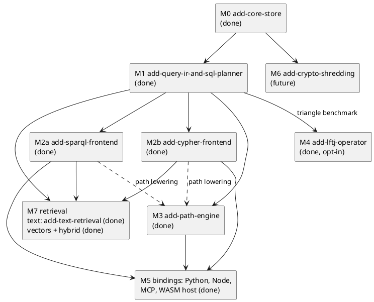

# Roadmap

Milestones in dependency order. Each is an OpenSpec change under `openspec/changes/` with a proposal, specs, a design and tasks.

## Milestones

The core comes first. After the IR lands, the two front ends and the path engine can proceed in parallel.

| Milestone | OpenSpec change | Delivers | Depends on |
|---|---|---|---|
| M0 | `add-core-store` | `tm-core` + `tm-rusqlite` + `tiramemsu` facade: executor trait, ObjectId, terms, schema + triggers, tx engine, views, event log, `with`, volatile, predicate schema, planner statistics | — |
| M1 | `add-query-ir-and-sql-planner` | `tm-ir`, `tm-exec`: IR, views and scans, virtual predicates, SQL codegen, decoding, plan tests on skewed data | M0 |
| M2a | `add-sparql-frontend` | `tm-sparql`: SPARQL 1.1 subset + 1.2 annotations + time IRIs | M1 |
| M2b | `add-cypher-frontend` | `tm-cypher`: openCypher subset + dual view + time clauses + differential suite | M1 |
| M3 | `add-path-engine` | Native path operator, `tm_path` table function, SPARQL/Cypher path lowering | M1 (M2 for lowering) |
| M4 | `add-lftj-operator` (implemented, opt-in) | Leapfrog triejoin for pure cyclic patterns as `tm_lftj`, with routing reasons in explain ([[query#Physical Planning#LFTJ]]) | M1, benchmark evidence |
| M5 | bindings: Python, Node, `add-mcp-adapter` and `add-wasm-sqlite-host` done | Python, Node and WASM over the JSON bridge, the `tiramemsu-mcp` stdio server ([[api#MCP Tools]]), the WebAssembly host ([[architecture#WebAssembly Host]]) | M0–M3 |
| M6 | future: `add-crypto-shredding` | `sys:sensitive`, `SEALED` terms, `seal_key`, erase transaction. See [[time-model#Erasure]] | M0 |
| M7 | `add-text-retrieval`, `add-vector-recall`, `add-hybrid-recall` (implemented, archived) | FTS5 over string terms (`term_fts`, format 2) with evidence ranking ([[query#Text Recall]]); exact, view-aware vector recall over the append-only `embedding` table of format 5 ([[query#Vector Recall]]); and their fusion ([[query#Hybrid Recall]]), from Rust, SPARQL, Cypher, the bridge, MCP and the bindings | M1, M2 |

Six smaller changes built on M0–M3 add the layer features of [[recipes]]: `add-statement-instants`, `add-typed-layers`, `add-query-provenance`, `add-fact-bundles`, `add-graph-scoped-paths` and `add-time-respecting-paths` (all archived). `add-query-budgets` adds opt-in deadlines, cancellation, reader timeouts and result limits ([[query#Query Budgets]]). `add-bulk-import` adds import sessions with deferred statistics ([[query#Bulk Import]]). `add-text-retrieval` adds opt-in text recall with evidence ranking over a derived FTS5 index introduced by format 2 ([[query#Text Recall]], [[storage#Text Index]]). `add-mcp-adapter` adds the opt-in `tiramemsu-mcp` crate, a local stdio MCP server with typed memory tools, read-only mode, budgets and provenance coverage ([[api#MCP Tools]]). `add-saved-answer-invalidation` adds saved answers with conservative event-driven invalidation in the derived tables of format 3 ([[query#Saved Answers]], [[storage#Saved Answers]]). `add-temporal-path-syntax` adds the SPARQL `SERVICE <tm:timeRespecting…>` scope with `tm:arrival`, the Cypher `MATCH TIME RESPECTING` modifier and path completeness reporting ([[query#Temporal Path Syntax]]). `add-lftj-operator` adds the opt-in native cyclic-join operator with conservative routing and explain reasons ([[query#Physical Planning#LFTJ]]). `add-memory-conflict-review` adds read-only conflict inspection with attributed evidence and noncommitting bundle import previews ([[query#Conflict Inspection]], [[data-model#Fact Bundles#Import Preview]]). `add-optional-query-frontends` makes the query engine and both front ends optional cargo features of the facade, with a core-only build that links no parser and a CI feature matrix ([[architecture#Crates#Cargo Features]]). `add-wasm-sqlite-host` adds `tm-wasm`, a host on SQLite compiled to WebAssembly with memory and OPFS storage and capabilities probed at open ([[architecture#WebAssembly Host]]). All ten are archived (2026-10-04). `reserve-replica-id` is decided and implemented: it reserves 12 origin bits in allocated ids so that agent memories can merge later ([[data-model#ObjectId#Origin Bits]]); merging itself is future work.

M7 exists because recall by text or embedding, not by graph pattern, is how agents usually query their memory. Ranking by support is part of it: a hit can be ordered by its confidence layers, its `sys:confirmedBy` count, the number of distinct transaction authors behind it and its `tm:addedAt`, all of which the store already holds ([[recipes]]). oxilite's design (index definitions stored as data, tables kept current by triggers, one k-NN statement per query) is the template ([[prior-art#oxilite]]).

Status as of 0.4.0: M0–M5 are done, M4 as an opt-in operator; M7 had its text half done and M6 was future work. 0.5.0 completes M7 with vector and hybrid recall (storage format 5). 0.4.0 adds the conformance repairs of [[overview#Formal Model]] and storage format 4.

The releases after 0.4.0 are proposed in `docs/feature-roadmap.md` (see [[project-review#Second Review]]): hardening, evidence at scale, the vector half of M7 and hybrid recall (now implemented), Cypher temporal types, crypto-shredding (M6), memory merge over origin bits, and a 1.0 stability promise.

### Proposed Changes

Eleven OpenSpec proposals (2026-10-10) cover the releases after 0.4.0 in `docs/feature-roadmap.md`. Vector and hybrid recall are implemented and archived (`openspec/changes/archive/2026-10-11-*`); libSQL is deferred (2026-10-11); the rest are open.

Six more (2026-10-27) add the redb backend and its native runner ([[backends]]). Four more (2026-10-28) add Datalog ([[datalog]]).

| Release | Change | Delivers |
|---|---|---|
| 0.5 | `add-scale-benchmarks` | Scale ceiling (10⁷ statements, 1 000 versions per key), nightly benchmark gates, `Db::metrics()` |
| — | `add-libsql-host` (deferred) | An optional libSQL host that may later offer an approximate vector tier; not the vector path |
| 0.6 | `add-vector-recall` (M7, archived) | Models as `sys:` statements, append-only `embedding` table (format 5), exact view-aware `vector_search`, SPARQL and Cypher |
| 0.6 | `add-hybrid-recall` (archived) | Text and vector fusion by reciprocal rank, expansion to layers and subject facts, evidence ranking, SPARQL and Cypher forms |
| 0.6 | `add-derived-beliefs` | `Tx::derive` with support cascade, read-time salience |
| 0.7 | `add-cypher-temporal-types` | Cypher temporal values (1 064 TCK scenarios) |
| 0.7 | `add-interval-algebra` | Allen relations over valid time in SPARQL and Cypher |
| 0.7 | `fix-sparql-value-semantics` | Exact decimals, language-tag-preserving strings, zoned dates, `!p` paths |
| 0.8 | `add-crypto-shredding` (M6) | Sealed terms under per-subject keys and erase, per [[time-model#Erasure]] |
| 0.8 | `add-signed-bundles` | Ed25519-signed bundles with a trust policy |
| 0.9 | `add-memory-merge` | Merge across origins over the reserved origin bits ([[data-model#ObjectId#Origin Bits]]) |
| 0.8 | `add-store-trait` | Typed storage trait, the shared transaction engine over it, an in-memory reference store, the SQLite engine as oracle ([[backends#Typed Storage Trait]]) |
| 0.8 | `add-redb-backend` | redb storage with six live permutations, exact statistics, FTS5-compatible text index, detection, `Db::create`, `durability`, lossless `convert` ([[backends#Same Logical Database]]) |
| 0.8 | `add-native-runner` | `tm-native`: the whole IR over the storage trait with hybrid and worst-case-optimal joins ([[backends#Hybrid Join Engine]]) |
| 0.8 | `add-tm-cli` | The `tm` command-line tool ([[backends#Backend Detection and CLI]]) |
| 0.8 | `add-backend-benchmarks` | redb vs SQLite vs Oxigraph, with an honest strengths-and-weaknesses report and two articles |
| 0.9 | `move-sqlite-onto-store` | SQLite on the storage trait behind a 5 % regression gate ([[backends#One Engine In Two Phases]]) |
| — | `add-datalog-engine` | `tm-datalog`: semi-naive engine with DatalogMTL over valid time, magic-set goals, `warn` checks, every surface ([[datalog]]) |
| — | `add-datalog-constraints` | `error` constraints enforced at commit, seeded by the transaction's changes ([[datalog#Warn And Error Constraints]]) |
| — | `add-datalog-materialization` | Programs materialized through `derive`, reconciliation, incremental runs ([[datalog#Shared Materialization With Reconciliation]]) |
| — | `add-datalog-query-calls` | Datalog goals from SPARQL `SERVICE` and Cypher `CALL` ([[datalog#Goal Calls In SPARQL And Cypher]]) |

## Benchmarks

The benchmarks are tracked from M0 onwards. Targets will be fixed once the scale ceiling is known. See [[overview#Open Inputs]].

The ten follow-up changes from the 2026-10-03 review (budgets, bulk import, text retrieval, MCP, saved answers, temporal syntax, cyclic joins, conflict previews, optional frontends and the WASM host) are implemented and archived under `openspec/changes/archive/2026-10-04-*`, and shipped in 0.3.0.

- **Churn:** N updates per key (N = 1, 10, 100, 1000). As-of throughput should stay at ≥ 70 % of the no-history baseline, the bar set by CozoDB's measurements. See [[prior-art#CozoDB]].
- **Point and 2-hop latency** at 10⁶ and 10⁷ statements, for the now, asOf and validAt views. The SPARQL variant (`crates/tiramemsu/benches/sparql.rs`) runs the same shapes through `View::sparql`; `SPARQL_BENCH_STATEMENTS` sets the size (default 10⁵).
- **Triangles:** SQL nested loops versus the M4 threshold. This decided that LFTJ is built. See [[query#Physical Planning#LFTJ]]. First result (`bench/triangles/`): SQLite's plan matches an intersection join on a uniform graph (1.0×) but is 41× slower on a hub-and-spoke graph and 36–104× slower on layered graphs, growing with size. The threshold is met for skewed cyclic patterns, so M4 is justified for them. With M4 built, `cargo run --release -p tiramemsu --example triangles` compares both routes through tiramemsu on one file after checking equal counts; at the small scale the native route is 1.3× faster on a uniform graph, 12× on hub-and-spoke and 2–4× on layered graphs (results in `bench/triangles/README.md`).
- **Paths:** all-endpoints shortest path and 3-hop trail latency, reachability over a chain and a small world, all-shortest paths on a grid, and the `rarray` chunk size (`crates/tiramemsu/benches/path.rs`; `PATH_BENCH_STATEMENTS` sets the size, default 10⁵). Trail errors fail the benchmark. Recorded results are in `crates/tiramemsu/benches/README.md`.
- **Backends:** tiramemsu on SQLite (with and without LFTJ) and on redb against Oxigraph on RocksDB, through `crates/tm-bench` and `bench/backends/` (`tm bench` runs the SQLite-and-redb part). Every query is checked for equal results on every engine before it is timed, and a query that passes 60 s is recorded as a timeout. After the `tune-native-runner` change (2026-10-27), at 10⁵ statements redb wins every cyclic join (a skewed triangle 57× over SQLite's own plan and 1.5× over LFTJ), the Cypher 2-hop (6×), concurrent readers (3.1× at 16 threads), bulk load (2.5×), F1 (2.1×) and lookups in every view. It loses Cypher variable-length paths (about 2.5×), stars and aggregates with selective constants (1.4–1.8×, down from 2.1–3.8×) and size (3.5×). Oxigraph wins writes, load, size and 16-thread readers and loses joins. At 10⁶ a skewed triangle takes 21 ms on redb, 4.9 s on SQLite without LFTJ and 55 s on Oxigraph; F1 is 20 ms against SQLite's 23 ms (0.8.0: 83 ms); redb alone answers the skewed 4-cycle within the cap; a fresh bulk load leaves redb at 7.5× SQLite's size until `tm compact`. The change made C1 1.7×, F1 4.1× and the Cypher 2-hop 124× faster at 10⁶; a larger redb cache changed nothing. Report: `bench/backends/README.md`; decisions [[backends#Hybrid Join Engine]] and [[backends#Snapshot Readers]]. `cargo run --release -p tm-bench --example probe` keeps the loaded files and compares answers before timing, for tuning runs.
- **Datalog:** closures, demand goals, same-generation and a DatalogMTL run on SQLite and redb against N3 and Soufflé (`cargo run --release -p tm-bench --features datalog,n3 --example datalog`); results and gate verdicts in `bench/datalog/README.md` ([[datalog#Gates And Oracles]]). After [[changes#Tune Datalog Performance]] (2026-10-29) closures are 2.5–4× faster (1.0–1.4× Soufflé's interpreter) and `datalog_reason` on the hub 11× faster, so both proposed gates are met; the benchmark prints evaluation and result time apart.
- **Size:** bytes per statement, and index overhead against raw data. Baseline: about 153 bytes per statement, with indexes at 5.3× the table ([[storage#Measured Footprint]]). This benchmark also decides whether `hist_*` becomes partial.
- **Supersede:** cost as a function of the cascade set size.
- **Plan quality:** a skewed fixture (one huge class, one rare predicate, churned properties) run with bound parameters, with and without statistics. It guards [[query#Physical Planning#Join Ordering]] and decides whether the forced-order fallback is built.
- **Head-to-head with oxilite:** oxilite's `write-cost` (rows written per triple) and `as-of-latency` (present, past and depth, 80 000–400 000 triples) harnesses, ported to run on both engines. They test the claim that covering history indexes read the past faster than oxilite's change log. See [[prior-art#oxilite]].
